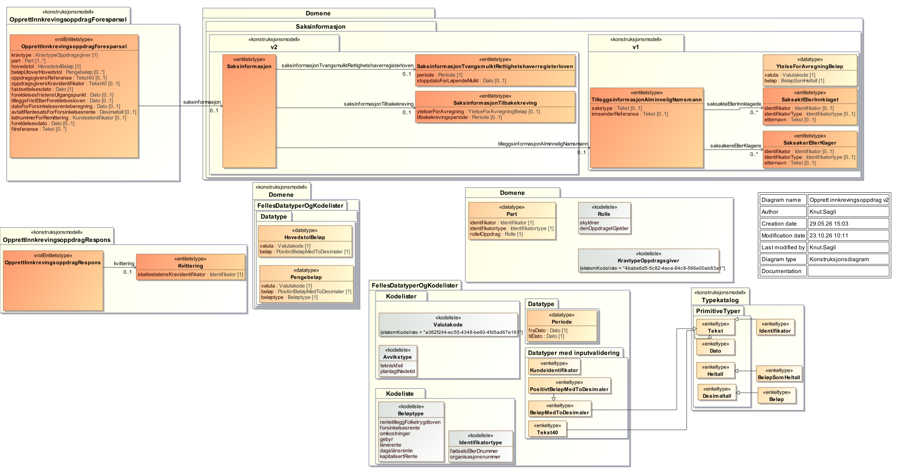
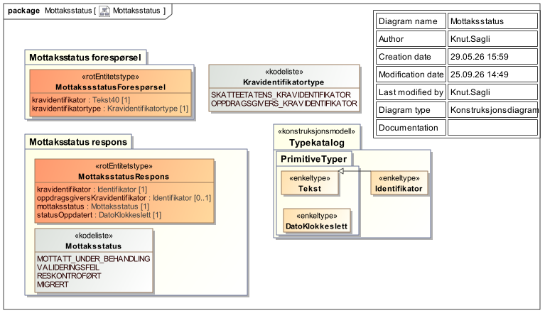
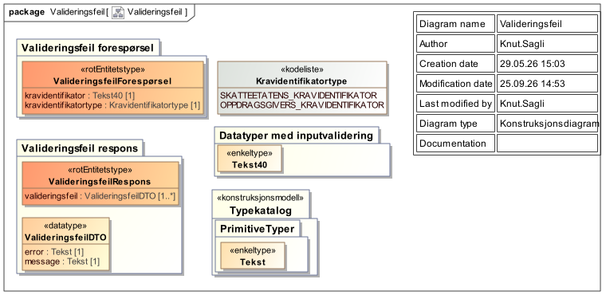
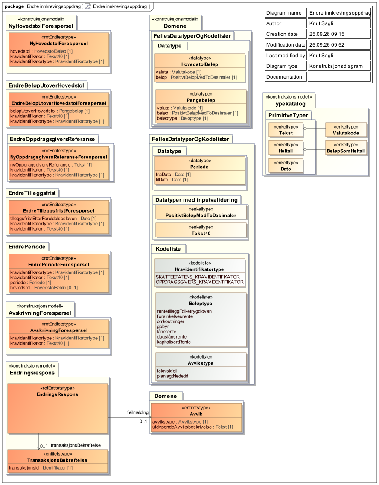
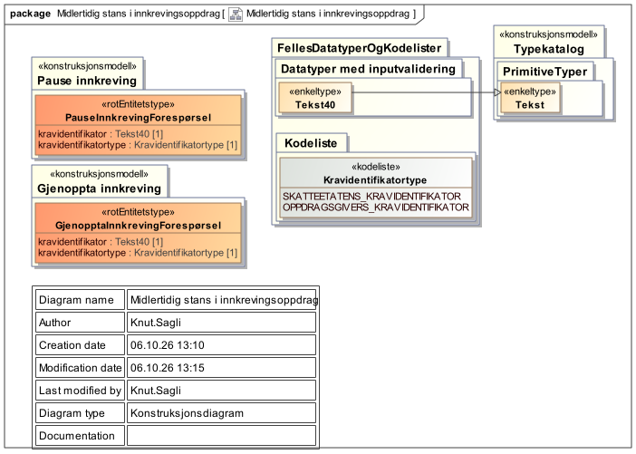
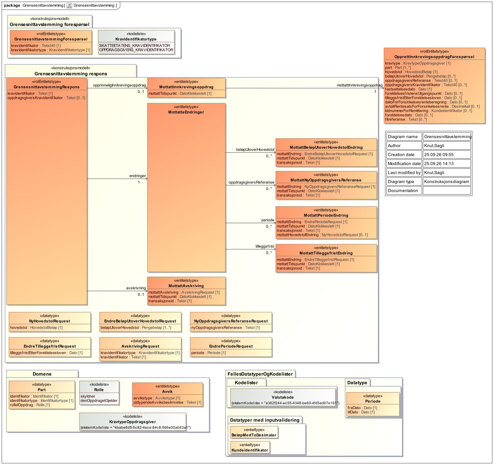
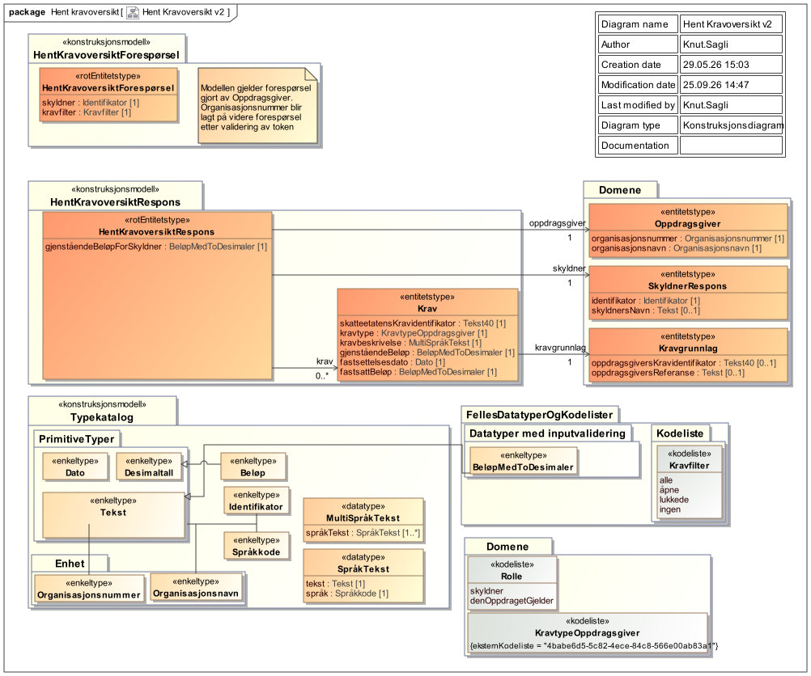
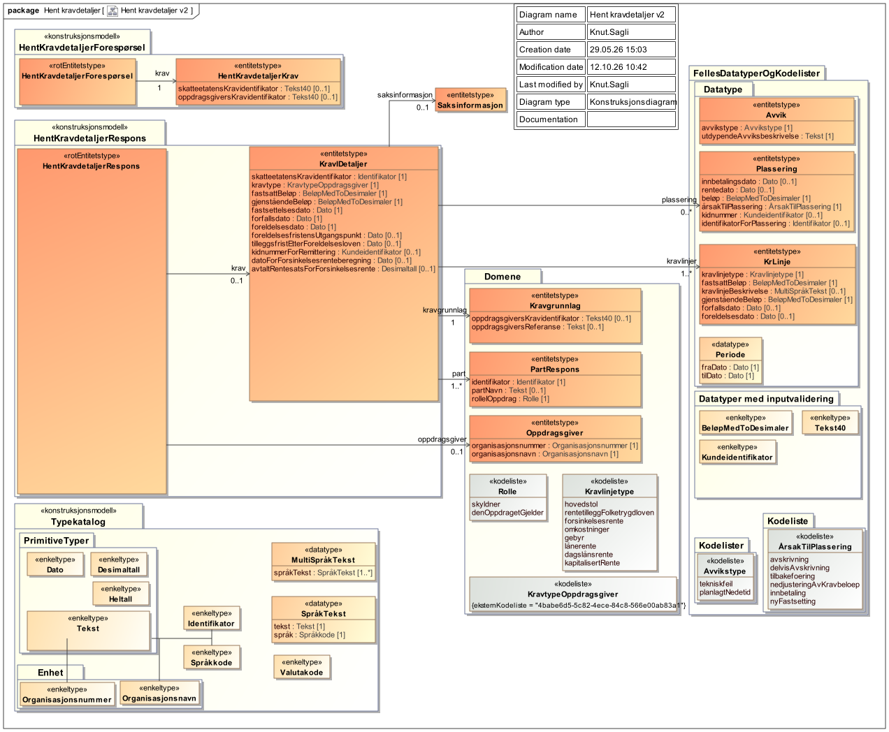

<Summary>Innkrevingsoppdrag API-et brukes til å opprette, endre og avskrive innkrevingsoppdrag. API-et har også tjenester for å avstemme det som er oversendt, og for å hente mottaksstatus og valideringsfeil. Et innkrevingsoppdrag inneholder både generell oppdragsinformasjon og informasjon som er spesifikk for én eller flere kravtyper. Alle informasjonselementene er beskrevet i Swagger, men hvilke kravtyper de er relevante for, reguleres av samarbeidsavtalen og dokumenteres ikke her.</Summary>

<Tabs underline={true}>
<TabItem headerText="Om tjenestene" itemKey="itemKey-1" default>

Innkrevingsoppdrag API-et er en del av Skatteetatens modernisering av oppdragsinnkreving. API-et gir oppdragsgivere mulighet til å:

- Opprette innkrevingsoppdrag
- Endre og avskrive egne innkrevingsoppdrag
- Avstemme innkrevingsoppdrag
- Hente oversikt over og detaljer om egne krav

Målgruppen er oppdragsgivere som benytter Skatteetaten til innkreving av pengekrav. Dette gjelder i all hovedsak offentlige virksomheter.

## Generell informasjon

For generell informasjon om tjenestene se egne sider om:

* [Bruk av tjenestene](../om/bruk.md)
* [Sikkerhetsmekanismer](../om/sikkerhet.md)
* [Feilhåndtering](../om/feil.md)
* [Versjonering](../om/versjoner.md)
* [Teknisk spesifikasjon](../om/tekniskspesifikasjon.md)

## Teknisk spesifikasjon

URL-er til API-et, beskrivelsen av parameterne, endepunkter og respons ligger i [Open API spesifikasjonen](https://app.swaggerhub.com/apis/skatteetaten/oppdragsinnkreving-api/) på SwaggerHub. Informasjonselementene i et innkrevingsoppdrag er beskrevet i fanen [Informasjonsmodell](innkrevingsoppdrag?tab=Informasjonsmodell), og i mer detalj i spesifikasjonen på SwaggerHub. Hvilke kravtyper de ulike elementene er relevante for, reguleres av samarbeidsavtalen med den enkelte oppdragsgiver.

## Tilgang til API-et

### Scope
Følgende scope skal benyttes ved autentisering i Maskinporten: `skatteetaten:innkrevingsoppdrag`

### Delegering
Tilgang til dette API-et kan delegeres i Altinn, f.eks. dersom leverandør benyttes for den tekniske oppkoblingen. Søk
opp følgende tjeneste i Altinn for å delegere tilgangen: `Innkrevingsoppdrag API - På vegne av`

### Skatteetaten må gi tilgang
For å kunne bruke dette API-et må Skatteetaten gi din virksomhet tilgang til en eller flere rettighetspakker. Ta kontakt med Skatteetaten for å få tilgang.

</TabItem>
<TabItem headerText="Bruk av tjenestene" itemKey="itemKey-2">

Her beskrives tjenestene i API-et og hvordan de brukes, med V2 som utgangspunkt. Alle begreper for V2 og forskjellene i fra V1, er beskrevet i fanen [Informasjonsmodell](innkrevingsoppdrag?tab=Informasjonsmodell). Endepunkter, parametere, forespørsel- og responsobjekter, samt eksempler, finnes i [Open API-spesifikasjonen på SwaggerHub](https://app.swaggerhub.com/apis/skatteetaten/oppdragsinnkreving-api/).

## Innholdsfortegnelse

- [Oversikt over tjenestene](#oversikt-over-tjenestene)
- [Opprett et innkrevingsoppdrag](#opprett-et-innkrevingsoppdrag)
- [Hent mottaksstatus](#hent-mottaksstatus)
- [Hent valideringsfeil](#hent-valideringsfeil)
- [Endre et innkrevingsoppdrag](#endre-et-innkrevingsoppdrag)
- [Avskriv et innkrevingsoppdrag](#avskriv-et-innkrevingsoppdrag)
- [Grensesnittavstemming](#grensesnittavstemming)
- [Hent kravoversikt](#hent-kravoversikt)
- [Hent kravdetaljer](#hent-kravdetaljer)

## Oversikt over tjenestene

Alle endepunktene ligger under basestien `/api/innkreving/innkrevingsoppdrag/v2/innkrevingsoppdrag`.

| Tjeneste | Metode | Endepunkt | Beskrivelse |
|---|---|---|---|
| Opprett innkrevingsoppdrag | POST | (basestien) | Oversender et nytt innkrevingsoppdrag til Skatteetaten. |
| Hent mottaksstatus | GET | `/{kravidentifikator}/mottaksstatus` | Viser om innkrevingsoppdraget er under behandling, har valideringsfeil eller er reskontroført. |
| Hent valideringsfeil | GET | `/{kravidentifikator}/valideringsfeil` | Henter feil fra den asynkrone valideringen. |
| Endre hovedstol | PUT | `/{kravidentifikator}/hovedstol` | Nedjusterer hovedstolen. |
| Endre beløp utover hovedstol | PUT | `/{kravidentifikator}/beloeputoverhovedstol` | Endrer beløpet for én beløpstype utover hovedstol. |
| Endre periode | PUT | `/{kravidentifikator}/periode` | Endrer perioden i saksinformasjonen. |
| Endre oppdragsgivers referanse | PUT | `/{kravidentifikator}/oppdragsgiversreferanse` | Endrer oppdragsgivers referanse. |
| Endre tilleggsfrist | PUT | `/{kravidentifikator}/tilleggsfrist` | Endrer tilleggsfrist etter foreldelsesloven. |
| Avskriv innkrevingsoppdrag | POST | `/avskriving` | Avskriver et innkrevingsoppdrag som ikke lenger skal kreves inn. |
| Grensesnittavstemming | GET | `/{kravidentifikator}/avstemming` | Henter alt Skatteetaten har mottatt for et innkrevingsoppdrag. |
| Hent kravoversikt | POST | `/kravoversikt` | Henter oversikt over kravene oppdragsgiver har på en skyldner. |
| Hent kravdetaljer | POST | `/kravdetaljer` | Henter detaljert informasjon om ett krav. |

### Felles for kallene

- Alle kall må ha headerne `Klientid` og `Korrelasjonsid`. `Klientid` settes til `<oppdragsgiver>/<versjon>`, f.eks. `NAV/2.0`, og brukes til sporbarhet. `Korrelasjonsid` må være en gyldig UUID som er unik for hvert kall.
- Endepunkter med `{kravidentifikator}` i stien krever query-parameteren `kravidentifikatortype`, som angir om kravidentifikatoren er Skatteetatens eller oppdragsgivers. Se «Identifikatorer» i fanen [Informasjonsmodell](innkrevingsoppdrag?tab=Informasjonsmodell).
- Feil returneres på RFC 7807-format. Se fanen [Feilkoder og valideringsregler](innkrevingsoppdrag?tab=Feilkoder+og+valideringsregler).

### Sporbarhet

Oppdragsgiver bør lagre alt som sendes til og mottas fra Skatteetaten, og som et minimum:

- Skatteetatens kravidentifikator, som returneres ved opprettelse
- Mottaksstatus for innkrevingsoppdraget
- Transaksjonsid, som returneres ved endring og avskriving
- Kravgrunnlaget, eller en referanse til dette

Dette sikrer sporbarhet, og er en del av transaksjonskontrollen etter Reglement for økonomistyring i staten. [Grensesnittavstemming](#grensesnittavstemming) kan brukes til å kontrollere at det Skatteetaten har mottatt stemmer med det oppdragsgiver har sendt.

## Opprett et innkrevingsoppdrag

Et innkrevingsoppdrag opprettes ved et POST-kall til basestien. Mottaket skjer i to steg: en synkron validering når forespørselen mottas, og en asynkron validering før innkrevingsoppdraget reskontroføres og Skatteetaten overtar ansvaret for innkrevingen.

**Viktig:** Før innkrevingsoppdraget sendes, må oppdragsgiver ha informert skyldner om kravet. Ellers risikerer skyldner å motta faktura fra Skatteetaten før vedkommende kjenner til kravet.

### Synkron validering

Forespørselen valideres mot API-spesifikasjonen og valideringsreglene for opprettelse. Se fanen [Feilkoder og valideringsregler](innkrevingsoppdrag?tab=Feilkoder+og+valideringsregler).

**Vellykket kall:**
- Returnerer HTTP 201 med Skatteetatens kravidentifikator for innkrevingsoppdraget
- Kravidentifikatoren bør tas vare på for sporbarhet, og for senere å kunne referere til innkrevingsoppdraget
- HTTP 201 bekrefter at innkrevingsoppdraget er mottatt, men Skatteetaten har ennå ikke overtatt ansvaret for innkrevingen

**Valideringsfeil:**
- Returnerer HTTP 422 med informasjon om feilen
- Innkrevingsoppdraget må korrigeres og sendes inn på nytt
- Valideringsreglene utføres sekvensielt, slik at det etter korrigering kan oppstå nye valideringsfeil fra påfølgende regler

### Asynkron validering

Etter vellykket synkron validering kontrolleres det at innkrevingsoppdraget er mulig å kreve inn, f.eks. at skyldner finnes og ikke er slettet. Resultatet fremgår av [mottaksstatus](#hent-mottaksstatus).

### Sende på nytt

Skatteetaten sikrer unikhet på `oppdragsgiversKravidentifikator`. Er oppdragsgiver usikker på om et innkrevingsoppdrag ble opprettet, f.eks. ved nettverksfeil, kan det sendes på nytt:

- Finnes innkrevingsoppdraget allerede, returneres HTTP 422 (`OPPDRAGSGIVERS_KRAVIDENTIFIKATOR_EKSISTERER_ALLEREDE`)
- Finnes det ikke, blir innkrevingsoppdraget opprettet

Dette forutsetter at `oppdragsgiversKravidentifikator` er fylt ut. Vi anbefaler derfor å alltid fylle ut feltet med en unik identifikator. Har oppdragsgiver ingen naturlig unik identifikator for kravet, kan f.eks. en identifikator fra egen overføringstabell benyttes.

## Hent mottaksstatus

Mottaksstatus hentes ved et GET-kall til `/{kravidentifikator}/mottaksstatus`, og viser hvor langt innkrevingsoppdraget har kommet i mottaket. Ved normal drift er status oppdatert noen sekunder etter opprettelse.

| Mottaksstatus | Betydning | Ansvar |
|---|---|---|
| MOTTATT_UNDER_BEHANDLING | Innkrevingsoppdraget er mottatt og behandles fortsatt. | Skatteetaten |
| VALIDERINGSFEIL | Den asynkrone valideringen har feilet. [Hent valideringsfeil](#hent-valideringsfeil), rett feilene og send innkrevingsoppdraget inn på nytt med en ny `oppdragsgiversKravidentifikator`. | Oppdragsgiver |
| RESKONTROFOERT | Mottaket er vellykket, og Skatteetaten har overtatt ansvaret for innkrevingen. | Skatteetaten |
| MIGRERT | Innkrevingsoppdraget er migrert mellom Skatteetatens innkrevingssystemer, og behandles på lik linje med RESKONTROFOERT. | Skatteetaten |
| SKAL_IKKE_RESKONTROFOERES | Innkrevingsoppdraget er mottatt, men skal ikke reskontroføres. | Skatteetaten |
| TIL_MANUELL_BEHANDLING | Innkrevingsoppdraget kunne ikke behandles automatisk, og følges opp manuelt av Skatteetaten. | Skatteetaten |

## Hent valideringsfeil

Når mottaksstatus er `VALIDERINGSFEIL`, hentes feilene ved et GET-kall til `/{kravidentifikator}/valideringsfeil`. Responsen er en liste med feilkode og beskrivelse for hver feil. Dersom den asynkrone valideringen ikke har gitt feil, returneres en tom liste. Mulige feil er beskrevet under "Asynkrone valideringsregler" i fanen [Feilkoder og valideringsregler](innkrevingsoppdrag?tab=Feilkoder+og+valideringsregler).

## Endre et innkrevingsoppdrag

Endringstjenestene brukes til å korrigere et innkrevingsoppdrag, f.eks. når skyldner har betalt deler av beløpet direkte til oppdragsgiver og hovedstolen må nedjusteres. Endringer gjøres med PUT-kall:

| Endring | Endepunkt | Beskrivelse |
|---|---|---|
| Hovedstol | `/{kravidentifikator}/hovedstol` | Ny hovedstol må være større enn 0, og kan ikke være høyere enn gjeldende hovedstol. Skal innkrevingsoppdraget nullstilles, brukes [avskriving](#avskriv-et-innkrevingsoppdrag). |
| Beløp utover hovedstol | `/{kravidentifikator}/beloeputoverhovedstol` | Nedjusterer beløpet for én beløpstype per kall. Nytt beløp kan være 0, men kan ikke være høyere enn gjeldende beløp for beløpstypen. Beløpstypen må være tillatt for kravtypen. |
| Periode | `/{kravidentifikator}/periode` | Endrer perioden i saksinformasjonen, f.eks. periode med tvangsmulkt. Forespørselen kan også inneholde ny hovedstol. |
| Oppdragsgivers referanse | `/{kravidentifikator}/oppdragsgiversreferanse` | Endrer oppdragsgivers referanse til saken. |
| Tilleggsfrist | `/{kravidentifikator}/tilleggsfrist` | Endrer tilleggsfrist etter foreldelsesloven. Støttes kun for innkrevingsoppdrag som behandles i INNFRI. |

**Viktig:** Et innkrevingsoppdrag kan først endres når det er reskontroført. Ved normal drift skjer dette tilnærmet umiddelbart etter opprettelse. Et avskrevet innkrevingsoppdrag kan ikke endres.

**Merk:** Oppjustering av hovedstol og beløp utover hovedstol er ikke implementert ennå. Inntil videre kan disse beløpene bare justeres ned.

**Vellykket kall:**
- Returnerer HTTP 200 med en transaksjonsid, som er Skatteetatens referanse til endringen
- Transaksjonsiden bør tas vare på for sporbarhet
- HTTP 200 bekrefter at Skatteetaten har mottatt og tatt ansvaret for at endringen blir utført

**Valideringsfeil:**
- Returnerer HTTP 404, 409 eller 422 med en beskrivende feilmelding

Det gjøres ingen asynkron validering av endringer, og det gis ingen mottaksstatus. Dersom det oppstår feil etter mottak som krever handling fra oppdragsgiver, varsles oppdragsgiver manuelt.

### Sende på nytt

Er oppdragsgiver usikker på om en endring ble utført, kan den samme endringen sendes på nytt et vilkårlig antall ganger med samme resultat. Det returneres fortsatt HTTP 200.

For innkrevingsoppdrag som behandles i INNFRI, kan det bare ligge én ubehandlet endring av hovedstol og én ubehandlet endring av beløp utover hovedstol om gangen. Sendes en ny endring før den forrige er ferdig behandlet, returneres HTTP 409 (`ENDRING_UNDER_BEHANDLING`), og endringen må sendes på nytt senere. Det samme gjelder avskriving mens en beløpsendring er under behandling.

## Avskriv et innkrevingsoppdrag

Et innkrevingsoppdrag avskrives ved et POST-kall til `/avskriving`, med kravidentifikator og kravidentifikatortype i meldingskroppen. Avskriving benyttes når oppdragsgiver mener at kravet ikke lenger skal kreves inn, f.eks. fordi kravet er frafalt.

**Viktig:** Et innkrevingsoppdrag kan først avskrives når det er reskontroført. Enkelte kravtyper kan ikke avskrives.

**Vellykket kall:**
- Returnerer HTTP 200 med en transaksjonsid, som er Skatteetatens referanse til avskrivingen
- Transaksjonsiden bør tas vare på for sporbarhet
- HTTP 200 bekrefter at Skatteetaten har mottatt og tatt ansvaret for at avskrivingen blir utført

**Valideringsfeil:**
- Returnerer HTTP 404, 409 eller 422 med en beskrivende feilmelding

Det gjøres ingen asynkron validering av avskrivinger, og det gis ingen mottaksstatus.

### Sende på nytt

Et innkrevingsoppdrag kan bare avskrives én gang. Sendes avskrivingen på nytt, returneres HTTP 409 (`AVSKREVET_INNKREVINGSOPPDRAG_KAN_IKKE_AVSKRIVES`), som bekrefter at innkrevingsoppdraget allerede er avskrevet.

## Grensesnittavstemming

Grensesnittavstemming lar oppdragsgiver kontrollere at innkrevingsoppdrag, endringer og avskrivinger er registrert korrekt i Skatteetatens mottak. Opplysningene hentes ved et GET-kall til `/{kravidentifikator}/avstemming`.

Responsen inneholder det opprinnelige innkrevingsoppdraget og alle endringer og avskrivinger, i samme format som de ble mottatt, med mottakstidspunkt og transaksjonsid. Se «Modell for grensesnittavstemming» i fanen [Informasjonsmodell](innkrevingsoppdrag?tab=Informasjonsmodell).

## Hent kravoversikt

Kravoversikten viser kravene oppdragsgiver har på en skyldner, og hentes ved et POST-kall til `/kravoversikt`. Forespørselen inneholder skyldners identifikator og et kravfilter (`alle`, `aapne`, `lukkede` eller `ingen`) som styrer hvilke krav som returneres basert på status. Søket gjelder kun parter med rollen `skyldner`.

Responsen inneholder en liste med krav og totalt gjenstående beløp for skyldneren. Se «Modell for kravoversikt» i fanen [Informasjonsmodell](innkrevingsoppdrag?tab=Informasjonsmodell).

## Hent kravdetaljer

Kravdetaljer gir utfyllende informasjon om ett krav, og hentes ved et POST-kall til `/kravdetaljer`. Kravet identifiseres med enten Skatteetatens eller oppdragsgivers kravidentifikator:

- For krav mottatt gjennom Innkrevingsoppdrag API kan Skatteetatens kravidentifikator benyttes
- For andre krav benyttes oppdragsgivers kravidentifikator

Responsen inneholder blant annet kravlinjer, plasseringer mot kravet og partene i kravet. Ved solidaransvar returneres alle skyldnerne med rollen `skyldner`. Se «Modell for kravdetaljer» i fanen [Informasjonsmodell](innkrevingsoppdrag?tab=Informasjonsmodell).

</TabItem>
<TabItem headerText="Informasjonsmodell" itemKey="itemKey-4">

Her beskrives alle informasjonsmodellene i V2 av Innkrevingsoppdrag API-et. Først kommer begreper som gjelder hele API-et, deretter én seksjon per modell med begrepene som hører til. Forskjellene i V1 er beskrevet til slutt. Datatyper, formater og eksempler for hvert felt finnes i [Open API-spesifikasjonen på SwaggerHub](https://app.swaggerhub.com/apis/skatteetaten/oppdragsinnkreving-api/).

## Innholdsfortegnelse

- [Generelt](#generelt)
  - [Innkrevingsoppdrag](#innkrevingsoppdrag)
  - [Identifikatorer](#identifikatorer)
  - [Kravtype](#kravtype)
  - [Innkrevingssystem](#innkrevingssystem)
  - [Slik leses modellene](#slik-leses-modellene)
- [Modell for opprett innkrevingsoppdrag](#modell-for-opprett-innkrevingsoppdrag)
  - [Parter og roller](#parter-og-roller)
  - [Beløp](#beløp)
  - [Datoer og foreldelse](#datoer-og-foreldelse)
  - [Renter og remittering](#renter-og-remittering)
  - [Saksinformasjon](#saksinformasjon)
- [Modell for mottaksstatus](#modell-for-mottaksstatus)
- [Modell for valideringsfeil](#modell-for-valideringsfeil)
- [Modell for endring og avskriving](#modell-for-endring-og-avskriving)
- [Modell for midlertidig stans](#modell-for-midlertidig-stans)
- [Modell for grensesnittavstemming](#modell-for-grensesnittavstemming)
- [Modell for kravoversikt](#modell-for-kravoversikt)
- [Modell for kravdetaljer](#modell-for-kravdetaljer)
- [Forskjeller i V1](#forskjeller-i-v1)

## Generelt

### Innkrevingsoppdrag

Et innkrevingsoppdrag er et pengekrav som en oppdragsgiver overfører til Skatteetaten for innkreving. Innkrevingsoppdraget angir hvem som skal betale (parter), hva som skal betales (hovedstol og eventuelle beløp utover hovedstol), hvilken type krav det gjelder (kravtype), og datoer som har betydning for innkrevingen, blant annet for beregning av foreldelse.

Når innkrevingsoppdraget er mottatt og validert, reskontroføres det. Fra da av har Skatteetaten ansvaret for innkrevingen, og innkrevingsoppdraget kan endres eller avskrives.

### Identifikatorer

| Identifikator | Beskrivelse |
|---|---|
| Skatteetatens kravidentifikator | Skatteetatens unike referanse til innkrevingsoppdraget. Returneres ved opprettelse. |
| Oppdragsgivers kravidentifikator | Oppdragsgivers unike identifikator for pengekravet, på inntil 40 tegn. Valgfri, men anbefalt. Kan ikke gjenbrukes på tvers av innkrevingsoppdrag hos samme oppdragsgiver. Brukes ved avstemming, og sikrer sporbarhet i regnskapet. |
| Oppdragsgivers referanse | Oppdragsgivers referanse til saken pengekravet er fastsatt i, f.eks. et saksnummer, på inntil 40 tegn. Brukes når oppdragsgiver og Skatteetaten utveksler informasjon om saken. Referansen oppgis på faktura, slik at skyldner kan vise til den ved henvendelser til oppdragsgiver. |
| Transaksjonsid | Skatteetatens referanse til en endring eller avskriving. Returneres ved hver endring og avskriving. |

Når et eksisterende innkrevingsoppdrag skal refereres til, angis hvilken identifikator som brukes med `kravidentifikatortype`:

| Kravidentifikatortype | Beskrivelse |
|---|---|
| SKATTEETATENS_KRAVIDENTIFIKATOR | Kravidentifikatoren er Skatteetatens kravidentifikator. |
| OPPDRAGSGIVERS_KRAVIDENTIFIKATOR | Kravidentifikatoren er oppdragsgivers kravidentifikator. |

Forskjellen mellom oppdragsgivers referanse og oppdragsgivers kravidentifikator er at én sak kan omfatte flere pengekrav. Et typisk eksempel er vedtak om løpende tvangsmulkt, der hver periode med påløpt mulkt overføres som et eget innkrevingsoppdrag. Innkrevingsoppdragene har da samme oppdragsgivers referanse, men hver sin kravidentifikator.

### Kravtype

Kravtypen er en samlebetegnelse på krav som har de samme egenskapene, både ved fastsettelse og innkreving, f.eks. `TILBAKEKREVING_BARNETRYGD` eller `TVANGSMULKT_RETTIGHETSHAVERREGISTERLOVEN`. Hvilke kravtyper en oppdragsgiver kan benytte, og hva de heter, avtales med Skatteetaten. Navnet på kravtypen vises for skyldner, og må derfor gjøre det tydelig hvilket krav som kreves inn.

Kravtypen styrer blant annet:

- Om skyldner kan være en person, en organisasjon eller begge
- Hvilke beløpstyper som er tillatt utover hovedstol
- Om innkrevingsoppdraget kan ha flere skyldnere (solidaransvar)
- Om foreldelsesdato, avtalt rentesats og dato for forsinkelsesrenteberegning kan angis
- Om KID-nummer for remittering er obligatorisk
- Om innkrevingsoppdraget kan endres og avskrives

### Innkrevingssystem

Skatteetaten bestemmer hvilket innkrevingssystem et innkrevingsoppdrag behandles i, ut fra oppdragsgiver og kravtype. Dette er uavhengig av hvilken versjon av API-et innkrevingsoppdraget sendes inn på. Enkelte funksjoner, f.eks. endring av tilleggsfrist, er bare tilgjengelige for innkrevingsoppdrag som behandles i INNFRI.

### Slik leses modellene

Modellene er UML-klassediagrammer. Hver boks er et objekt, og linjene mellom boksene viser hvilke objekter som inngår i hverandre. Navnet på linjen er feltnavnet i JSON.

| Betegnelse | Betydning |
|---|---|
| «konstruksjonsmodell» | Rammen rundt én forespørsel eller én respons. |
| «rotEntitetstype» | Toppnivået i forespørselen eller responsen. |
| «entitetstype» | Et sammensatt objekt som inngår i forespørselen eller responsen. |
| «datatype» | En gjenbrukbar struktur, f.eks. et beløp med valuta. |
| «kodeliste» | En liste med gyldige verdier for et felt. |

Antallet som står bak hvert felt viser om feltet er påkrevd og om det kan gjentas:

| Antall | Betydning |
|---|---|
| `[1]` | Påkrevd |
| `[0..1]` | Valgfritt |
| `[1..*]` | Påkrevd, og kan gjentas |
| `[0..*]` | Valgfritt, og kan gjentas |

Forespørsler som bare skal identifisere et eksisterende innkrevingsoppdrag, inneholder kravidentifikator og kravidentifikatortype. Dette gjelder bl.a. mottaksstatus, valideringsfeil, avskriving og grensesnittavstemming.

## Modell for opprett innkrevingsoppdrag



Brukes til å opprette et innkrevingsoppdrag. Kravtype, minst én part med rollen `skyldner`, hovedstol og fastsettelsesdato er påkrevd. Hvilke andre felter som kan eller må fylles ut, avhenger av kravtypen. Responsen er en kvittering med Skatteetatens kravidentifikator.

Opplysningene i forespørselen er beskrevet under.

### Parter og roller

Personene og virksomhetene som er involvert i innkrevingsoppdraget angis som parter. Hver part har en identifikator, en identifikatortype og en rolle i oppdraget. I de fleste tilfeller inneholder innkrevingsoppdraget én part – skyldner.

| Rolle | Beskrivelse |
|---|---|
| skyldner | Den som er pliktig til å betale kravet. Minst én part må ha denne rollen. |
| denOppdragetGjelder | Den innkrevingsoppdraget gjelder, men som ikke har en regnskapsmessig rolle. Brukes når dette er en annen enn skyldner, f.eks. når skyldner er et bostyre eller en institusjon, eller når en hovedenhet får faktura for et krav som gjelder en underenhet. |

| Identifikatortype | Beskrivelse |
|---|---|
| foedselsEllerDnummer | Fødselsnummer eller D-nummer (11 siffer) for en person. |
| organisasjonsnummer | Organisasjonsnummer (9 siffer) for en virksomhet. Organisasjonsnummeret til hovedenheten skal oppgis, ikke underenheten. |

#### Solidaransvar

Solidaransvar angis ved å sende flere parter med rollen `skyldner`. Rollen solidaransvarlig utledes av Skatteetaten, og kan ikke angis direkte. Solidaransvar er bare tillatt for kravtyper som støtter det.

### Beløp

Alle beløp oppgis i norske kroner (`NOK`). Hovedstol og beløp utover hovedstol kan ha inntil to desimaler, mens ytelser for avregning oppgis i hele kroner.

#### Hovedstol

Hovedstolen er det opprinnelige pengekravet, uten påløpte renter, gebyrer og andre tillegg. Hovedstolen må være større enn 0.

#### Beløp utover hovedstol

Poster som ikke inngår i hovedstolen, oppgis som beløp utover hovedstol. Hvert beløp har en beløpstype, som er avgjørende for videre behandling. Hvilke beløpstyper som er tillatt, avhenger av kravtypen.

| Beløpstype | Beskrivelse |
|---|---|
| rentetilleggFolketrygdloven | Beløp som legges til hovedstolen som følge av forsett eller grov uaktsomhet. |
| forsinkelsesrente | Rente fastsatt i lov som påløper ved for sen betaling. |
| omkostninger | Omkostninger som har oppstått i forbindelse med oppdraget. |
| gebyr | Beløp som har kommet til som en tilleggskostnad til oppdraget. |
| laanerente | Rente som har påløpt før Skatteetaten mottok oppdraget, f.eks. for studielån. |
| dagslaansrente | Renter som påløper fra 1.1 til forfallsdato 1.3 for refusjon yrkesskade. |
| kapitalisertRente | Oppsparte renter, ofte omtalt som renters rente. |

### Datoer og foreldelse

Fastsettelsesdato er påkrevd. De øvrige datoene er valgfrie, eller kan bare angis for enkelte kravtyper.

| Dato | Beskrivelse |
|---|---|
| fastsettelsesdato | Datoen kravet ble fastsatt hos oppdragsgiver, f.eks. vedtaksdato. Oppgis på faktura, slik at skyldner vet hvilket vedtak kravet gjelder. Er som hovedregel utgangspunktet for foreldelsesfristen. Kan ikke være frem i tid, eller mer enn 3 år tilbake i tid. |
| foreldelsesfristensUtgangspunkt | Angis når foreldelsesfristen skal regnes fra en annen dato enn fastsettelsesdatoen, og må da være tidligere enn fastsettelsesdatoen. Kan ikke angis sammen med tilleggsfrist etter foreldelsesloven. |
| tilleggsfristEtterForeldelsesloven | Angis når foreldelsesfristen skal utvides fordi oppdragsgiver har fått ny kunnskap om kravet eller skyldneren. Kan ikke angis sammen med foreldelsesfristens utgangspunkt. |
| foreldelsesdato | Datoen kravet foreldes. Kan kun angis for kravtyper som tillater det. Ellers beregner Skatteetaten foreldelsesdatoen. |
| datoForForsinkelsesrenteberegning | Datoen forsinkelsesrente beregnes fra. Kan kun angis for rentebærende kravtyper, og må ligge mellom fastsettelsesdatoen og dagens dato. Angis den ikke, benyttes datoen som er definert for kravtypen. For kravtyper der en slik dato ikke er definert, må datoen angis. |
| forfallsdato | Datoen kravet forfaller, for kravtyper som tillater at den angis. Feltet finnes i informasjonsmodellen, men er ikke implementert ennå. |

### Renter og remittering

| Opplysning | Beskrivelse |
|---|---|
| avtaltRentesatsForForsinkelsesrente | Rentesats for forsinkelsesrente på hovedkravet, når den avviker fra den ordinære satsen som er forhåndsdefinert hos Skatteetaten. Typisk fastsatt i en dom. Kan kun angis for kravtyper som tillater det. |
| kidnummerForRemittering | KID-nummer som benyttes når innbetalinger skal remitteres til oppdragsgiver. Obligatorisk for enkelte kravtyper. |

### Saksinformasjon

Saksinformasjon er opplysninger som bare er relevante for enkelte kravtyper.

| Saksinformasjon | Gjelder | Innhold |
|---|---|---|
| saksinformasjonTilbakekreving | Tilbakekreving av feilutbetalte ytelser | Tilbakekrevingsperioden feilutbetalingen gjelder, og ytelser for avregning. Når ytelser for avregning er oppgitt, kan og skal kravet avregnes. |
| saksinformasjonTvangsmulktRettighetshaverregisterloven | Tvangsmulkt etter rettighetshaverregisterloven | Periode med påløpt tvangsmulkt, og eventuell stoppdato for løpende mulkt. |
| tilleggsinformasjonAlminneligNamsmann | Krav fra alminnelig namsmann | Saksøkte eller innklagede, saksøkere eller klagere, sakstype og innsenders referanse. |

Det kan angis høyst én variant, og den skal passe med kravtypen.

## Modell for mottaksstatus



Brukes til å se hvor langt et innkrevingsoppdrag har kommet i mottaket. Betydningen av hver status er beskrevet under «Hent mottaksstatus» i fanen [Bruk av tjenestene](innkrevingsoppdrag?tab=Bruk+av+tjenestene).

## Modell for valideringsfeil



Brukes til å hente feil fra den asynkrone valideringen når mottaksstatus er `VALIDERINGSFEIL`. Listen er tom hvis valideringen ikke ga feil. Feilkodene er beskrevet under «Asynkrone valideringsregler» i fanen [Feilkoder og valideringsregler](innkrevingsoppdrag?tab=Feilkoder+og+valideringsregler).

## Modell for endring og avskriving

**Merk:** Modellen inneholder felter for oppjustering av hovedstol og beløp utover hovedstol. Oppjustering er ikke implementert ennå, og i dag kan hovedstol og beløp utover hovedstol bare justeres ned.



Viser forespørslene for endring og avskriving. En vellykket endring eller avskriving gir en transaksjonsid tilbake.

- Ved endring av hovedstol og beløp utover hovedstol angir `justeresFraOgMedDato` hvilken dato en nedjustering gjelder fra. Nytt beløp kan ikke være høyere enn gjeldende beløp. Ved oppjustering (ikke implementert ennå) må `fastsettelsesdato` angis.
- Endring av periode kan også inneholde ny hovedstol.
- Avskriving inneholder ingen opplysninger utover kravidentifikator og kravidentifikatortype.

## Modell for midlertidig stans

**Merk:** Midlertidig stans, og feltet `innkrevingsoppdragPauset`, er ikke implementert ennå.



Viser forespørslene for å stanse innkrevingen av et innkrevingsoppdrag midlertidig (`PauseInnkrevingForespørsel`), og for å gjenoppta den (`GjenopptaInnkrevingForespørsel`). Begge inneholder bare kravidentifikator og kravidentifikatortype.

Om innkrevingen er stanset, vises med `innkrevingsoppdragPauset` i grensesnittavstemming, kravoversikt og kravdetaljer.

## Modell for grensesnittavstemming



Viser alt Skatteetaten har mottatt for et innkrevingsoppdrag: det opprinnelige innkrevingsoppdraget, endringer og eventuell avskriving. Forespørslene vises i samme format som de ble sendt inn, med mottakstidspunkt og transaksjonsid.

- En periodeendring kan også inneholde en hovedstolendring.
- `innkrevingsoppdragPauset` viser om innkrevingen er midlertidig stanset.

## Modell for kravoversikt



Viser kravene oppdragsgiver har på en skyldner, filtrert på status med `Kravfilter`, og totalt gjenstående beløp for skyldneren.

- Beløp i responsen er tekst med inntil to desimaler, og kan være negative.
- `Kravgrunnlag` inneholder oppdragsgivers egne identifikatorer for kravet.

## Modell for kravdetaljer



Viser utfyllende informasjon om ett krav, identifisert med enten Skatteetatens eller oppdragsgivers kravidentifikator.

- Kravlinjene deler kravet opp i hovedstol og beløpstyper (`Kravlinjetype`). Forfalls- og foreldelsesdato oppgis bare der de avviker fra kravet.
- Plasseringer viser innbetalinger og andre disponeringer mot kravet. Årsaken står i `ÅrsakTilPlassering`, f.eks. innbetaling, avskrivning eller nedjustering av kravbeløp.
- Partene oppgis med identifikator, navn og rolle.

## Forskjeller i V1

V1 er den forrige versjonen av API-et, og har en smalere informasjonsmodell enn V2. V2 er et supersett av V1, slik at alt som kan uttrykkes i V1 også kan uttrykkes i V2.

Basestien i V1 er `/api/innkreving/innkrevingsoppdrag/v1/innkrevingsoppdrag`.

### Forskjeller i informasjonsmodellen

| Område | V2 | V1 |
|---|---|---|
| Parter | `part` – liste med én eller flere parter, hver med rolle | `skyldner` – én skyldner, uten rolle |
| Solidaransvar | Flere parter med rollen `skyldner` | Støttes ikke |
| Identifikatortype | `foedselsEllerDnummer` / `organisasjonsnummer` | `person` / `organisasjon` |
| Hovedstol og beløp utover hovedstol | Inntil to desimaler | Kun hele kroner |
| Beløp utover hovedstol | `beloepUtoverHovedstol` med beløpstype | `renteBeloep` med rentetype `STRAFFERENTE`, som tilsvarer `rentetilleggFolketrygdloven` i V2 |
| Saksinformasjon | `saksinformasjon` | `tilleggsinformasjon`, med tilsvarende innhold |
| Tilbakekrevingsperiode | Valgfri | Påkrevd |
| avtaltRentesatsForForsinkelsesrente | ✔ | Støttes ikke |
| kidnummerForRemittering | ✔ | Støttes ikke |
| foreldelsesdato | ✔ | Støttes ikke |
| Parter i kravoversikt og kravdetaljer | `part` med rolle | `skyldner` |
| Beløp i kravoversikt og kravdetaljer | Tekst med tall inntil to desimaler | Tall |
| Plasseringer i kravdetaljer | `plasseringer` med årsak, i tillegg til `innbetalingerPlassertMotKrav` | Bare `innbetalingerPlassertMotKrav` |

### Endepunkter i V1

Alle tjenestene finnes i begge versjoner, med samme sti under basestien til versjonen. Unntaket er endring av beløp utover hovedstol:

| Endring | V2 | V1 |
|---|---|---|
| Beløp utover hovedstol | `/{kravidentifikator}/beloeputoverhovedstol` – ett beløp per kall, identifisert med beløpstype | `/{kravidentifikator}/renter` – alle rentebeløp samlet, som erstatter eksisterende rentebeløp |

Avskriving, mottaksstatus, valideringsfeil og endring av periode, oppdragsgivers referanse og tilleggsfrist er identiske i V1 og V2.

### Bruk av V1 og V2 om hverandre

- Et innkrevingsoppdrag opprettet på V1 kan endres, avstemmes og hentes på V2
- Et innkrevingsoppdrag opprettet på V2 må endres på V2 ved endring av hovedstol og beløp utover hovedstol
- Et innkrevingsoppdrag opprettet på V2 kan bare hentes på V1 dersom innholdet lar seg uttrykke i V1, dvs. hele kroner, én skyldner, kun `rentetilleggFolketrygdloven` som beløpstype og ingen av feltene som bare finnes i V2
- Enkelte kravtyper finnes bare i V2, og må sendes inn på V2

</TabItem>
<TabItem headerText="Feilkoder og valideringsregler" itemKey="itemKey-5">

Se egen side for generell info om [feilhåndtering i tjenestene](../om/feil.md).

## Feilkoder

Innkrevingsoppdrag API-et returnerer feilresponser på RFC 7807 format for følgende statuskoder:

- 400 Bad Request
- 401 Unauthorized
- 403 Forbidden
- 404 Not Found
- 409 Conflict
- 422 Unprocessable Content
- 500 Internal Server Error

Alle feilresponser inneholder feltene **type**, **title**, **status**, **detail** og **instance**. For **409 Conflict** inkluderes også **kravidentifikator** som et ekstra felt. Eneste unntak er **503 Service Unavailable** som returneres med tom body, og indikerer bare at tjenesten midlertidig ikke kan behandle forespørselen.

### Eksempel

```json
{
  "type": "tag:skatteetaten.no,2026:innkreving:innkrevingsoppdrag:ugyldig-fastsettelsesdato",
  "title": "Ugyldig fastsettelsesdato",
  "status": 422,
  "detail": "Fastsettelsesdatoen kan ikke være frem i tid.",
  "instance": "/api/innkreving/innkrevingsoppdrag/v2/innkrevingsoppdrag"
}
```

Feilkodene i tabellene under gjenfinnes i feilresponsen slik:

- **title**: feilkoden med små bokstaver og mellomrom, f.eks. `Ugyldig fastsettelsesdato`
- **type**: siste del etter siste kolon er feilkoden med små bokstaver og bindestrek, f.eks. `ugyldig-fastsettelsesdato`. Årstallet i type-feltet er året feilen oppstod, og bør ikke benyttes i feilhåndteringslogikk
- **status**: HTTP-statuskoden

Disse verdiene er konstante for en gitt feil og kan benyttes til å utvikle feilhåndteringslogikk. Feltet **detail** gir utfyllende informasjon om feilen, og varierer avhengig av årsaken.

### Håndtering av feil

- **5xx-feil** skyldes et problem hos Skatteetaten. Forespørselen kan sendes på nytt, gjerne med eksponentiell backoff.
- **4xx-feil** skyldes et problem med forespørselen, f.eks. ugyldige data eller manglende tilgang. Forespørselen bør **ikke** sendes på nytt før årsaken er undersøkt og rettet.

Se også "Sende på nytt" seksjonen i fanen [Bruk av tjenestene](innkrevingsoppdrag?tab=Bruk+av+tjenestene).

## Valideringsregler

Valideringsreglene utføres sekvensielt, og første regel som feiler returneres. Reglene gjelder både V1 og V2, med unntak av regler for felter som bare finnes i V2.

### Opprett innkrevingsoppdrag – felles regler

| Feilkode | HTTP-status | Beskrivelse |
|---|---|---|
| KRAVTYPE_EKSISTERER_IKKE | 422 | Kravtypen som er oppgitt finnes ikke i kodelistekatalogen. |
| UGYLDIG_KRAVTYPE | 422 | Kravtypen er ikke gyldig for den aktuelle oppdragsgiveren. |
| BELOEP_ER_IKKE_OVER_0 | 422 | Hovedstolens beløp må være større enn 0. |
| RENTEBELOEP_ER_IKKE_OVER_0 | 422 | (v1) Rentebeløp må være større enn 0. |
| UGYLDIG_OPPDRAGSGIVERS_REFERANSE | 422 | oppdragsgiversReferanse inneholder ugyldige tegn. |
| UGYLDIG_OPPDRAGSGIVERS_KRAVIDENTIFIKATOR | 422 | oppdragsgiversKravidentifikator inneholder ugyldige tegn. |
| OPPDRAGSGIVERS_KRAVIDENTIFIKATOR_EKSISTERER_ALLEREDE | 422 | Den oppgitte oppdragsgiversKravidentifikator er allerede brukt på et annet krav hos samme oppdragsgiver. |
| UGYLDIG_SKYLDNERS_IDENTIFIKATOR | 422 | (v1) Skyldners identifikator er ikke en gyldig fødselsidentifikator (11 siffer) eller organisasjonsnummer (9 siffer), avhengig av oppgitt identifikatortype. |
| UGYLDIG_PARTS_IDENTIFIKATOR | 422 | (v2) En parts identifikator samsvarer ikke med identifikatortypen som er oppgitt for parten (11 siffer for fødsels-/D-nummer, 9 siffer for organisasjonsnummer). |
| MANGLER_DEBITOR | 422 | (v2) Forespørselen mangler minst én part med rollen skyldner. |
| UGYLDIG_ROLLE_I_OPPDRAG | 422 | (v2) Enkelte roller kan ikke settes direkte på en part, men utledes internt av systemet (f.eks. solidaransvar angis ved å sende flere parter med rolle skyldner). |
| UGYLDIG_SOLIDARANSVAR_FOR_KRAVTYPE | 422 | (v2) Denne kravtypen tillater ikke flere parter med rolle skyldner (solidaransvar). |
| UGYLDIG_FASTSETTELSESDATO | 422 | Fastsettelsesdatoen må være en gyldig dato og kan ikke være frem i tid. |
| UGYLDIG_FASTSETTELSESDATO_3_AAR_TILBAKE_I_TID | 422 | Fastsettelsesdatoen kan ikke være mer enn 3 år tilbake i tid. |
| UGYLDIG_RENTERILAGTDATO | 422 | (v1) Datoen renten ble ilagt må være gyldig og kan ikke være frem i tid. |
| UGYLDIG_FORELDELSESFRISTENS_UTGANGSPUNKT | 422 | Foreldelsesfristens utgangspunkt må være tidligere enn fastsettelsesdatoen, og kan ikke være frem i tid. |
| UGYLDIG_TILLEGGSFRIST_ETTER_FORELDELSESLOVEN | 422 | Tilleggsfrist etter foreldelsesloven kan ikke angis samtidig som foreldelsesfristens utgangspunkt. |
| UGYLDIG_FORELDELSESDATO_FOR_KRAVTYPE | 422 | (v2) Foreldelsesdato kan ikke angis for denne kravtypen. |
| UGYLDIG_AVTALT_RENTESATS_FOR_KRAVTYPE | 422 | (v2) Avtalt rentesats for forsinkelsesrente kan ikke angis for denne kravtypen (kravtypen må være rentebærende og tillate overstyrt rentesats). |
| MANGLER_OPPLYSNINGER_OM_RENTE | 422 | Kravtypen er rentebærende, men det er ikke definert hvilken dato forsinkelsesrenten skal beregnes fra. Dato for forsinkelsesrenteberegning må derfor angis. |
| UGYLDIG_DATO_FOR_FORSINKELSESRENTEBEREGNING_FOR_KRAVTYPE | 422 | Dato for forsinkelsesrenteberegning kan enten ikke angis for denne kravtypen, eller ligger utenfor intervallet fastsettelsesdato–i dag (f.eks. frem i tid). |
| UGYLDIG_FORSINKELSESRENTE | 422 | (v2) Forsinkelsesrente kan bare angis for rentebærende kravtyper. |
| UGYLDIG_RENTEBELOEP_FOR_KRAVTYPE | 422 | (v1) Rentebeløp kan ikke angis for denne kravtypen, fordi strafferente for kravtypen håndteres som en egen beløpstype i INNFRI som kravtypen ikke tillater. |
| MANGLER_OBLIGATORISK_KID_NUMMER | 422 | (v2) KID-nummer for remittering mangler, men er obligatorisk for denne kravtypen. |
| SAMME_ORGANISASJONSNUMMER_PAA_SKYLDNER_OG_DEN_OPPDRAGET_GJELDER_ER_IKKE_TILLATT | 422 | (v2) Samme organisasjonsnummer kan ikke angis på både en part med rollen skyldner og en part med rollen denOppdragetGjelder. |
| UGYLDIG_KID_NUMMER | 422 | (v2) KID-nummer må bestå av 2–25 tegn, kun siffer, med valgfri avsluttende bindestrek. |
| BELOEPTYPE_ER_IKKE_TILLATT_FOR_KRAVTYPE | 422 | (v2) En eller flere beløpstyper i beloepUtoverHovedstol er ikke tillatt for den oppgitte kravtypen. |
| UGYLDIG_SAKSINFORMASJON | 400 | Saksinformasjon er angitt for en kravtype som ikke tillater det, eller saksinformasjonen har ugyldig format for kravtypen. |

### Opprett innkrevingsoppdrag – tilleggsregler

Tilleggsreglene gjelder bare for enkelte oppdragsgivere og kravtyper.

| Feilkode | HTTP-status | Beskrivelse |
|---|---|---|
| KRAVTYPE_GJELDER_KUN_FOR_PERSON | 422 | Denne kravtypen krever at skyldner er en person, ikke en organisasjon. |
| KRAVTYPE_GJELDER_KUN_FOR_ORGANISASJON | 422 | Denne kravtypen krever at skyldner er en organisasjon, ikke en person. |
| FORELDELSESFRISTENS_UTGANGSPUNKT_ELDRE_ENN_2_AAR_OG_10_MAANEDER | 422 | Foreldelsesfristens utgangspunkt kan ikke være eldre enn 2 år og 10 måneder. |
| TILLEGGSFRIST_ETTER_FORELDELSESLOVEN_ELDRE_ENN_10_MAANEDER | 422 | Tilleggsfrist etter foreldelsesloven kan ikke være eldre enn 10 måneder. |
| YTELSER_FOR_AVREGNING_ER_IKKE_OVER_0 | 422 | Beløpet for ytelser til avregning (tilbakekrevingssaker) må være større enn 0. |
| UGYLDIG_TILBAKEKREVINGSPERIODE | 422 | Tilbakekrevingsperioden er ugyldig: fraDato må ikke ligge etter tilDato, ingen av datoene kan være frem i tid, og tilDato kan ikke være etter utgangen av inneværende måned. |
| UGYLDIG_PERIODE | 422 | Perioden for tvangsmulkt (rettighetshaverregisterloven) er ugyldig: fraDato må ikke ligge etter tilDato, og ingen av datoene kan være frem i tid. |
| UGYLDIG_STOPPDATO_FOR_LOEPENDE_MULKT | 422 | Stoppdato for løpende mulkt kan ikke være frem i tid. |
| RENTEBELOEP_ER_IKKE_TILLATT_FOR_KRAVTYPE | 422 | (v1) Rentebeløp kan ikke angis i det hele tatt for denne kravtypen. |
| UGYLDIG_FORELDELSESFRISTENS_UTGANGSPUNKT_FOR_KRAVTYPE | 422 | Foreldelsesfristens utgangspunkt kan ikke angis for denne kravtypen. |

### Endre innkrevingsoppdrag – felles regler

Reglene gjelder for alle endringstjenestene.

| Feilkode | HTTP-status | Beskrivelse |
|---|---|---|
| INNKREVINGSOPPDRAG_EKSISTERER_IKKE | 404 | Innkrevingsoppdraget finnes ikke hos den oppdragsgiveren som utfører kallet (feil eier eller ukjent kravidentifikator). |
| INNKREVINGSOPPDRAG_ER_IKKE_RESKONTROFOERT | 409 | Oppdraget er ikke reskontroført ennå (eller migrert), og kan derfor ikke endres på den aktuelle egenskapen. |
| AVSKREVET_INNKREVINGSOPPDRAG_KAN_IKKE_ENDRES | 409 | Oppdraget er allerede avskrevet, og den aktuelle egenskapen kan derfor ikke endres. |
| ENDRING_UNDER_BEHANDLING | 409 | Det ligger allerede en endring av samme type til behandling på innkrevingsoppdraget. Forespørselen må sendes på nytt når den er ferdig behandlet. Gjelder endring av hovedstol og beløp utover hovedstol for oppdrag som behandles i INNFRI. |
| KRAVTYPEN_KAN_IKKE_ENDRES | 422 | Kravtypen tilhører en liste over kravtyper som ikke kan endres (f.eks. tvangsmulkt etter rettighetshaverregisterloven). |
| UGYLDIG_OPPDRAGSGIVERS_REFERANSE | 422 | Ny oppdragsgiversReferanse inneholder ugyldige tegn (gjelder endring av oppdragsgivers referanse). |

I tillegg gir datofelter som ikke er på formatet `YYYY-MM-DD`, eller som feiler datosjekk, 422 med feilkoden til den aktuelle regelen.

### Endre hovedstol

| Feilkode | HTTP-status | Beskrivelse |
|---|---|---|
| HOVEDSTOL_ER_IKKE_OVER_0 | 422 | Ny hovedstol må være større enn 0. Skal oppdraget nullstilles, må avskrivingsendepunktet brukes i stedet. |
| NY_HOVEDSTOL_ER_IKKE_LAVERE_ENN_GJELDENDE_HOVEDSTOL | 422 | Ny hovedstol kan ikke være høyere enn gjeldende hovedstol på oppdraget. Sjekken hoppes over for kaldlager og migrerte krav. |
| DESIMALER_STOETTES_IKKE_FOR_INNKREVINGSOPPDRAGET | 422 | Innkrevingsoppdraget støtter bare hele kroner. Avrunding må gjøres hos oppdragsgiver. |

### Endre beløp utover hovedstol

| Feilkode | HTTP-status | Beskrivelse |
|---|---|---|
| BELOEP_ER_UNDER_0 | 422 | Beløp utover hovedstol må være et positivt tall eller 0. |
| BELOEPTYPE_ER_IKKE_TILLATT_FOR_KRAVTYPE | 422 | Den oppgitte beløpstypen er ikke tillatt for kravtypen på det opprinnelige oppdraget (sjekkes for oppdrag i INNFRI). |
| ASSOSIERT_KRAV_ER_OPPRETTET_AV_INNFRI | 422 | Beløpet for beløpstypen er lagt til av INNFRI, ikke av oppdragsgiver, og kan derfor ikke endres. |
| BELOEPTYPE_STOETTES_IKKE_FOR_INNKREVINGSSYSTEM | 422 | Innkrevingssystemet som oppdraget behandles i støtter bare beløpstypen `rentetilleggFolketrygdloven`. |
| DESIMALER_STOETTES_IKKE_FOR_INNKREVINGSSYSTEM | 422 | Innkrevingssystemet som oppdraget behandles i støtter bare hele kroner. Avrunding må gjøres hos oppdragsgiver. |
| BELOEP_ER_HOEYERE_ENN_GJELDENDE_BELOEP | 422 | Nytt beløp kan ikke være høyere enn gjeldende beløp for beløpstypen. Sjekken hoppes over for kaldlager og migrerte krav. |

### Endre rentebeløp (V1)

| Feilkode | HTTP-status | Beskrivelse |
|---|---|---|
| RENTEBELOEP_ER_UNDER_0 | 422 | Rentebeløp må være et positivt tall eller 0. |
| UGYLDIG_RENTEBELOEP_FOR_KRAVTYPE | 422 | Rentebeløp kan ikke endres for denne kravtypen, fordi strafferente for kravtypen håndteres som en egen beløpstype i INNFRI som kravtypen ikke tillater. |
| ASSOSIERT_KRAV_ER_OPPRETTET_AV_INNFRI | 422 | Rentebeløpet er lagt til av INNFRI, ikke av oppdragsgiver, og kan derfor ikke endres. |
| RENTEBELOEP_ER_HOEYERE_ENN_GJELDENDE_RENTEBELOEP | 422 | Nytt rentebeløp kan ikke være høyere enn gjeldende rentebeløp. Sjekken hoppes over for kaldlager og migrerte krav. |
| ENDRING_STOETTES_IKKE_FOR_VERSJON_AV_INNKREVINGSOPPDRAG | 422 | Innkrevingsoppdraget er opprettet på V2, og må endres på V2-endepunktet. Gjelder også endring av hovedstol på V1. |

### Endre periode

| Feilkode | HTTP-status | Beskrivelse |
|---|---|---|
| DATO_TIL_KAN_IKKE_VAERE_I_FREMTIDEN | 422 | Ny tilDato kan ikke være frem i tid. |
| DATO_FRA_KAN_IKKE_VAERE_ETTER_DATO_TIL | 422 | fraDato kan ikke ligge etter tilDato. |
| HOVEDSTOL_ER_IKKE_OVER_0 | 422 | Hvis ny hovedstol oppgis, må den være større enn 0. |
| NY_HOVEDSTOL_ER_IKKE_LAVERE_ENN_GJELDENDE_HOVEDSTOL | 422 | Hvis ny hovedstol oppgis, kan den ikke være høyere enn gjeldende hovedstol. Migrerte krav hoppes over. |

### Endre tilleggsfrist

| Feilkode | HTTP-status | Beskrivelse |
|---|---|---|
| TILLEGGSFRIST_KAN_IKKE_VAERE_I_FREMTIDEN | 422 | Tilleggsfrist etter foreldelsesloven kan ikke settes frem i tid. Verdien `null` er tillatt og fjerner fristen. |
| TILLEGGSFRIST_STOETTES_IKKE_FOR_INNKREVINGSSYSTEM | 422 | Endring av tilleggsfrist støttes bare for oppdrag som behandles i INNFRI. |

### Avskriving

| Feilkode | HTTP-status | Beskrivelse |
|---|---|---|
| INNKREVINGSOPPDRAG_EKSISTERER_IKKE | 404 | Innkrevingsoppdraget finnes ikke hos den oppdragsgiveren som utfører kallet. |
| KRAVTYPEN_KAN_IKKE_AVSKRIVES | 422 | Kravtypen tilhører en liste over kravtyper som ikke kan avskrives. |
| INNKREVINGSOPPDRAG_ER_IKKE_RESKONTROFOERT | 409 | Oppdraget er ikke reskontroført (eller migrert) og kan derfor ikke avskrives. |
| AVSKREVET_INNKREVINGSOPPDRAG_KAN_IKKE_AVSKRIVES | 409 | Det er allerede registrert en avskriving på oppdraget fra tidligere. |
| ENDRING_UNDER_BEHANDLING | 409 | Det ligger en endring av beløp til behandling på innkrevingsoppdraget. Avskrivingen må sendes på nytt når endringen er ferdig behandlet. Gjelder oppdrag som behandles i INNFRI. |

### Øvrige og generelle feil

| Feilkode | HTTP-status | Beskrivelse |
|---|---|---|
| UGYLDIG_KRAVIDENTIFIKATOR | 422 | Kravidentifikatoren er ikke en gyldig UUID. |
| UGYLDIG_OPPDRAGSGIVERS_KRAVIDENTIFIKATOR | 422 | Oppdragsgivers kravidentifikator i stien inneholder ugyldige tegn. |
| INNKREVINGSOPPDRAG_EKSISTERER_IKKE | 404 | Det finnes ikke noe innkrevingsoppdrag med oppgitt kravidentifikator og kravidentifikatortype hos oppdragsgiveren. |
| INNKREVINGSOPPDRAG_ER_IKKE_RESKONTROFOERT | 404 | (grensesnittavstemming) Innkrevingsoppdraget er ikke reskontroført (eller migrert), og kan derfor ikke avstemmes. |
| KRAV_KAN_IKKE_REPRESENTERES | 422 | Et påkrevd felt mangler i responsrepresentasjonen av kravet. |
| KRAVDETALJER_EKSISTERER_IKKE | 400 | (kravdetaljer) Kravet finnes ikke hos oppdragsgiveren som utfører kallet. |
| KRAVIDENTIFIKATOR_EKSISTERER_IKKE | 404 | (kravdetaljer) Det finnes ikke noe krav med oppgitt kravidentifikator. |
| KRAVDETALJER_NOT_FOUND | 404 | (kravdetaljer) Kravdetaljene ble ikke funnet i reskontro. |
| KRAV_I_SANERT_RESKONTRO | 404 | (kravdetaljer) Kravet ligger i et reskontrosystem som er sanert, og kravdetaljer kan ikke hentes. |
| BAD_REQUEST | 400 | (kravoversikt og kravdetaljer) Ugyldig forespørsel, f.eks. skyldner eller kravfilter med ugyldig format, eller at ingen eller begge kravidentifikatorene er oppgitt. |
| UGYLDIG_FORESPOERSEL | 400 | Ugyldig forespørsel, f.eks. at headeren `Accept` ikke er `application/json`, at `Korrelasjonsid` ikke er en gyldig UUID, eller oppslag av et v2-krav via v1-endepunkt. |
| UGYLDIG_INPUT | 400 | Ugyldig verdi, f.eks. beløp som ikke er større enn 0 eller har mer enn 2 desimaler. |
| UGYLDIG_KRAVTYPE | 400 | Ugyldig enum-verdi for kravtype i forespørselens body. |
| ANNEN_FEIL_I_BAKENFORLIGGENDE_SYSTEM | 400 | Et bakenforliggende system avviste oppslaget. |
| INVALID_OPPDRAGSGIVER | 401 | Organisasjonsnummeret i tokenet tilhører ikke en kjent oppdragsgiver. |
| UGYLDIG_ORGNR | 401 | Tokenet inneholder et ugyldig organisasjonsnummer. |
| INGEN_TILGANG_TIL_TJENESTEN | 401 | (grensesnittavstemming) Oppdragsgiveren har ikke tilgang til tjenesten. |
| INSUFFICIENT_SCOPE | 403 | Kallet mangler nødvendig tilgang (ATS). |
| OPPDRAGSGIVER_IKKE_AKTIVERT | 403 | Oppdragsgiveren er ikke aktivert for tjenesten. |
| FEIL_I_BAKENFORLIGGENDE_SYSTEM | 500 | Feil i et bakenforliggende system. Forespørselen kan sendes på nytt. |
| INTERN_FEIL | 500 | Uventet feil hos Skatteetaten. Forespørselen kan sendes på nytt. |

## Asynkrone valideringsregler

Feil fra den asynkrone valideringen ved opprettelse returneres ikke som RFC 7807-feilresponser, men hentes med tjenesten for å hente valideringsfeil. Hvilke regler som gjelder, avhenger av oppdragsgiver og kravtype.

| Feilkode | Beskrivelse |
|---|---|
| PERSON_EKSISTERER_IKKE | En eller flere av partene i innkrevingsoppdraget finnes ikke. |
| PERSON_ER_DOED | Personen er død. Gjelder kravtyper der det ikke kan rettes krav mot døde personer. |
| PERSON_ER_SLETTET | Personen er slettet på grunn av feil i Folkeregisteret. |
| ORGANISASJONSNUMMER_FINNES_IKKE | Organisasjonsnummeret finnes ikke. Meldingen kan inneholde tilleggsinformasjon om at virksomheten er slettet, eller slettet som følge av dublett med nytt organisasjonsnummer. |
| ORGANISASJONEN_ER_SLETTET | Organisasjonen er slettet i Enhetsregisteret. |
| ORGANISASJONSNUMMERET_ER_UGYLDIG | Organisasjonsnummeret er ikke lenger gyldig. |

### Eksempel

```json
{
  "valideringsfeil": [
    {
      "error": "ORGANISASJONSNUMMER_FINNES_IKKE",
      "message": "Organisasjon med organisasjonsnummer=xxxxxxxxx finnes ikke."
    }
  ]
}
```

</TabItem>
<TabItem headerText="Test" itemKey="itemKey-7">

## Testmiljø

For spesifikke URL-er til testmiljø hos Skatteetaten, se [Swagger for testmiljøet](https://innkrevingsoppdrag-eksternt-api-iop-ekstern-innsending-pub.nebula-innkreving-synt.nebula.skatteetaten-it.no/swagger-ui/index.html).

For OpenAPI-dokumentasjon for Skatteetatens tjenester knyttet til registrering av innkrevingsoppdrag, se [SwaggerHub](https://app.swaggerhub.com/apis/skatteetaten/oppdragsinnkreving-api/).

### Eksempel

Et POST-kall mot `https://innkrevingsoppdrag-eksternt-api-iop-ekstern-innsending-pub.nebula-innkreving-synt.nebula.skatteetaten-it.no/api/innkreving/innkrevingsoppdrag/v2/innkrevingsoppdrag` med tilhørende token fra Maskinporten vil opprette et nytt innkrevingsoppdrag i testmiljøet.

## Testdata

For testing av API-et skal det kun benyttes syntetiske testdata. Det skal ikke være noen koblinger til data i produksjon. Verdiene som oppgis i feltene `oppdragsgiversReferanse` og `oppdragsgiversKravidentifikator` skal også være syntetiske.

Syntetiske personer og virksomheter kan hentes fra [Tenor](https://testdata.skatteetaten.no/web/testnorge/soek/freg).

</TabItem>
</Tabs>
