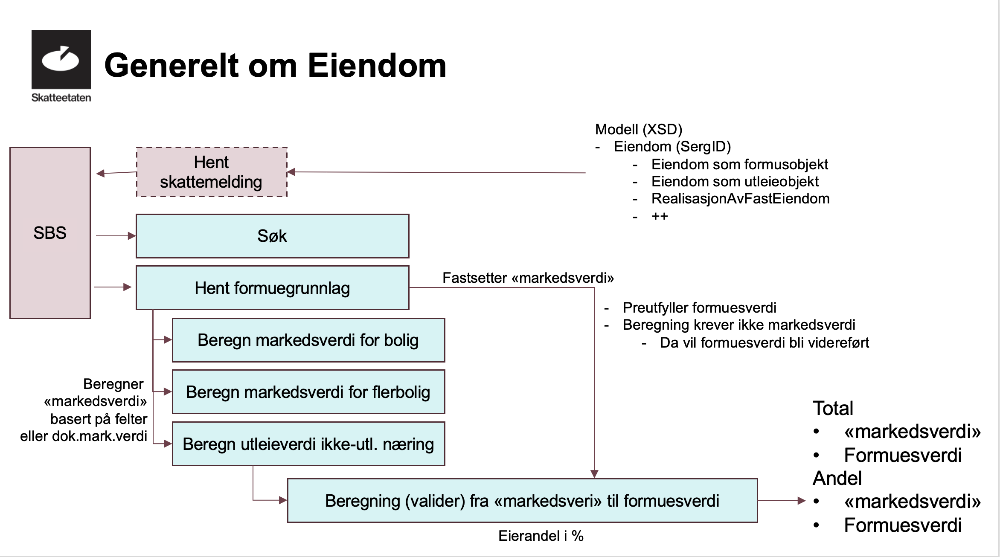

Eiendomstjenester benyttet for innrapportering av skattemeldingen fra sluttbrukersystemer

<Tabs underline={true}>
<TabItem headerText="Funksjonell dokumentasjon" itemKey="itemKey-1" default>

| Begrep          | Beskrivelse                                                                                                |
|-----------------|------------------------------------------------------------------------------------------------------------|
| SBS             | Sluttbrukersystem                                                                                          |
| SERG            | Betegnelse på Eiendomsregisteret                                                                           |
| Markedsverdi    | Markedsverdien som sluttbrukersystem beregner ved hjelp av eiendomstjenestene                              |
| Formuesverdi    | Formuesverdien som Skatteetaten beregner basert på markedsverdien ved innsending av skattemeldingen        |
| Egenfastsetting | Verdier som fastsettes av den skattepliktige selv, i motsetning til verdier fylt inn av Skatteetaten       |

Skatteetaten har utviklet egne tjenester for å hente eiendomsinformasjon og formuesgrunnlag fra Eiendomsregisteret, og beregne korrekt **markedsverdi**.
Eiendomsdataene som hentes ut og beregnes sendes inn til valideringstjenesten som en del av skattemeldingen slik at Skatteetaten kan beregne korrekt **formuesverdi** for eiendommene.
Valideringstjenesten beregner og returnerer også formuesverdien for hele eiendommene, formuesverdien for den skattepliktiges formuesandel av
eiendommene, og verdi før verdsettingsrabatt for den skattepliktiges formuesandel av eiendommene. Dette er verdier som skal benyttes ved innsending av skattemeldingen.

Eiendomsopplysninger preutfylles i utkastet til gjeldende skattemelding for personlige skattepliktige, men må egenfastsettes for upersonlige.

I dette dokumentet beskrives den funksjonelle flyten for beregning av markedsverdi for eiendom, og overordnet teknisk dokumentasjon.
Endepunktene med informasjonsmodeller er dokumentert under [Eiendomstjenester i OpenAPI](pathname:///download/skattemeldingupersonlig/openapi.html).

  _Funksjonell flyt for beregning av markedsverdi for eiendommer som inngår i skattemeldingen_

## Scope
Som beskrevet i [hovedsiden for innrapportering av skattemelding](../api/innrapportering-skattemelding-new#scope) 
trengs det et eget scope `skatteetaten:formueinntekt/skattemelding/eiendom` for å få tilgang til eiendomstjenestene.

## 1. Søk etter eiendom
Søketjenesten brukes til å identifisere den skattepliktiges eiendommer som skal inngå i skattemeldingen hvis eiendommen ikke allerede er preutfylt.
Tjenesten fungerer som inngangsport til de øvrige eiendomstjenestene, og leverer en eiendomsidentifikator som brukes videre i prosessen.
Det er mulig å søke på alle norske veiadresser og matrikkelnummer. Søket returnerer kun eiendommer som eksisterer for inntektsåret det søkes for.

## 2. Hent formuesgrunnlag
Om ikke formuesgrunnlaget for eiendommene som skal inngå i skattemeldingen skal egenfastsettes, kan det hentes ut fra denne tjenesten.
Eiendomsidentifikatoren fra søketjenesten brukes til å identifisere eiendommene.
Tjenesten henter ut ulik informasjon basert på hvilken eiendomstype eiendomsidentifikator har, samt inntektsåret det søkes for.
Noen detaljer vil fjernes fra responsen hvis skatteyter ikke er eier av eiendommen.

Eiendomstypen bestemmer også om det skal beregnes markedsverdi, ev. utleieverdi, før validering og innsending av skattemeldingen.
For følgende eiendomstyper skal det beregnes markedsverdi gjennom tjenestene beskrevet i neste avsnitt: 
* Selveid bolig              
* Boenhet i boligselskap     
* Flerboligbygning           
* Ikke utleid næringseiendom 

## 3. Beregning av markedsverdi/utleieverdi
Det er tre tjenester som benyttes for å beregne markedsverdi for eiendommer basert på eiendomstype:
* Selveid bolig, boenhet i boligselskap: tjenesten for beregning av markedsverdi for bolig
* Flerboligbygning: tjenesten for å beregne markedsverdi for flerbolig
* Ikke utleid næringseiendom: tjenesten for beregning av utleieverdi for næringseiendom
* For andre eiendomstyper gjør valideringstjenesten nødvendige beregninger for å fastsette formuesverdien, og det er ikke nødvendig å kalle tjenestene for beregning av markedsverdi.

For de ovennevnte eiendomstypene det skal beregnes markedsverdi/utleieverdi for, sendes formuesgrunnlaget fra den foregående tjenesten som input til tjenesten.
Sender man inn hele responsen fra hent formuesgrunnlag vil responsen til beregningen innholde alt som ble sendt inn pluss de beregnede feltene.

Det er også er mulig å oppgi dokumentert markedsverdi.
Ugyldig dokumentert markedsverdi i forhold til klagegrense vil ikke hensyntas. Mer informasjon om klage finnes på [Klage til Skatteetaten](https://www.skatteetaten.no/kontakt/klage/).
Om dokumentert markedsverdi har blitt hensyntatt vil responsen fra beregningstjenesten inkludere justert markedsverdi.

Eventuell opplasting av vedlegg for å dokumentere markedsverdi/utleieverdi er dokumentert på [siden for skattemeldingen](../api/innrapportering-skattemelding-new#42-laste-opp-vedlegg-til-skattemeldingen).

De tre tjenestene for beregningning av markedsverdi/utleieverdi er dokumentert under [teknisk dokumentasjon](#Beregning-av-markedsverdiutleieverdi).

</TabItem>
<TabItem headerText="Teknisk dokumentasjon" itemKey="itemKey-2">

På denne siden dokumenteres sentrale tekniske elementer for eiendomstjenestene.
Endepunktene med fullstendige informasjonsmodeller er dokumentert under [Eiendomstjenester i OpenAPI](pathname:///download/skattemeldingupersonlig/openapi.html).

## Søk etter eiendom
Bruk endepunktet `/api/skattemelding/v2/eiendom/soek/v2/{inntektsår}?query={query}&resultSize={resultSize}` for å søke etter eiendommer.

Følgende forretningsregler gjelder for `query`-parameteren:
* `Hvis første tegn man angir er et tall vil søket kun lete blant matrikkeladresser.`
* `Hvis første tegn man angir er en bokstav vil søket kun lete blant veiadresser.`
* `Søket krever streng plassering av tegn.`

`resultSize` spesifiserer maks antall resultater som skal returneres. Default er 10.

## Hent formuesgrunnlag
Bruk endepunktet `/api/skattemelding/v2/eiendom/formuesgrunnlag/{inntektsår}/{eiendomsidentifikator}/{identifikator}`.
`eiendomsIdentifikator` er `SERG eiendomsidentifikator` for eiendommen fra søketjenesten.

Eiendomstypene som støttes av beregningstjenesten er mappet til følgende feltnavn i API-et:

| Eiendomstype                                                  | Feltnavn i API-et                 |
|---------------------------------------------------------------|-----------------------------------|
| Selveid bolig                                                 | `selveidBolig`                    |
| Boenhet i boligselskap | `boenhetIBoligselskap`            |
| Flerboligbygning                                              | `flerboligbygning`                |
| Ikke utleid næringseiendom                                    | `ikkeUtleidNaeringseiendomINorge` |

For næringseiendom er det i tillegg en egen `naeringseiendomstype` som benytter en egen kodeliste `{inntektsår}_naeringseiendomstype.xml` for å angi type næringseiendom.

## Beregning av markedsverdi/utleieverdi
Beregning av markedsverdi/utleieverdi benytter en av tre tjenester avhenegig av eiendomstype.

Informasjonsmodellene fra inntektsår 2024 er forskjellige fra tidligere inntektsår.
Blant annet er feltnavnene for dokumentert markedsverdi, justert markedsverdi og beregnet markedsverdi hhv. `dokumentertMarkedsverdi`, `justertMarkedsverdi` og `beregnetMarkedsverdi` før inntektsår 2024,
mens det er spesifikke feltnavn per boligtype fra inntektsår 2024 som er dokumentert nedenfor.

### 3.1 Beregning av markedsverdi for bolig
Beregningen er basert på sjablong fra SSB hvor boligegenskaper og inntektsår inngår i beregningen.

Endepunktet `/api/skattemelding/v2/eiendom/markedsverdi/bolig/{inntektsår}/{eiendomsidentifikator}` benyttes for å beregne markedsverdi for bolig.
Feltet `beregnetMarkedsverdiForBolig` i responsen er den beregnede markedsverdien for boligen.

Skal det sendes med dokumentert markedsverdi for boligen, sendes feltet `dokumentertMarkedsverdiForBolig` med i request-objektet.
Fra inntektsår 2024 returneres justert eiendomsverdi i feltet `justertMarkedsverdiForBolig`.

### 3.2 Beregning av markedsverdi for flerbolig
Beregningen er basert på sjablong fra SSB hvor boligegenskaper og inntektsår inngår i beregningen.
Spesielt for flerboligbygning er at det også beregnes markedsverdi for hver useksjonerte boenhet. Denne beregningen gjøres uavhengig av om dokumentert markedsverdi er oppgitt for bygningen.

Endepunktet `/api/skattemelding/v2/eiendom/markedsverdi/flerbolig/{inntektsår}/{eiendomsidentifikator}` benyttes for å beregne markedsverdi for flerbolig og useksjonerte boenheter.
I responsen returneres feltene `beregnetMarkedsverdiForFlerboligbygning` for hele boligen, og `boligverdi` for hver useksjonerte boenhet.

Skal det sendes med dokumentert markedsverdi for flerboligbygning, sendes feltet `dokumentertMarkedsverdiForFlerboligbygning` med i request-objektet sammen med `aarForMottattMarkedsverdiForFlerboligbygning`.
I responsen returneres justert markedsverdi for flerboligbygning i feltet `justertMarkedsverdiForFlerboligbygning`.

### 3.3 Beregning av utleieverdi for næringseiendom
Beregningen er basert på næringssjablong fra SSB hvor næringstype, areal, bystatus, sentralitet og skatteleggingsperiode inngår i beregningen.

Endepunktet `/api/skattemelding/v2/eiendom/utleieverdi/{inntektsår}/{eiendomsidentifikator}` benyttes for å beregne utleieverdi for næringseiendom.

Skal det sendes med dokumentert utleieverdi for næringseiendom, sendes feltet `dokumentertMarkedsverdiForIkkeUtleidNaeringseiendomINorge` med i request-objektet.
Beregnet utleieverdi returneres i feltet `beregnetUtleieverdiForIkkeUtleidNaeringseiendomINorge` i responsen fra inntektsår 2024.

</TabItem>

</Tabs>