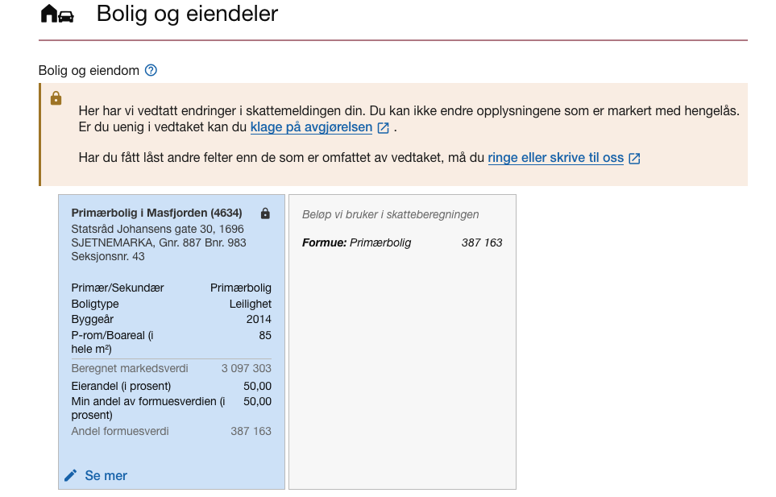

<Summary>Innsendingstjenester i forbindelse med innrapportering av skattemeldingen fra sluttbrukersystemer</Summary>

<Tabs underline={true} compact>
<TabItem headerText="Hent gjeldende skattemelding" itemKey="itemKey-1">
Første steg i innsendingsprosessen er å hente ut den siste gjeldende skattemeldingen.
Denne danner grunnlaget for videre utfylling og senere innsending av skattemeldingen, og kan ha status utkast eller fastsatt:

* Utkast er en preutfylt skattemelding Skatteetaten har laget for den skattepliktige basert på innrapporterte data og data fra skattemeldingen tidligere år.
* Fastsatt betyr at skattemeldingen er manuelt innlevert eller automatisk innlevert ved utløp av innleveringsfrist. Denne kan også inneholde et eller flere myndighetsfastsatte felter. For mer informasjon om myndighetsfastsatte felter se avsnittet under valider skattemeldingen.

Tjenesten som benyttes for å hente ut den siste gjeldende skattemeldingen er `GET /api/skattemelding/v2/{inntektsår}/{identifikator}`.

## Informasjonsmodell
XSD for responsobjektet til hent gjeldende skattemelding er `skattemeldingognaeringsspesifikasjonforespoerselrespons_{versjon}_kompakt.xsd`,
og skiller seg ut fra XSD-ene for validering og innsending i Altinn3 som er beskrevet i fanen [Informasjonsmodell for validering og innsending](#informasjonsmodell-for-validering-og-innsending-av-skattemelding-med-næringsspesifikasjon).
Merk at denne XSD-en kun kommer i kompakt versjon uten begrepsreferanser. 

På rotnivå er det to objekter, `dokumenter` og `laasteFelt`.

`skattemeldingdokument` i `dokumenter`-objektet har en `type` og `content` som inneholder Base64-encodet XML for skattemeldingen.
Tabellen under viser hvilke typer som kan returneres i responsen, og hvilken XSD som beskriver innholdet i `content`-feltet:

<div className="responsive-table">

| Dokumenttype i respons-XSD                                               | XSD-filnavn uten versjonsnummer (skattemeldingsdokument)                                                 | Beskrivelse                                  |
|--------------------------------------------------------------------------|----------------------------------------------------------------------------------------------------------|----------------------------------------------|
| `skattemeldingPersonligUtkast` <br /> `skattemeldingPersonligFastsatt`   | [`skattemelding_{versjon}_ekstern.xsd`](#xsd-for-personlig-skattemelding)                                | Skattemelding for personlige skattepliktige  |
| `skattemeldingUpersonligUtkast` <br /> `skattemeldingUpersonligFastsatt` | [`skattemeldingUpersonlig_{versjon}_ekstern.xsd`](#xsd-for-upersonlig-skattemelding)                     | Skattemelding for upersonlige skattepliktige |
| `selskapsmeldingSdfUtkast` <br /> `selskapsmeldingSdfFastsatt`           | [`selskapsmeldingSelskapMedDeltakerFastsetting_{versjon}_ekstern.xsd`](#xsd-for-selskapsmelding-for-sdf) | Selskapsmelding for SDF                      |

</div>

`naeringsspesifikasjondokument` i `dokumenter`-objektet inneholder `content` Base64-encodet XML for næringsspesifikasjonen.
XSD-en som beskriver innholdet i `content`-feltet er `naeringsspesifikasjon_{versjon}_ekstern.xsd`.

Begge dokumentene har et `id`-felt. Disse må hentes ut og brukes som `dokumentreferanseTilGjeldendeDokument`
i skattemeldings- og næringsspesifikasjonsdokumentene som sendes inn for validering og innsending.

### Utvidet veiledning
Det er mulig å etterspørre eventuelle ubesvarte utvidede veiledninger som del av dette API-et.

En utvidet veiledning representerer opplysninger som Skatteetaten har om skatteyter som muligens burde vært oppgitt i skattmeldingen, men som ikke er det.
Disse opplysningene er gjerne ikke fullstendige, og kan derfor ikke forhåndsutfylles.
Opplysningene vil trolig heller ikke validere mot valideringstjenesten senere i prosessen uten å ha blitt besvart.

Bare "ubesvarte" utvidede veiledninger returneres i responsen. En veiledning kan besvares på to måter:
* Gjennom Skatteetatens innleveringsportal for personlige skatteytere, der de kan velge å avvise eller legge til opplysningene.
* Ved innsending av `komplett` skattemelding fra et sluttbrukersystem. Når en slik innsending er fullført og fører til fastsetting, vil alle ubesvarte veiledninger _på fastsettingstidspunktet_ bli besvart som at de er "hentet av SBS".
  * Siden nye utvidede veiledninger kan oppstå fortløpende, så finnes det en risiko for at det har kommet nye mellom tidspunktet hvor SBS henter veiledningene og fastsetting utføres. Det er derfor en risiko for at veiledninger som ikke har blitt hentet av SBSen og fremvist bruker blir besvart som det.

For å etterspørre utvidet veiledning, sendes query-parameteren `ìnkluderUtvidetVeiledning=true` med i kallet til <br/> `GET /api/skattemelding/v2/{inntektsaar}/{identifikator}`.
Parameteren støttes fra inntektsår 2022. Hvis request-parameteren sendes med for tidligere år vil den ignoreres.

Det kan være mange `utvidetVeiledningdokument` i responsen, én per opplysning Skattetaten ønsker at skatteyter skal ta stilling til.
`content`-delen av `utvidetVeiledningdokument` inneholder et skattemeldingsdokument med foreslått tillegg for skatteyter.
Dette er ikke en fullstendig XML iht. skattemelding-XSD.
I de tilfeller det er flere opplysninger per veiledningsdokument, er anbefalingen at én av entitetene skal legges til, ikke alle.

### Låste felter
Skatteetaten har muligheten til å låse enkeltfelter eller hele skattemeldingen og/eller næringsspesifikasjonen.
Dette vil kun forekomme på en fastsatt skattemelding ved [myndighetsfastsetting](../api/innrapportering-skattemelding-andre-tjenester#klage), og aldri utkast.

Responsen til hent gjeldende skattemelding vil inneholde en liste over eventuelle låste felter for en fastsatt skattemelding.
Disse returneres i objektet `laasteFelt`, og er delt inn i hhv. `laastFeltSkattemelding` og `laastFeltNaeringsspesifikasjon`.

</TabItem>

<TabItem headerText="Valideringstjenesten" itemKey="itemKey-2">

Før innsending av skattemelding med næringsspesifikasjon, valideres innsendingen ved bruk av valideringstjenesten for å sikre at skattemeldingen er korrekt og mest sannsynlig vil bli godkjent ved innsending.
Samme tjeneste benyttes av Skatteetatens mottak ved validering av innsendt skattemelding. Som beskervet i de fire hovedstrategiene for implementasjon, kan SBS velge å implementere alle beregninger selv, eller integrere valideringstjenesten i sitt system.

:::tip[Lagring av valideringsdata]
Skatteetaten vil ikke lagre eller følge opp informasjonen som sendes inn i valideringstjenesten på noen måte. Skatteetaten anser disse dataene som eid av den skattepliktige og ikke av Skatteetaten.
:::

Valideringen utfører følgende steg:
1. Kontroll av XML-meldingsformatet for skattemeldingen og næringsspesifikasjon mot de tilhørende XSD-ene
2. Utføring av alle relevante beregninger for å finne Skatteetatens versjon av de kalkulerte verdiene.
   Beregningene hensyntar også ektefelle.
3. Sammenligning av Skatteetatens kalkulerte verdier mot de innsendte kalkulerte verdiene
4. Validering av andre forretningsregler som ikke gjelder kalkyler
5. Tilbakemelding som inneholder:
<br/>  a. Skatteetatens skattemelding etter å ha kjørt interne beregninger
<br/>  b. Skatteetatens næringsspesifikasjon etter å ha kjørt interne beregninger
<br/>  c. Foreløpig beregnet skatt
<br/>  d. Summert skattegrunnlag for visning (nivå av inntekt, fradrag, formue, gjeld)
          Dette er de samme tallene som ligger i skatteoppgjøret for personlig skattepliktige som underlag for å kunne forstå grunnlagene i beregnet skatt
<br/>  e. Alle avvik som ble funnet på beregninger gruppert etter summer hvor det er avvik og summer Skatteetaten har beregnet hvor SBS ikke sendte inn noen verdi
<br/>  f. Kontrollutslag på kontroller av innsendte oppgaver (noen obligatoriske, andre til info)
<br/>  g. Valideringsresultat og eventuelle avvisningsårsaker
<br/>  h. Sentrale elementer fra skattesubjektet benyttet i skatteberegningen

:::info[Foreløpig skatteberegning]
Merk at skatteberegningen kun er en foreløpig beregning. Den endelige skatteberegningen utføres i skatteoppgjøret.
:::

Validering kan gjøres løpende etter hvert som sluttbruker fyller inn informasjon, eller som én samlet validering før innsending.
Dette avhenger av flyten i sluttbrukersystemet.

Endepunktet som benyttes for validering er `/api/skattemelding/v2/valider/{inntektsår}/{identifikator}`.

XSD-en for requestobjektet til tjenesten er `skattemeldingognaeringsspesifikasjonrequest_{versjon}.xsd`,
og XSD til responsobjektet er `skattemeldingognaeringsspesifikasjonresponse_{versjon}.xsd`.
XSD-ene er nærmere beskrevet i [Informasjonsmodell for validering og innsending av skattemelding med næringsspesifikasjon](#informasjonsmodell-for-validering-og-innsending-av-skattemelding-med-næringsspesifikasjon).

### Kontrollutslag på kontroller av innsendte oppgaver
I forbindelse med validering kjøres eksterne kontroller i Skatteetatens saksbehandlingssystemer (SMIA). Kontroller som kjøres eksternt er benevnt som veiledning.
Alle veiledningsforekomster har en betjeningsstrategi som returneres i responsdokumentet. Noen få av disse hindrer innsending, de fleste ikke.

Objektet `veiledningEtterKontroll` i responsen til valideringstjenesten inneholder en liste med veiledningsforekomster som er funnet under valideringen.
Objektet inneholder betjeningsstrategi og tekstlig gjengivelse av veiledningen.
Disse er nærmere beskrevet i fanen [Informasjonsmodell](#respons-objekt).

### Valideringsresultat og eventuelle avvisningsårsaker
Valideringstjenesten vil inneholde eget felt som viser valideringsresultatet, slik at man før innsending kan se om innsendt skattemelding med
næringsspesifikasjon vil bli avvist eller ikke.

Feltet `resultatAvValidering` i responsen vil returnere `validertOK` om innsendingen ikke inneholder feil som vil medføre avvisning,
eller `validertMedFeil` om innsending vil medføre at skattemeldingen med næringsspesifikasjon blir avvist.

I tillegg returneres `aarsakTilValidertMedFeil` hvis valideringsresultatet er ´validertMedFeil´, gir en tekstkode for feilårsaken.
`avvikVedValidering` returnerer en liste med alle avvik som ble funnet under valideringen.

### Krav til næringsspesifikasjon
* Næringsspesifikasjon skal alltid sendes inn sammen med skattemelding upersonlig
  * Valideringsregel vil gi feil dersom dette ikke er gjort, og eventuell senere innsending uten vil bli avvist
* Næringsspesifikasjon skal alltid sendes inn sammen med skattemelding personlig, når den skattepliktige er definert til å ha
  enkeltpersonforetak for det året i skatteetatens systemer
  * Valideringsregel vil gi feil dersom dette ikke er gjort, og eventuell senere innsending uten vil bli avvist
  * Ved opphør av næring må det i næringsspesifikasjon fastsettes '0' i inntekt, som vil gi 0 i årsresultat og beregnet fordelt
  næringsinntekt. _Det er forskjell på å ikke fastsette næringsinntekt (da vil man bli skjønnsfastsatt) og fastsette 0 som næringsinntekt_.
* Næringsspesifikasjon kan sendes inn sammen med skattemelding personlig når den skattepliktige ikke er definert som å ha
  enkeltpersonforetak for det året i skatteetatens systemer

### Avrundingsregler
For å unngå avvik i beregnede beløp må SBS og Skatteetatens valideringstjeneste benytte de samme prinsippene for avrunding av beløp.

* 2 desimaler er tillatt for opplysningene i XML for næringsspesifikasjon.
* Bruk av desimaler for opplysninger i XML for skattemelding tillates ikke.
* Alle beløp i XML for næringsspesifikasjon som skal overføres til XML for skattemelding skal avrundes til nærmeste kronebeløp iht. de alminnelige avrundingsreglene:
  * Ørebeløp som ender på 1 - 49 øre rundes ned til nærmeste kronebeløp.
  * Ørebeløp som ender på 50 - 99 øre rundes opp til nærmeste kronebeløp.

Bruk av desimaler for opplysninger i XML for skattemelding tillates ikke fordi det vil kunne skape utfordringer når summene skal
sendes videre til skatteberegning.

### Validering av låste felter
Ved validering av skattemelding som inneholder endringer på et felt som er låst vil følgende valideringsresultat returneres: `KanIkkeOverskriveMyndighetsfastsattVerdi` eller `KanIkkeSletteMyndighetsfastsattVerdi`
Dette skyldes at en forekomst som har blitt låst har blitt endret eller slettet.


<br/>_Eksempel på låst felt i SME_.

</TabItem>
<TabItem headerText="Altinn3-app for innsending" itemKey="itemKey-3">
Resten av prosessen for innsending av skattemelding med næringsspesifikasjon skjer ved bruk av Altinn3.
Skatteetaten har opprettet en egen app i Altinn3 som håndterer innsendingen av skattemeldingen med næringsspesifikasjon,
opplasting av vedlegg, signering av skattepliktig og eventuell revisor, og å hente ut kvittering på innsendt skattemelding i ettertid.

Det er mulig å følge prosessen for innsending via en oppgave i innboksen i Altinn, og få opp en forenklet visningsklient
som lar sluttbrukerne se innholdet i XML-dokumentene som er lastet opp på Altinn-instansen i et lesbart format.
Signering av den skattepliktige og eventuell revisor skjer også via klienten.
Etter at skattemeldingen er sendt inn vil det være mulig å hente ut innholdet som ble sendt inn via klienten.

Endepunkter med beskrivelse av parametre og respons ligger i [OpenAPI-spesifikasjonen til Altinn3-appen for skattemeldingen](https://skd.apps.altinn.no/skd/formueinntekt-skattemelding-v2/swagger/index.html?urls.primaryName=End+user+app+API+for+skd%2Fformueinntekt-skattemelding-v2).
Denne genereres og administreres av Altinn basert på appen utviklet av Skatteetaten.
Altinn har også tilgjengeliggjort en [generisk OpenAPI-spesifikasjon](https://docs.altinn.studio/nb/api/apps/spec/) for Altinn3-API-et som er relevant ved uthenting/oppdatering/sletting av elemeter på instansen.

Autentisering mot Altinns API er beskrevet i [Tilgang til Altinn3 App API](#tilgang-til-altinn3-app-api) med referanse til detaljert dokumentasjon på Altinns sider.
Det er det innvekslede Altinn-tokenet som benyttes for å opprette instansen i Altinn3 og øvrige kall til Altinn3-API.

Diagrammet under viser den overordnede forretningsprosessen for innsending av skattemelding med næringsspesifikasjon via Altinn3-appen.

XSD-ene er nærmere beskrevet i [Informasjonsmodell for validering og innsending av skattemelding med næringsspesifikasjon](#informasjonsmodell-for-validering-og-innsending-av-skattemelding-med-næringsspesifikasjon).


<br/>_Overordnet forretningsprosess for Altinn3-appen._

## Asynkront API for innsending
Det tilbys et eget API for asynkron innsending av skattemeldinger med næringsspesifikasjoner større enn 10 MB.
I disse tilfellene er det påkrevd å bruke de asynkrone tjenestene for innsending.

Det asynkrone API-et er dokumentert på [GitHub](https://github.com/Skatteetaten/skattemeldingen/blob/master/docs/api-asynk/README.md).

## 1 &nbsp; Opprettelse av instans i Altinn3
Første steg i innsendingen er å opprette en instans i Altinn3. En instans brukes av Altinn for å bevare tilstanden til innsendingen av skattemeldingen med næringsspesifikasjon, inklusive alle dokumenter og vedlegg.
Detaljert dokumentasjon for hva en instans er og hvordan den brukes finnes i [Altinns API-dokumentasjon](https://docs.altinn.studio/nb/api/apps/instances/).
* `org` i Altinns dokumentasjon er `skd`
* `appname` er `formueinntekt-skattemelding-v2`.

Spesifikt for Skatteetatens app er at `ìnntektsaar` skattemeldingen gjelder for må spesifiseres ved opprettelse av intansen.

Når instansen er opprettet får den status `data`, og det er klart for å laste opp skattemeldingen med næringsspesifikasjon og eventuelle vedlegg.

### 1.1 &nbsp; Revisors signering
Om revisjonsplikt foreligger og det er forekomster som skal bekreftes av revisor, må også `skalBekreftesavRevisor` settes til `true` ved opprettelse av instansen.
Disse parameterne sendes inn i et `dataValues`-objekt som en del av requesten til Altinn3-API-et som vist i eksempelet under:

```
{
  "appId": "skd/formueinntekt-skattemelding-v2",
  "instanceOwner": { ... },
  "dataValues": 
    {
      "inntektsaar": 2023,
      "skalBekreftesavRevisor": true
    }
}
```

Hvilke forekomster i skattemeldingen og næringsspesifikasjonen som krever signatur av revisor er beskrevet i [Revisors plikter i forbindelse med signering av signaturpliktige opplysninger i næringsspesifikasjon og skattemelding.
](https://www.skatteetaten.no/rettskilder/type/skattedirektoratets-meldinger/revisors-plikter-i-forbindelse-med-signering-av-signaturpliktige-opplysninger-i-naringsspesifikasjon-og-skattemelding/).
Regnskapspliktige som ikke er revisjonspliktige kan også velge å engasjere en revisor. Feltet `skalBekreftesavRevisor` må da også settes til `true` ved opprettelse av instansen,
og revisor skal senere signere de signaturpliktige forekomstene som er angitt i skattemeldingen og næringsspesifikasjonen.

I kapittel [4.5 Sende videre til revisors signering](#45-sende-videre-til-revisors-signering) beskrives flyten ved signering av revisor.

## 2 &nbsp; Laste opp vedlegg til skattemeldingen
Ved behov for å laste opp vedlegg gjøres dette etter at instansen er opprettet og før innsending av skattemeldingen.

Vedlegg til skattemeldingen lastes opp til instansen ved å benytte endepunktet [`POST /skd/formueinntekt-skattemelding-v2/instances/{instanceOwnerPartyId}/{instanceGuid}/data/type/skattemelding-vedlegg`](https://skd.apps.altinn.no/skd/formueinntekt-skattemelding-v2/swagger/index.html?urls.primaryName=End+user+app+API+for+skd%2Fformueinntekt-skattemelding-v2).
Tillatte vedleggstyper er PDF, JPEG, PNG og Excel (xlsx). Det er ikke mulig å laste opp andre filtyper, og må spesifiseres i `Content-Type`-headeren i requesten.
Filen som lastes opp må ha et filnavn som spesifiseres i `Content-Disposition`-headeren i requesten på formatet `attachment; filename={filnavn}`.

Når vedlegget er lastet opp på instansen må `id` hentes ut fra responsen og legges inn som en vedleggsreferanse i XML-objektet for skattemeldingen.
Det anbefales å sende skattemeldingsdokumentet til valideringstjenesten på nytt etter at dette har blitt oppdatert med vedleggsreferanser, for å sikre at alle vedleggene er korrekt referert i skattemeldingen.
En oversikt over vedleggstyper og hvordan disse legges til skattemeldingen i henhold til XSD er beskrevet i [informasjonsmodell](#vedlegg).

## 3 &nbsp; Laste opp skattemelding med næringsspesifikasjon
Når de foregående stegene i prosessen er utført og skattemeldingen og næringsspesifikasjonen skal sendes videre til bekreftelse,
må skattemeldingensdokumentet for personlig, upersonlig eller selskapsmelding med næringsspesifikasjonen først lastes opp på instansen.

Dette gjøres ved å benytte endepunktet [`POST /skd/formueinntekt-skattemelding-v2/instances/{instanceOwnerPartyId}/{instanceGuid}/data/type/skattemeldingOgNaeringsspesifikasjon`](https://skd.apps.altinn.no/skd/formueinntekt-skattemelding-v2/swagger/index.html?urls.primaryName=End+user+app+API+for+skd%2Fformueinntekt-skattemelding-v2).

Dokumentenene skal lastes opp i henhold til XSD-filen `skattemeldingognaeringsspesifikasjonrequest_{versjon}.xsd`.
Dette er samme format som benyttes i valideringstjenesten.

Filnavnet som spesifiseres i `Content-Disposition` skal være `attachment; filename=skattemelding.xml` __uten double quotes__.

Responsen vil inneholde metadata om objektet som ble opprettet, inkludet en `id` som kan brukes til å oppdatere, hente ut og slette dokumentet ved behov senere.

### 3.1 &nbsp; Oppdatere skattemeldingen
Det er mulig å gjøre oppdateringer på den opplastede skattemeldingen med næringsspesifikasjon før den [sendes til behandling hos Skatteetaten](#46-innsending-av-skattemelding-med-næringsspesifikasjon-til-skatteetaten).

For å gjøre det trengs `id` til dataelementet for typen `skattemeldingOgNaeringsspesifikasjon` som ble sendt inn i steget over.
Hvis SBS har lagret `id` fra forrige respons, kan denne brukes. Hvis ikke må `id` hentes ut fra instansen ved å gjøre følgende:
1. Hent ut instansdata fra endepunktet [`GET /skd/formueinntekt-skattemelding-v2/instances/{instanceOwnerPartyId}/{instanceGuid}`](https://skd.apps.altinn.no/skd/formueinntekt-skattemelding-v2/swagger/index.html?urls.primaryName=End+user+app+API+for+skd%2Fformueinntekt-skattemelding-v2).
2. Hent ut `id`-feltet fra vedlegget `skattemeldingOgNaeringsspesifikasjon` i responsen

Når nødvendige oppdateringer er gjort, sendes `id` i `dataGuid`-parameteren i endepunktet [`PUT /skd/formueinntekt-skattemelding-v2/instances/{instanceOwnerPartyId}/{instanceGuid}/data/{dataGuid}`](https://docs.altinn.studio/nb/api/apps/spec/)
sammen med oppdaterte dokumenter i requesten.

## 4 &nbsp; Sende skattemeldingen til signering
Når skattemeldingen med næringsspesifikasjon er lastet opp på instansen, og eventuelle vedlegg er lastet opp, kan skattemeldingen sendes til signering.
Dette gjøres ved å benytte endepunktet [`PUT /skd/formueinntekt-skattemelding-v2/instances/{instanceOwnerPartyId}/{instanceGuid}/process/next`](https://skd.apps.altinn.no/skd/formueinntekt-skattemelding-v2/swagger/index.html?urls.primaryName=End+user+app+API+for+skd%2Fformueinntekt-skattemelding-v2).
Dette setter instansen i status `confirmation`.

Når prosessen har blitt sendt til signering, vil den skattepliktige få tilgang til å se gjennom og signere skattemeldingen med næringsspesifikasjon
gjennom Skatteetatens visningsklient. Visningsklienten er tilgjengelig på URL `https://skatt.skatteetaten.no/web/skattemelding-visning/altinn?appId=skd/formueinntekt-skattemelding-v2&instansId={instanceGuid}`
slik at SBS kan lenke direkte til klienten, eller via innboksen i Altinn.

Hele signeringsprosessen kan håndteres direkte fra SBS uten å gå via Altinn eller visningsklienten.

:::info
For å sende instansen videre etter signering av den skattepliktige og eventuelt revisor, må  ID-Porten benyttes for autentisering da Skatteetaten er avhengig av å vite hvem som har utført handlingen.
:::

## 5 &nbsp; Sende videre til revisors signering
Hvis det er spesifisert i instansen at forekomster i skattemeldingen eller næringsspesifikasjonen skal signeres av revisor,
vil instansen etter at den skattepliktige har signert gå videre til revisors signering. Hvis den skattepliktige har signert
i visningsklienten vil denne håndtere endring av status til revisors signering.
Hvis SBS håndterer signeringen direkte, må SBS selv endre status til revisors signering etter at den skattepliktige har signert
ved å benytte endepunktet [`PUT /skd/formueinntekt-skattemelding-v2/instances/{instanceOwnerPartyId}/{instanceGuid}/process/next`](https://skd.apps.altinn.no/skd/formueinntekt-skattemelding-v2/swagger/index.html?urls.primaryName=End+user+app+API+for+skd%2Fformueinntekt-skattemelding-v2).
Instansen vil fortsatt være i status `confirmation`, men instansen inneholder også en separat _task_ som vil endres til _Task\_2Revisor_ når revisor skal signere.

Revisor signerer på samme måte som den skattepliktige som beskrevet i [kapittel 4.4](#4-sende-skattemeldingen-til-signering),
enten via visningsklienten eller direkte fra SBS.

### 5.1 &nbsp; Revisors vedlegg
Det kan være tilfeller hvor revisor har behov for å laste opp vedlegg i forbindelse med revisjonen.
Dette kan eksempelvis være hvis revisor avslår en forekomst i skattemeldingen eller næringsspesifikasjonen.

Ved opplasting av vedlegg fra revisor benyttes endepunktet [`POST /skd/formueinntekt-skattemelding-v2/instances/{instanceOwnerPartyId}/{instanceGuid}/data/type/revisor-vedlegg`](https://skd.apps.altinn.no/skd/formueinntekt-skattemelding-v2/swagger/index.html?urls.primaryName=End+user+app+API+for+skd%2Fformueinntekt-skattemelding-v2).
`id`-feltet i responsen til opplastingen av vedlegget må legges inn i XML-dokumentet for revisors bekreftelse som er beskrevet under.

#### 4.5.2 &nbsp; Revisors bekreftelse
Revisors bekreftelse er en egen XSD-fil som skal lastes opp på instansen etter at revisor har signert.
Ved signering i visningsklienten er det ikke behov for å laste opp revisors bekreftelse, da visningsklienten håndterer dette.

XSD-filen for revisors bekreftelse er `revisorsbekreftelse_{versjon}_ekstern.xsd`.
For hvert av elementene som revisor signerer på, skal det opprettes et bekreftelseselement i henhold til XSD-en.
Denne må inneholde om revisor bekrefter eller ikke, samt referanser til informasjonselementet og forekomsten i skattemeldingen eller næringsspesifikasjonen som revisor signerer på.
XSD-en beskrives nærmere i fanen [Informasjonsmodell](#revisors-bekreftelse).

Når revisor har godkjent/avslått de aktuelle forekomstene og XML-dokumentet er utfylt av SBS med eventuelle vedleggsreferanser,
skal dette lastes opp på instansen ved å benytte endepunktet
[`POST /skd/formueinntekt-skattemelding-v2/instances/{instanceOwnerPartyId}/{instanceGuid}/data/type/revisor-bekreftelse`](https://skd.apps.altinn.no/skd/formueinntekt-skattemelding-v2/swagger/index.html?urls.primaryName=End+user+app+API+for+skd%2Fformueinntekt-skattemelding-v2).

## 6 &nbsp; Innsending av skattemelding med næringsspesifikasjon til Skatteetaten
Når både den skattepliktige og eventuell revisor har signert, kan skattemeldingen med næringsspesifikasjon sendes videre til behandling hos Skatteetaten.
Dette trigges av nok et kall til [`PUT /skd/formueinntekt-skattemelding-v2/instances/{instanceOwnerPartyId}/{instanceGuid}/process/next`](https://skd.apps.altinn.no/skd/formueinntekt-skattemelding-v2/swagger/index.html?urls.primaryName=End+user+app+API+for+skd%2Fformueinntekt-skattemelding-v2).
Instansen vil da settes til status `feedback`.

## 7 &nbsp; Opprettelse av gjeldende fastsetting og kvittering på innsendt skattemelding
:::info
Ny flyt for arkivering er under utvikling. Denne seksjonen vil derfor bli oppdatert når ny prosess er klar.
:::

Etter at Skatteetaten har mottatt skattemeldingen med næringsspesifikasjon vil det sendes en kvittering i XML-format tilbake til Altinn3-appen.
Denne kan hentes ut på følgende måte:
1. Hent ut instansdata fra endepunktet [`GET /skd/formueinntekt-skattemelding-v2/instances/{instanceOwnerPartyId}/{instanceGuid}`](https://skd.apps.altinn.no/skd/formueinntekt-skattemelding-v2/swagger/index.html?urls.primaryName=End+user+app+API+for+skd%2Fformueinntekt-skattemelding-v2).
2. Hent ut `id`-feltet fra vedlegget `tilbakemelding` i responsen, og send denne i `dataGuid`-parameteren i endepunktet
[`GET /skd/formueinntekt-skattemelding-v2/instances/{instanceOwnerPartyId}/{instanceGuid}/data/{dataGuid}`](https://skd.apps.altinn.no/skd/formueinntekt-skattemelding-v2/swagger/index.html?urls.primaryName=End+user+app+API+for+skd%2Fformueinntekt-skattemelding-v2).

Når Skatteetaten har ferdigbehandlet innsendingen, vil instansen i Altinn3-appen bli satt til status `arkivert`.
Dette er ensbetydende med at det er opprettet _gjeldende fastsetting_ for skattemeldingen.
* Hvis SBS har sendt inn en komplett skattemelding og den er validert OK, vil Altinn3-instansen bli satt til `arkivert` direkte ved innsending fra SBS.
* Hvis SBS har sendt inn en ikke-komplett skattemelding, vil Altinn3-instansen bli ha status `feedback` inntil den skattepliktige har sendt inn i SME.
* Hvis skattemeldingen er validert til _Ikke OK_, blir status satt til `arkivert` direkte med melding om resultatet uavhengig av om den er komplett eller ikke-komplett.

Skatteetaten oppdaterer innboksen i Altinn med oppdatert status på innsendingen. SBS kan benytte Dialogporten til å spørre
om nye meldinger fra Skatteetaten for den skattepliktige og dermed utlede når en ikke-komplett innsending er fullført.
Se [Hvordan hente meldinger gjennom Dialogporten](https://samarbeid.digdir.no/altinn/hvordan-hente-meldinger-gjennom-dialogporten/2869) for mer informasjon.

Den skattepliktige kan sende inn skattemelding gjentatte ganger. For hver nye innsending må Altinn3-prosessen startes på nytt med en ny instans.

</TabItem>

<TabItem headerText="Informasjonsmodell for validering og innsending" itemKey="itemKey-4">

## Informasjonsmodell for validering og innsending av skattemelding med næringsspesifikasjon
Valideringstjenesten og Altinn3-tjenesten for innsending av skattemelding med næringsspesifikasjon benytter samme XSD-filer.
Dette gjør at det er mulig å validere skattemeldingen med næringsspesifikasjon før innsending, og at det ikke er behov for å endre på XML-filen mellom validering og innsending.

Opplasting av skattedata til Altinn gjøres i en såkalt konvolutt som inneholder aktuelle dokumenter, dokumentreferanse,
inntektsår og innsendingsinformasjon.

### Request-objekt
XSD for request-objektet er `skattemeldingognaeringsspesifikasjonrequest_{versjon}.xsd`.

Objektet inneholder følgende informasjon som må fylles ut av sluttbrukersystemet: <br/>
* `dokumenter`: De ulike dokumentene for skattemelding, selskapsmelding og næringsspesifikasjon er beskrevet over.
* `inntektsaar`: Aktuelt inntektsår skattemelding gjelder for
* `innsendingsinformasjon`:
  * `innsendingstype`: `komplett` eller `ikkeKomplett`
  * `opprettetAv`: navn på sluttbrukersystem
  * `tin`: fødselsnummer/d-nummer (Tax Identification Number) for den skattepliktige som sender inn skattemeldingen.
  * `innsendingsformaal`: Innsendingens formål. Gyldige typer er:
    * `egenfastsetting`: Skattemeldingen fastsettes på grunnlag av opplysningene den skattepliktige har innrapportert.
      Dette er verdien som benyttes ved ordinær innsending av skattemeldingen.
    * `endringsanmodning`: _Skal ikke benyttes_.
    * `klage`: Les mer om klage i [eget kapittel](../api/innrapportering-skattemelding-andre-tjenester#klage).

### Respons-objekt
XSD for respons-objektet er `skattemeldingognaeringsspesifikasjonrespons_{versjon}.xsd`.

`dokumenter`-objektet kan inneholde flere av dokumenttypene i tabellen under basert skattepliktstype.
Dette er for øvrig også dokumentert i [informasjonsmodellen på GitHub](https://github.com/Skatteetaten/skattemeldingen/blob/master/docs/informasjonsmodell/README.md) per skattepliktstype og inntektsår.

<div className="responsive-table">

| Dokumenttype i respons-XSD                                                                                                                                       | XSD-filnavn uten versjonsnummer                                                                                                                         | Beskrivelse                                                                                                                                                                             |
|------------------------------------------------------------------------------------------------------------------------------------------------------------------|---------------------------------------------------------------------------------------------------------------------------------------------------------|-----------------------------------------------------------------------------------------------------------------------------------------------------------------------------------------|
| `summertskattegrunnlagforVisningPersonlig` <br/> `summertSkattegrunnlagForVisningPersonligSvalbard`                                                              | `skatteberegningsgrunnlag_{versjon}.xsd`                                                                                                                | Summert skatteberegningsgrunnlag for personlige skattepliktige (nivå av inntekt, fradrag, formue, gjeld som vises i skattemelding og skatteoppgjør) <br/> Underlag for beregnet skatt.  |
| `summertskattegrunnlagforVisningUpersonlig` <br/> `summertSkattegrunnlagForVisningUpersonligSvalbard` <br/> `summertSkattegrunnlagForVisningUpersonligPetroleum` | `summertSkatteGrunnlagForVisning_upersonligskattyter_{versjon}.xsd`                                                                                     | Summert skatteberegningsgrunnlag for upersonlige skattepliktige (nivå av inntekt, fradrag, formue, gjeld som vises i skattemelding og skatteoppgjør) <br/> Underlag for beregnet skatt. |
| `beregnetSkattPersonlig` <br/> `beregnetSkattPersonligSvalbard`                                                                                                  | `beregnet_skatt_{versjon}.xsd`                                                                                                                          | Beregnet skatt for personlige skattepliktige                                                                                                                                            |
| `beregnetSkattUpersonlig` <br/> `beregnetSkattUpersonligSvalbard`                                                                                                | `beregnetskatt_upersonlig_{versjon}_ekstern.xsd`                                                                                                        | Beregnet skatt for upersonlige skattepliktige                                                                                                                                           |
| `skattemeldingPersonligEtterBeregning`                                                                                                                           | `skattemelding_{versjon}_ekstern.xsd` <br/> `skattemelding_{versjon}_kompakt_ekstern.xsd`                                                               | Skattemelding for personlige skattepliktigemed og uten begrepsreferanser                                                                                                                |
| `skattemeldingUpersonligEtterBeregning`                                                                                                                          | `skattemeldingUpersonlig_{versjon}_ekstern.xsd` <br/> `skattemeldingUpersonlig_{versjon}_kompakt_ekstern.xsd`                                           | Skattemelding for upersonlige skattepliktige med og uten begrepsreferanser                                                                                                              |
| `selskapsmeldingSdfEtterBeregning`                                                                                                                               | `selskapsmeldingSelskapMedDeltakerFastsetting_{versjon}_ekstern.xsd` <br/> `selskapsmeldingSelskapMedDeltakerFastsetting_{versjon}_kompakt_ekstern.xsd` | Selskapsmelding for SDF med og uten begrepsreferanser                                                                                                                                   |
| `naeringsspesifikasjonEtterBeregning`                                                                                                                            | `naeringsspesifikasjon_{versjon}_ekstern.xsd` <br/> `naeringsspesifikasjon_{versjon}_kompakt_ekstern.xsd`                                               | Næringsspesifikasjon med og uten begrepsreferanser                                                                                                                                      |

</div>
`resultatAvValidering` sier om skattemeldingen med næringsspesifikasjon er `validertOK` eller `validertMedFeil`.
Hvis resultatet er `validertMedFeil`, vil det være én eller flere forekomster av `aarsakTilValidertMedFeil`.

Eksempler på årsaker til validert med feil kan være:
* Feil bruk av ID-er på forekomster i XML der det er satt eksplisitte krav til innhold på id, eksempelvis i næringsspesifikasjonen
* Summeringer samsvarer ikke med summeringsresultatet fra beregningstjenesten og summen er ikke angitt som overstyrt. Dette medfører at:
  * valideringstjenesten vil gi avvik der valideringstjenesten beregner en sum som avviker fra innsendt sum fra SBS (over grensen for avvik vi aksepterer) - innsending avvises
  * valideringstjenesten vil gi mangel der valideringstjenesten beregner en sum som ikke ble sendt inn fra SBS - innsending avvises ikke som følge av dette
* Veiledning inneholder forekomster med betjeningsstrategi `faktiskFeil`. Betjeningsstrategier er nærmere beskrevet nedenfor.
* Egenfastsatt informasjon som avviker fra tidligere myndighetsfastsatt informasjon
* Innsendt skattemelding er ikke basert på gjeldende skattemelding (utkast eller fastsatt)
* Parten har ikke tilgang den skattepliktiges skattemelding

En vesentlig forskjell i responsobjektet mellom valideringstjenesten og innsendingstjenesten er at 
i valideringstjenesten vil objektet `avvikVedValidering` returneres ved eventuelle avvik,
mens det etter innsending vil returneres eventuelle avvik i `avvikEtterBeregning`.
Objektene er like, og består av følgende felter:
* `avvikstype`: Avvikstype er definert fra kodelisten `{inntektsår}_avvikskodeVedValidertMedFeil.xml`.
* `forekomstidentifikator` – identifikator av felt i skattemeldingen
* `mottattVerdi` – verdien som ble sendt inn
* `beregnetVerdi` – verdien som ble beregnet
* `avvikIVerdi` – avviket mellom den innsendte verdien og den beregnede verdien
* `sti` – stien til elementet som har avvik 

`veiledningEtterKontroll` inneholder veiledningsforekomster avdekket etter kontroll. Veiledningsforekomstene
kommer fra Skatteetatens saksbehandlingssystemer (SMIA), og er definert i JSON-filen
[`kontrollDefinisjoner_eksterne_{inntektsår}.json` på GitHub](https://github.com/Skatteetaten/skattemeldingen/tree/master/docs/kontroller)
per inntektsår. Forekomstene inneholder følgende felter:
* `veiledningsType`: identifikator for veiledningen, mapper til feltet `kontrollnavn` i JSON-filen.
* `hjelpetekst`: veiledningstekst som kan vises i SBS. Ligger inne som `hjelpetekstSME` per språk i JSON-filen.
* `forekomstidentifikator`: identifikator til felt i skattemeldingen
* `sti`: stien til elementet med veiledning
* `betjeningsstrategi`: strategi for hvordan veiledningen skal vises i SBS. Ettersom veiledningene kommer fra SMIA,
  listes ikke alle mulige strategier her. De ulike strategiene er derimot representert i JSON-filen.
  
  Det er likevel er verdt å fremheve betjeningsstrategien `faktiskFeil`, da dette er en faktisk feil og forekomster av disse i responsen vil hindre innsending senere. <br/>
  Forekomster av `merknadDokumentasjon` krever at det legges til dokumentasjon for forekomsten, og bør korrigeres i SBS for å unngå at innsendingen havner i kontroll senere. <br/>
  Øvrige betjeningsstrategier er kun merknader på formatet `merknad*`, eksempelvis `merknadStandard`, og vil ikke hindre innsending.

`informasjonOmPersonligSkattesubjekt` og `informasjonOmUpersonligSkattesubjekt` inneholder sentrale skatteelementer tilknyttet hhv. personlig og upersonlig skattesubjekt.


## XSD for upersonlig skattemelding
XSD for skattemelding for upersonlige skattepliktige er `skattemeldingUpersonlig_{versjon}_ekstern.xsd`, og `skattemeldingUpersonlig_{versjon}_kompakt_ekstern.xsd` for kompakt versjon uten begrepsreferanser.

## XSD for selskapsmelding for SDF
XSD for selskapsmelding for selskap med deltakerfastsetting (SDF) er `selskapsmeldingSelskapMedDeltakerFastsetting_{versjon}_ekstern.xsd`,
og `selskapsmeldingSelskapMedDeltakerFastsetting_{versjon}_kompakt_ekstern.xsd` for kompakt versjon uten begrepsreferanser.

## XSD for næringsspesifikasjon
XSD for næringsspesifikasjon er `naeringsspesifikasjon_{versjon}_ekstern.xsd`, og `naeringsspesifikasjon_{versjon}_kompakt_ekstern.xsd` for kompakt versjon uten begrepsreferanser.

Merk at informasjonen som skal sendes inn i næringsspesifikasjonen avhenger av hvilken `virksomhetstype` og `regnskapspliktstype` denne har.
Disse feltene finnes under `virksomhet`-objektet på rotnivået i næringsspesifikasjonen.
Ved å filtrere på virksomhets- og regnskapspliktstype i [veilederen](https://skattemelding-veileder.formueinntekt.skatt.skatteetaten.no/2025/naering),
skal det være mulig å se hvilke felter som skal fylles ut i næringsspesifikasjonen for den aktuelle virksomheten og skattepliktige.

`virksomhetstype` er definert av kodelisten `{inntektsår}_virksomhetstype.xml`. <br/>
`regnskapspliktstype` er definert av kodelisten `{inntektsår}_regnskapsplikttype.xml`. <br/>
I tillegg bruker feltet `regeltypeForAarsregnskap` kodelisten `{inntektsår}_regeltypeForAarsregnskap.xml`.
Denne er det foreløpig ikke mulig å filtrere på i veilederen.

### ID-er i næringsspesifikasjonen
Det er et par spesielle regler for `id`-feltene i næringsspesifikasjonen:

* For entitetene under `Resultat` og `Balanse` skal id ___alltid___ settes til __1__.
* For entitetene `Resultatregnskapsforekomst` og `Balanseregnskapsforekomst`  skal id settes lik teknisk navn på valgt type i samme objekt.
  Typen er kontonummeret som beløpet er ført på. Se kodeliste `{inntektsår}_resultatregnskapOgBalanse.xml` for hvilke typer som er tilgjengelige.

### Regnskapspliktstyper i næringsspesifikasjonen
Regnskapspliktstypene finnes som filtreringsmuligheter i veilederen, og i kodelisten `{inntektsår}_regnskapsplikttype.xml`.
I tillegg følger en kort beskrivelse av de ulike typene her:
* `ingenRegnskapsplikt`: næringsdrivende som har bokføringsplikt, men ikke regnskapsplikt. Disse rapporterer resultatregnskap og balanse
  basert på skattemessige prinsipper.
* `fullRegnskapsplikt`: næringsdrivende som har bokføringsplikt og full regnskapsplikt, og som må utarbeide Årsregnskap som sendes til
  Regnskapsregisteret. Disse rapporterer resultatregnskap og balanse basert på regnskapsmessige prinsipper.
* `begrensetRegnskapsplikt`: næringsdrivende som har bokføringsplikt og begrenset regnskapsplikt, og som må utarbeide Årsregnskap etter regel
  om begrenset regnskapsplikt som sendes til Regnskapsregisteret. Disse rapporterer resultatregnskap og balanse basert på skattemessige
  prinsipper.

## Revisors bekreftelse
Som beskrevet i [den funksjonelle spesifikasjonen](#452-revisors-bekreftelse) er det XSD-en `revisorsbekreftelse_{versjon}_ekstern.xsd` 
som benyttes for å signere forekomster av revisor.

Som nevnt tidligere er forekomster som krever signatur av revisor dokumentert i [Revisors plikter i forbindelse med signering av signaturpliktige opplysninger i næringsspesifikasjon og skattemelding.](https://www.skatteetaten.no/rettskilder/type/skattedirektoratets-meldinger/revisors-plikter-i-forbindelse-med-signering-av-signaturpliktige-opplysninger-i-naringsspesifikasjon-og-skattemelding/).
Disse referansene vil også være tilgjengelig i [veilederen](https://skattemelding-veileder.formueinntekt.skatt.skatteetaten.no/2025/skattemelding).

I XSD-ene for skattemelding, selskapsmelding og næringsspesifikasjon vil aktuelle forekomster som kan signeres av revisor
ha et felt `*skalBekreftesAvRevisor` som settes til `true` for å indikere at forekomsten skal signeres av revisor.
`*` indikerer at feltet kan ha et prefiks, for eksempel `prosjektSkalBekreftesAvRevisor` for forsknings- og utviklingsprosjekter.
For næringsspesifikasjonen kan hele dokumentet signeres, så her ligger signeringselementet `skalBekreftesAvRevisor` på rotnoden av [XSD for næringsspesifikasjon](#xsd-for-næringsspesifikasjon)

`bekreftelse`-objektet i XSD-en for revisors bekreftelse inneholder følgende felter:
* `informasjonselementidentifikator`: XPath til elementet i XML-dokumentet som skal bekreftes 
* `forekomstidentifikator`: forekomstidentifikator til XPath-elementet
* `erBekreftetGodkjent`: true/false, om elementet er bekreftet av revisor eller ikke

Vedlegg til revisors bekreftelse legges til på samme måte som andre vedlegg, ref. [Vedlegg](#vedlegg).

## Vedlegg
XSD-ene for skattemelding, selskapsmelding, næringsspesifikasjon og revisors bekreftelse har et eget objekt for vedlegg.
Dette objektet kan inneholde en liste med vedlegg som skal sendes inn sammen med skattemeldingen.

Som beskrevet i [den funksjonelle spesifikasjonen](#42-laste-opp-vedlegg-til-skattemeldingen)
må `id` hentes ut etter at et vedlegg er lastet opp og legges inn i `id`-feltet i det respektive XML-dokumentet vedlegget er lastet opp for.

`vedleggstype` i XSD-ene har et felt `vedleggskategori` som benytter kodelisten [`/{inntektsår}/{inntektsår}_vedleggskategori.xml`](https://github.com/Skatteetaten/skattemeldingen/tree/master/src/resources/kodeliste)
til å definere gyldige verdier.

Andre elementer for vedlegg:
* `vedleggsnavn`: Navn på vedlegget
* `vedleggsfil`: Objekt for opprinnelig filnavn, filtype og dato/tid
* `informasjonselementidentifikator` (valgfri): sti/XPath til elementet vedlegget knytter seg til
* `forekomstidentifikator` (valgfri): `ìd` til forekomsten vedlegget knytter seg til

Vedlegg kan knyttes direkte til en forekomst ved hjelp av de to sistnevnte elementene i vedleggsobjektet. Dette er ikke påkrevd.

<span id="sekvensdiagram-for-innsending-av-skattemelding-med-naeringsspesifikasjon"></span>

# Sekvensdiagram for innsending av skattemelding med næringsspesifikasjon


</TabItem>
</Tabs>
