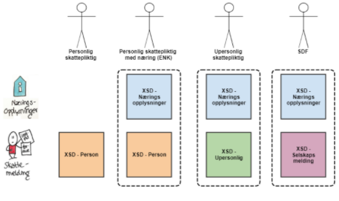

## Ordliste
| Begrep | Beskrivelse                                                                                                |
|--------|------------------------------------------------------------------------------------------------------------|
| SBS    | Sluttbrukersystem                                                                                          |
| SDF    | Selskap med deltakerfastsetting                                                                            |
| SERG   | Betegnelse på Eiendomsregisteret                                                                           |
| SME    | Skattemelding, modernisert versjon. (benyttes oftest om publikumssiden for innlevering av skattemeldingen) |
| SMIA   | Skattemelding interne arbeidsflate (nytt saksbehandlingssystem 2020)                                       |

# Introduksjon

Denne siden inneholder en onboardingsguide for innrapportering av
skattemelding med eventuell næringsspesifikasjon for personlige og upersonlige skattepliktige fra sluttbrukersystem.
Den primære målgruppen er systemleverandører av årsoppgjørsprogram eller regnskapssystem for
innrapportering av skattemeldingen og næringsopplysninger. Slike systemer kalles heretter
sluttbrukersystemer (SBS).

Løsningen legger opp til at en innsending skal inneholde en skattemelding. For personlig skattepliktige som driver ENK, upersonlig skattepliktige (selskaper) og for selskaper
med deltakerfastsetting skal innsendingen også __alltid__ inneholde næringsspesifikasjon. Det er kun lønnstakere og pensjonister som kun sender inn
skattemelding. Dette illustreres her:

 _Illustrasjon av skattemeldingsvarianter for personlige og upersonlige skattepliktige._

Det anbefales å lese følgende generelle sider før denne onboardingsguiden:

* [Kom i gang](../komigang.md)
* [Bruk av API-er for innrapportering](../om/bruk_innrapportering.md)
* [Sikkerhetsmekanismer](../om/sikkerhet.md)
* [Systembruker](../om/systembruker.md)
* [Feilhåndtering](../om/feil.md)
* [Versjonering](../om/versjoner.md)
* [Teknisk spesifikasjon](../om/tekniskspesifikasjon.md)

For informasjon og oppdateringer for systemleverandører med integrasjon mot skattemeldingen for person og næring, se Skatteetatens [fellessider for systemleverandører](https://www.skatteetaten.no/samarbeidspartnere/sluttbrukersystemer/skattemelding-sbs/).

Det tilbys to sett med tjenester:

- Skatteetaten tilbyr egne tjenester for blant annet henting og validering av skattemeldinger, eiendomskalkulator,
  søknad om utsatt frist, m.m. Disse er dokumentert på egne sider:
  - [Utfylling](../api/innrapportering-skattemelding-utfylling.md)
  - [Eiendom](../api/innrapportering-skattemelding-eiendom.md)
  - [Innsending](../api/innrapportering-skattemelding-innsending.md)
  - [Andre tjenester](../api/innrapportering-skattemelding-andre-tjenester.md)
  - Utkast til OpenAPI-spesifikasjon for Skattemeldingen finnes [her](pathname:///download/skattemeldingupersonlig/openapi.html)
- Skatteetaten har opprettet en egen app i Altinn3 som håndterer innsendingen av skattemeldingen med næringsspesifikasjon,
  opplasting av vedlegg, signering av skattepliktig og eventuell revisor, og å hente ut kvittering på innsendt skattemelding i ettertid.
  Altinn3-API-ene er dokumentert i en egen [OpenAPI-spesifikasjon for Altinn3-appen](https://skd.apps.altinn.no/skd/formueinntekt-skattemelding-v2/swagger/index.html?urls.primaryName=End+user+app+API+for+skd%2Fformueinntekt-skattemelding-v2).

I tillegg tilbyr Skatteetaten tjenesten [Skatt dialogdokumenter](../api/skattdialogdokumenter)
for å hente ut dokumenter som tilgjengeliggjøres i dialoger for formues- og inntektsskatt, blant annet skatteoppgjør og brev om skattemeldingen.

## Tilgang til API-ene
Når en skattepliktig skal benytte et sluttbrukersystem for å sende inn skattemeldingen og næringsopplysninger gjennom
API må sluttbrukeren og/eller sluttbrukersystemet være autentisert og autorisert gjennom en påloggingsprosess.

Ved kall til skattemelding-API ønsker Skatteetaten å kjenne til identiteten til innsender. Identiteten til pålogget
bruker, kombinert med informasjon fra Altinn autorisasjon vil avgjøre hvilken person/selskap en pålogget bruker kan
hente skattemeldingen til eller sende inn skattemelding for.

Autentisering skjer enten via ID-porten eller Maskinporten:

- Personlig innlogging vil skje via ID-porten med bruk av sluttbrukerens eget personnummer.
- Systemer/maskiner som ønsker å opptre på vegne av en organisasjon kan autentisere seg via Maskinporten.

Tilgang til API-ene kan gis til en bruker som logger inn via ID-porten, eller til en systembruker som autentiseres via Maskinporten.
For noen tjenester er autentisering med ID-Porten påkrevd. Dette gjelder blant annet tjenesten for å bekrefte skattemeldingen i Altinn3.

En mer detaljert guide for hvordan opprette en systembruker finnes under [Systembruker](../om/systembruker.md).
I likhet med Maskinporten-integrasjon benyttes Samarbeidsportalen til å opprette en ID-Porten-integrasjon.
For mer informasjon om autentisering og autorisasjon, inkludert hvordan komme i gang med ID-Porten, se [Sikkerhet](../om/sikkerhet.md).

### Tilgang til Altinn3 App API
Access-tokenet fra ID-porten eller Maskinporten må veksles til et Altinn-token for å autentisere seg mot Altinn3 API-et for innsending av skattemeldingen.
Mer informasjon om autentisering med ID-porten finnes på
[Altinns side for autentisering med ID-porten](https://docs.altinn.studio/nb/authorization/getting-started/authentication/id-porten/).
En mer teknisk dokumentasjon finnes i [Altinns API-dokumentasjon](https://docs.altinn.studio/nb/api/scenarios/authentication/).

### Scopes
#### Skatteetaten API
Følgende scopes må konfigureres i Samarbeidsportalen for autentisering mot Skatteetatens API-er.
Maksimal levetid i tabellen gjelder token fra Maskinporten:

| Scope                                            | Beskrivelse                                                                                                    | Levetid access-token | Levetid refresh-token |
|--------------------------------------------------|----------------------------------------------------------------------------------------------------------------|----------------------|-----------------------|
| skatteetaten:formueinntekt/skattemelding         | Tilgang til skattemeldingstjenester                                                                            | 8 timer              | 90 dager              |
| skatteetaten:formueinntekt/skattemelding/eiendom | Tilgang til eiendomstjenester                                                                                  | 8 timer              | 90 dager              |

:::info
Scopet med den korteste levetiden vil være gjeldende for hele access-tokenet.
Det anbefales å begrense levetiden på access-tokenet ytterligere, og heller ta i bruk refresh-token.
:::

#### Altinn3 API
For Altinn3 trengs det i tillegg til scope for skattemelding noen Altinn-spesifikke scopes, som listet opp i tabellen under:

| Scope                                    | Beskrivelse                                                                                         |
|------------------------------------------|-----------------------------------------------------------------------------------------------------|
| skatteetaten:formueinntekt/skattemelding | Skatteetaten-scope spesielt relevant for å endre status på innsendingen i Altinn3                   |
| altinn:instances.read                    | Scope Altinn krever for å hente innhold i Altinn3-appen fra sluttbrukersystem                       |
| altinn:instances.write                   | Scope Altinn krever for å sende inn innhold i Altinn3-appen fra sluttbrukersystem                   |

For å se maksimal levetid til Altinn sine scopes, finner man oversikt over disse på [DigDir Scopes - Altinn dokumentasjon](https://docs.altinn.studio/nb/api/authentication/digdirscopes/).

### Tilgangspakker
API-ene krever at brukeren som logger inn via ID-porten, eller systembrukeren som autentiseres via Maskinporten, har tilgang til én eller flere av tilgangspakkene i tabellen under.
Hvilke tilgangspakker som er aktuelle, avhenger av hvem brukeren eller systembrukeren skal representere.
Felles for alle tilgangspakkene er at de også gir tilgang til ressursen `app_skd_formueinntekt-skattemelding-v2`, som er påkrevd både for Skatteetatens og Altinns tjenester:

| Tilgangspakke                               | URN                                                                | Når den er aktuell og tilgang i innsendingsløpet                                                                                                                  |
|---------------------------------------------|--------------------------------------------------------------------|-------------------------------------------------------------------------------------------------------------------------------------------------------------------|
| **Ansvarlig revisor**                       | `urn:altinn:accesspackage:ansvarlig-revisor`                       | For ansvarlig revisor på vegne av en kunde. Kan lese og arbeide med utkast og bekrefte i revisors eget steg, men ikke i innsendingssteget før revisors signatur.  |
| **Revisormedarbeider**                      | `urn:altinn:accesspackage:revisormedarbeider`                      | For revisormedarbeider på vegne av en kunde. Kan lese og arbeide med utkast, men ikke bekrefte innsendingssteget.                                                 |
| **Revisorattesterer**                       | `urn:altinn:accesspackage:revisorattesterer`                       | For tjenester som krever revisorattestering. Kan lese og arbeide med utkast og bekrefte i revisors eget steg, men ikke i innsendingssteget før revisors signatur. |
| **Regnskapsfører med signeringsrettighet**  | `urn:altinn:accesspackage:regnskapsforer-med-signeringsrettighet`  | For regnskapsfører med signeringsrett på vegne av en kunde. Kan lese og arbeide med utkast og bekrefte innsendingssteget.                                         |
| **Regnskapsfører uten signeringsrettighet** | `urn:altinn:accesspackage:regnskapsforer-uten-signeringsrettighet` | For regnskapsfører uten signeringsrett på vegne av en kunde. Kan lese og arbeide med utkast, men ikke bekrefte innsendingssteget.                                 |
| **Skatt næring**                            | `urn:altinn:accesspackage:skatt-naering`                           | For skattetjenester for næringsvirksomhet. Kan lese og arbeide med utkast og bekrefte innsendingssteget.                                                          |
| **Skatteforhold for privatpersoner**        | `urn:altinn:accesspackage:innbygger-skatteforhold-privatpersoner`  | For fullmakt til skatteforhold for privatpersoner. Kan lese og arbeide med utkast og bekrefte innsendingssteget for privatpersoner.                               |

Alle pakkene gir tilgang til å opprette og lese en instans i Altinn og arbeide med skattemeldingen og næringsspesifikasjonen.
Bare **Ansvarlig revisor** og **Revisorattesterer** kan bekrefte i revisors signeringssteg, ikke **Revisormedarbeider**. Se [kapittel 4.5 Sende videre til revisors signering](#45-sende-videre-til-revisors-signering) for den detaljerte flyten.

[Tjenesteoversikten utviklet av Altinn](https://tjenesteoversikten.no/resource/app_skd_formueinntekt-skattemelding-v2) beskriver tilgangspakkene ytterligere. Merk at dette er en uoffisiell tjeneste fra Altinn, og endringer kan forekomme.

Ved bruk av systembruker må systemleverandøren oppgi pakkens _URN_ i `accessPackages` ved [registrering av systemet og opprettelse av forespørsel om systembruker](../om/systembruker.md#steg-for-steg).
Den som skal gi systembrukeren tilgang, må godkjenne forespørselen i Altinn. For klientsystembruker knyttes aktuelle klienter til systemtilgangen.
Ved bruk av ID-porten må den innloggede brukeren ha de aktuelle tilgangene i Altinn.

### Skatteetaten må gi tilgang
For å kunne bruke API-ene må Skatteetaten gi din virksomhet tilgang.
[Bestill tilgang til API-et](https://www.skatteetaten.no/samarbeidspartnere/sluttbrukersystemer/skattemelding-sbs/#trenger-du-hjelp)

---

## Ta i bruk API-ene
I øvrig dokumentasjonen benyttes begrepet _skattepliktig_  for personen eller selskapet skattemeldingen 
med eventuell næringsspesifikasjon sendes inn for. Det er ikke ensbetydende med at det er den skattepliktige som utfører innleveringsprosessen
dokumentert her. Eksempelvis kan en regnskapsfører være den som leverer inn skattemeldingen
på vegne av den skattepliktige. For selskaper representerer daglig leder eller styreleder den skattepliktige.

Følgende figur gir en en overordnet flyt med aktører og komponenter for innsending av skattemelding med næringsspesifikasjon:

Som det fremkommer av figuren kan skattemeldingen med tilhørende næringsspesifikasjon sendes inn som _komplett_ eller _ikke-komplett_.
* Ved __komplett innsending__ sendes ferdig utfylt skattemelding og næringsspesifikasjon inn fra SBS og lagres hos Skatteetaten som <u>gjeldende fastsetting</u>.
* __Ikke-komplett innsending__ er kun støttet for personlig skattepliktige. SBS kan velge å la den skattepliktige fylle ut deler av personlig skattemelding,
  eller å kun støtte næringsspesifikasjon, og la den den skattepliktige fullføre innsending av skattemelding i Skatteetatens portalløsning (SME).

Næringsspesifikasjonen kan ikke redigeres. Skal næringsspesifikasjon endres, må denne sendes inn på nytt fra SBS.

Det er fire hovedstrategier for hvordan man integrerer seg mot Skatteetatens tjenester for innsending av skattemelding og næringsspesifikasjon.
Dette er ikke en uttømmende liste, men representerer de mest vanlige scenariene:

#### Komplett innsending med full beregningsimplementasjon:
SBS implementerer alle beregninger som Skatteetaten gjør i valideringstjenesten, og sender inn skattemelding og næringsspesifikasjon som komplett.

#### Komplett innsending med integrert valideringstjeneste:
SBS integrerer valideringstjenesten i sitt sluttbrukersystem, og sender inn skattemelding og næringsspesifikasjon som komplett.

#### Ikke-komplett innsending med beregningsstøtte kun for næringsspesifikasjon:
SBS implementerer kun støtte for beregning av næringsspesifikasjon, og sender inn utkast til skattemelding fra Skatteetaten uten endringer.

#### Ikke-komplett innsending med integrert valideringstjeneste kun for næringsspesifikasjon:
SBS integrerer valideringstjenesten kun for næringsspesifikasjon, og sender inn utkast til skattemelding fra Skatteetaten uten endringer.

Nederst på denne siden er det et [sekvensdiagram for innrapportering av skattemelding næring](#sekvensdiagram-for-innsending-av-skattemelding-med-naeringsspesifikasjon)
som illustrerer flyten ut fra endepunktene som skal benyttes.

For en overordnet beskrivelse av noen sentrale konsepter i flyten, er [Skattemelding for selskap](https://www.skatteetaten.no/bedrift-og-organisasjon/skatt/skattemelding-naringsdrivende/selskap/)
nyttig bakgrunnsinformasjon.

---

# Informasjonsmodell

Skattemeldingen og næringsopplysninger skal leveres som XML-filer. Innhold og format på XML-filene er spesifisert gjennom XML Schema Definition, XSD.

Følgende informasjonsmodeller skal brukes for fastsetting:
* [skattemelding for formues- og inntektsskatt for personlige skattepliktige](#xsd-for-personlig-skattemelding)
* [skattemelding for formues- og inntektsskatt for upersonlige skattepliktige](#xsd-for-upersonlig-skattemelding)
* [selskapsmeldingen for selskap med deltakerfastsetting (SDF)](#xsd-for-selskapsmelding-for-sdf)
* [næringsspesifikasjon](#xsd-for-næringsspesifikasjon)

De til enhver tid gjeldende XSD-filene for informasjonsmodellene per inntektsår er tilgjengelig på [skattemeldingen på GitHub](https://github.com/Skatteetaten/skattemeldingen/tree/master/src/resources/xsd).
Gjeldende versjoner oppdateres årlig iht. [årsrevisjon av spesifikasjonene](#årsrevisjon-av-spesifikasjonene).

XSD-ene beskriver informasjonsmodellen som benyttes ved utveksling av data mellom sluttbrukersystemet og Skatteetaten.
Strukturen i informasjonsmodellen er ikke en beskrivelse av hvordan opplysningene skal presenteres for sluttbrukeren.
De samme opplysningene kan derfor være strukturert annerledes i en brukerflate enn i XML-en.

På [GitHub](https://github.com/Skatteetaten/skattemeldingen/tree/master/src/resources/xsd) ligger de versjonerte XSD-filene som benyttes for skattemelding personlig og upersonlig, selskapsmelding og næringsspesifikasjon, i fullstendig og kompakt format.
I de fullstendige versjonene av XSD-filene er det referanser til [begrepskatalogen](https://data.skatteetaten.no/web/datakatalog/begreper), hvor de ulike feltene er dokumentert. XSD-ene kommer også i en [kompakt versjon](#kompakt-xsd) uten referanser til begrepskatalogen.

Skatteetaten har også en [veileder](https://skattemelding-veileder.formueinntekt.skatt.skatteetaten.no/) til skattemeldingen og næringsspesifikasjonen, hvor de ulike informasjonsmodellene er dokumentert per inntektsår.
Dette vil være **hovedkilden** for informasjon om de ulike feltene i XSD-ene.

Lede- og hjelpetekstene er tilgjengelige på bokmål, nynorsk, engelsk og samisk i maskinlesbart JSON-format på [GitHub](https://github.com/Skatteetaten/skattemeldingen/tree/master/docs/tekster).
Tekstene som Skatteetaten har definert for skattemeldingen er knyttet til presentasjonen av opplysningene,
og er ikke en del av XSD-en. Tekstene er mappet mot XPath-uttrykk som angir hvor i XML-strukturen den enkelte teksten hører til.

Dokumentinnholdet i XML-forespørselene og responsene serialiseres i Base64-encodet format i henhold til [RFC 4648](https://datatracker.ietf.org/doc/html/rfc4648).
Responsen fra Skatteetaten vil alltid inneholde Base64 som er formatert på denne måten.
Dette gjelder både ved uthenting av gjeldende skattemelding, validering og innsending av skattemeldingen med næringsspesifikasjon.
Encodingen er gjort på `UTF-8`-format. Dette fremkommer også i `encoding`-feltet i XSD-ene.

## Årsrevisjon av spesifikasjonene
XSD-spesifikasjonene vil gjennomgå en årlig revisjon slik at det normalt kommer én ny versjon av disse per inntektsår.
Skatteetaten har valgt å ikke ha inntektsåret i filnavnet, men derimot ha et løpende versjonsnummer.
Dette er for å kunne støtte breaking changes i XSD-ene etter at en versjon er låst når det er strengt nødvendig.
Før en versjon av XSD-ene låses, kan det gjøres endringer på disse fortløpende uten at dette utløser en ny versjon.

Informasjon om nye versjoner av XSD-ene publiseres på [Skatteetatens side for sluttbrukersystemer](https://www.skatteetaten.no/samarbeidspartnere/sluttbrukersystemer/skattemelding-sbs/),
og kan abonneres på. I tillegg oppdateres GitHub-siden [Informasjonsmodell og kodeverk](https://github.com/Skatteetaten/skattemeldingen/blob/master/docs/informasjonsmodell/README.md) med gjeldende versjoner per inntektsår.

## Kompakt XSD
Alle XSD-filer med begrepsreferanser kommer i en "kompakt versjon" med _\_kompakt_ i filnavnet. De kompakte utgavene følger samme versjonering som de vanlige XSD-filene, men inneholder ikke referanser til begrepskatalogen.
Siden de ikke inneholder referansen til begrepskatalogen, vil det være enklere å følge med på funksjonelle endringer fra en versjon til neste ved hjelp av Git-funksjonalitet eller eksterne verktøy for å sammenligne to XSD-er.

Referanser til begrepskatalogen er angitt med egenskapen `skatt:begrepsreferanse` i de originale XSD-filene og er disse som er fjernet i de kompakte XSD-filene.

Eksempel:
<pre>
<code>
&lt;xsd:simpleType name="Heltall" skatt:begrepsreferanse="https://data.skatteetaten.no/web/datakatalog/begrep/20b52af0-9fe1-11e5-a9f8-e4115b280940"&gt;
    &lt;xsd:restriction base="xsd:long" /&gt;
&lt;/xsd:simpleType&gt;
</code>
</pre>

## Kodelister
For enkelte felt er verdiene som kan angis definert i eksterne kodelister.
Når en type i XSD-en bruker en slik kodeliste, er det angitt med egenskapen `skatt:eksternKodeliste`.

Eksempel:
<pre>
<code>
&lt;xsd:simpleType name="SaerskiltSkatteplikt" skatt:eksternKodeliste="/formuesOgInntektsskatt/2026_saerskiltSkatteplikt.xml"&gt;
    &lt;xsd:restriction base="xsd:string" /&gt;
&lt;/xsd:simpleType&gt;
</code>
</pre>

Referansen i `skatt:eksternKodeliste` angir hvilken kodeliste som skal brukes for feltet. Noen kodelister er definert direkte i XSD-en.
Disse vil ha verdien `skatt:eksternKodeliste="inline"`.  
Kodelistene er tilgjengelige på [GitHub](https://github.com/Skatteetaten/skattemeldingen/tree/master/src/resources/kodeliste).

# Spesifikasjon av konvolutt for skattemelding, selskapsmelding og næringsspesifikasjon
Nedenfor beskrives de ulike XSD-filene overordnet. Versjonsnummeret er tatt bort fra filnavnet fordi disse revideres årlig.
Dokumentasjonen vil ikke ta for seg alle felter i XSD-ene, men det henvises til [veilederen](https://skattemelding-veileder.formueinntekt.skatt.skatteetaten.no/) og [begrepskatalogen](https://data.skatteetaten.no/web/datakatalog/begreper) for mer informasjon.

## XSD for personlig skattemelding
XSD for skattemelding for personlige skattepliktige er `skattemelding_{versjon}_ekstern.xsd`, og `skattemelding_{versjon}_kompakt_ekstern.xsd` for kompakt versjon uten begrepsreferanser.

## XSD for upersonlig skattemelding
XSD for skattemelding for upersonlige skattepliktige er `skattemeldingUpersonlig_{versjon}_ekstern.xsd`, og `skattemeldingUpersonlig_{versjon}_kompakt_ekstern.xsd` for kompakt versjon uten begrepsreferanser.

## XSD for selskapsmelding for SDF
XSD for selskapsmelding for selskap med deltakerfastsetting (SDF) er `selskapsmeldingSelskapMedDeltakerFastsetting_{versjon}_ekstern.xsd`,
og `selskapsmeldingSelskapMedDeltakerFastsetting_{versjon}_kompakt_ekstern.xsd` for kompakt versjon uten begrepsreferanser.

## XSD for næringsspesifikasjon
XSD for næringsspesifikasjon er `naeringsspesifikasjon_{versjon}_ekstern.xsd`, og `naeringsspesifikasjon_{versjon}_kompakt_ekstern.xsd` for kompakt versjon uten begrepsreferanser.

Merk at informasjonen som skal sendes inn i næringsspesifikasjonen avhenger av hvilken `virksomhetstype` og `regnskapspliktstype` denne har.
Disse feltene finnes under `virksomhet`-objektet på rotnivået i næringsspesifikasjonen.
Ved å filtrere på virksomhets- og regnskapspliktstype i [veilederen](https://skattemelding-veileder.formueinntekt.skatt.skatteetaten.no/2025/naering),
skal det være mulig å se hvilke felter som skal fylles ut i næringsspesifikasjonen for den aktuelle virksomheten og skattepliktige.

`virksomhetstype` er definert av kodelisten `{inntektsår}_virksomhetstype.xml`.  
`regnskapspliktstype` er definert av kodelisten `{inntektsår}_regnskapsplikttype.xml`.  
I tillegg bruker feltet `regeltypeForAarsregnskap` kodelisten `{inntektsår}_regeltypeForAarsregnskap.xml`.
Denne er det foreløpig ikke mulig å filtrere på i veilederen.

## Interoperabilitet mellom ulike sluttbrukersystemer via Altinn
Alle ledd i løsningen skal være så standardiserte at det er mulig for en skattepliktig eller annen aktør å bytte ut ett SBS med et annet
uten at det fører til problemer med å behandle skattemeldingen i det nye systemet. Dette gjelder også mellom ulike SBS-er fra ulike leverandører.
Dette oppnås ved at Altinn blir et felles opplastingsområde som kan benyttes til å utveksle data på tvers av ulike SBS-er.
Dataene som er lagret i Altinn eller sendt inn til Skatteetaten er sluttbrukerens eiendom og skal være tilgjengelig fra alle typer SBS.

Dette betyr at de ulike operasjonene i flyten i løsningen kan kunne utføres av SBS-er av ulik type.
Det er ikke et krav at en SBS-type støtter alle operasjoner i flyten eller må støtte data for alle inntektsår, men de operasjonene og
inntektsårene som støttes må følge standarden. Det er dermed mulig å tilby et SBS som kun leverer deler av flyten i løsningen, men
et slikt system kan ha begrenset verdi for de skattepliktige sluttbrukene.

Det er ikke et krav at SBS-ene har samme interne datamodell for skattemeldingen.

### Eksempel på samspill og interoperabilitet mellom ulike SBS-system
* Regnskapsfører som benytter SBS av type "A" sammenstiller et utkast av skattemeldingen og næringsspesifikasjon og laster disse filene opp
til Altinn som versjon 1.
* Den næringsdrivende som benytter SBS av type "B" får skattemeldingen og næringsspesifikasjon lastet ned fra Altinn til sitt SBS og
kan der kontrollere eller komplettere skattemeldingen og næringsspesifikasjon . Deretter lastes skattemeldingen og næringsspesifikasjon opp
til Altinn som versjon 2.
* Revisor som benytter SBS av type "C" får skattemeldingen og næringsspesifikasjon lastet ned fra Altinn til sitt SBS og kan der
kontrollere og signere skattemeldingen og næringsspesifikasjon . Deretter oppdateres status på skattemeldingen og næringsspesifikasjon til
"signert" ved at SBS oppdaterer statusen til Altinn.
* Siden status nå er signert kan skattemeldingen og næringsspesifikasjon bli sendt inn til skatteetaten. Dette utføres via et API-kall fra et av de
samarbeidende SBS-systemene.
* Året etter har regnskapsfører byttet til SBS av type "D". Fra denne SBS-en kan regnskapsfører hente skattemeldingen for sine kunder for
tidligere år fra Altinn/Skatteetaten. 

De 3 aktørene i dette scenariet kan ha hvert sitt SBS fra ulike leverandører.

# Sekvensdiagram for innsending av skattemelding med næringsspesifikasjon
Dette sekvensdiagrammet som illustrerer flyten for bruk av de ulike API-ene for [utfylling](../api/innrapportering-skattemelding-utfylling.md), [eiendom](../api/innrapportering-skattemelding-eiendom.md) og [innsending](../api/innrapportering-skattemelding-innsending.md).
