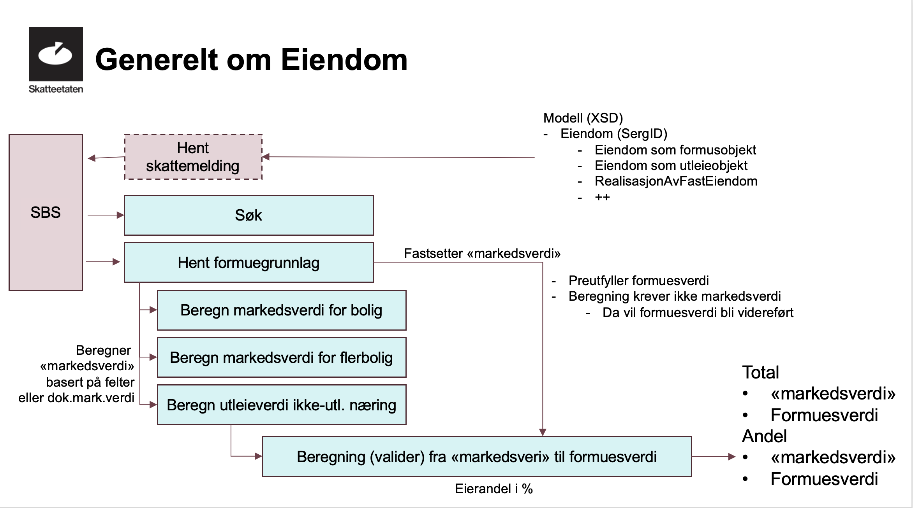

import Perioder from '../api/innrapportering-skattemelding-perioder.md';

Utfyllingstjenester benyttet for innrapportering av skattemeldingen fra sluttbrukersystemer

<Tabs underline={true}>
<TabItem headerText="Generelt" itemKey="itemKey-1" default>

## Introduksjon
Denne siden beskriver tjenestene for utfylling av skattemeldingen. I denne fanen tar vi for oss generelle konsepter som
gjelder for XSD-filene som brukes for skattemeldingen og næringsspesifikasjonen.

I fanen [Hent gjeldende skattemelding](../api/innrapportering-skattemelding-utfylling?tab=Hent+gjeldende+skattemelding) beskriver vi hvordan dere henter ut den siste gjeldende skattemeldingen som danner grunnlaget for videre utfylling og senere innsending av skattemeldingen.

Fanen [Eiendomstjenester](../api/innrapportering-skattemelding-utfylling?tab=Eiendomstjenester) beskriver hvordan eiendomsinformasjon skal fylles inn i skattemeldingen slik at Skatteetaten kan beregne korrekt formuesverdi for den skattepliktiges eiendommer som inngår i skattemeldingen.

Fanen [Begrenset skatteplikt](../api/innrapportering-skattemelding-utfylling?tab=Begrenset+skatteplikt) beskriver hvordan dere
kan tilrettelege for skattepliktige med begrenset skatteplikt. Dette er ikke en del av hovedflyten for innsending.

Utfyllingstjenestene vil til slutt lede til innsending og [valideringstjenesten](../api/innrapportering-skattemelding-innsending).
Merk at dere har anledning til å foreta løpende valideringer underveis i utfyllingsprosessen, og at dere derfor ikke må
vente med å integrere valideringstjenesten til utfylling er fullført.

## Generelle konsepter i XSD-filene
Noen typer og egenskaper brukes på tvers av informasjonsmodellene dokumentert i [onboardingsguiden](../anvendelsesomraader/skattemelding#informasjonsmodell-onboarding). XSD-ene angir hvilke egenskaper som er tilgjengelige på det enkelte objektet eller feltet.

### ID-er
Objekter i skattemeldingen har en `id` som identifiserer den enkelte forekomsten. Når et objekt kommer fra et utkast,
bør samme `id` videreføres når objektet endres. Feltene på objektet kan endres uten at objektet får en ny `id`.
Når sluttbrukersystemet oppretter et nytt objekt, må det også opprette en `id`. ID-en må være unik innenfor skattemeldingen.
Den kan for eksempel være en GUID eller en annen unik identifikator.

Det er noen unntak for håndtering av id i [næringsspesifikasjonen](../api/innrapportering-skattemelding-innsending?tab=informasjonsmodell#id-er-i-næringsspesifikasjonen).

## Egenskaper på objekter og felter
Objekter og felter i skattemeldingen kan ha egenskaper i tillegg til selve opplysningen som rapporteres. Hvilke egenskaper som kan brukes på den enkelte forekomsten, er definert i informasjonsmodellen.

### Egenskaper på objekter
Enkelte forhold angis som egenskaper på objektet de gjelder, og rapporteres ikke som egne objekter i skattemeldingen.
Dette gjelder blant annet:
* utenlandsforhold, som angis med `landkode`
* kommunetilhørighet, som angis med `kommunenummer`

Det finnes altså ikke egne objekter for eksempelvis et utenlandsforhold eller en kommunetilhørighet. Egenskapen angis på objektet som forholdet gjelder.

For personlig skattepliktige fremgår hvilke egenskaper som kan brukes på de ulike forekomstene av kodelisten `{inntektsår}_egenskaperPerForekomstISkattemelding.xml` hvor `{inntektsår}` er inntektsåret for skattemeldingen.

### Egenskaper på felter
Enkelte felt kan ha egenskaper i tillegg til feltets verdi. Hvilke egenskaper som kan angis, bestemmes av typen til feltet i XSD-en.
For eksempel kan et beløpsfelt ha skattemessige egenskaper knyttet til beløpet. Slike egenskaper skal bare brukes på felt der den aktuelle typen i XSD-en åpner for det.

Bruk XSD-en for samtlige, og i tillegg kodelisten `{inntektsår}_egenskaperPerForekomstISkattemelding.xml` for personlig skattepliktige, for å avgjøre hvilke egenskaper som kan brukes på den aktuelle forekomsten.

### Fastsettingsberegninger
En del steder i skattemeldingen er det laget beregningsstøtte for å komme frem til skattemessige verdier. Slike beregninger kalles
fastsettingsberegninger.

I XSD-ene for skattemeldingen er det mulig å se hvilke felt som har fastsettingsberegninger og som beregnes med utgangspunkt i andre felt. Dette
vises slik i XSD (merket rødt):

<pre>
<code>
&lt;xsd:complexType name="FormueOgGjeld"&gt;
{"  "}&lt;xsd:sequence&gt;
{"    "}&lt;xsd:element maxOccurs="unbounded" minOccurs="0" name="formuesobjekt" type="Formuesobjekt"/&gt;
{"    "}&lt;xsd:element name="id" type="Tekst"/&gt;
{"    "}&lt;xsd:element minOccurs="0" name="gjeld" type="Gjeld"/&gt;
{"    "}&lt;xsd:element minOccurs="0" name="samletVerdiFoerEventuellVerdsettingsrabatt" skatt:erAvledet="true" type="BeloepSomHeltallMedOverstyring"/&gt;
{"    "}&lt;xsd:element minOccurs="0" name="samletGjeld" skatt:erAvledet="true" type="BeloepSomHeltallMedOverstyring"/&gt;
{"    "}&lt;xsd:element minOccurs="0" name="samletVerdiBakAksjeneISelskapet" skatt:erAvledet="true" type="BeloepSomHeltallMedOverstyring"/&gt;
{"    "}&lt;xsd:element minOccurs="0" name="fasteEiendommer" type="FasteEiendommer"/&gt;
{"  "}&lt;/xsd:sequence&gt;
&lt;/xsd:complexType&gt;
</code>
</pre>

Alle felt som er avledet vil bli reberegnet i mottak av skattemeldingen, og hvis verdien som er sendt inn ikke er lik verdien den beregnes til vil
innsendingen bli avvist.

Det er mulig å ikke sende inn avledede felter - disse vil da bli beregnet ved mottak og dermed bli en del av fastsettingen
(det blir markert som et avvik i valideringstjenesten, men vil ikke bli avvist).

#### Overstyring av fastsettingsberegninger
Avledede felt har en tilhørende type som tillater overstyring (eks:`BeløpSomHeltallMedSkattemessigeEgenskaperMedOverstyring`).
Denne typen vil ha en egenskap `erOverstyrt` som gjør at det kan fastsettes at verdien i dette sumfeltet er overstyrt.
Det betyr at en sum kan fastsettes og denne vil gjelde selv om skatteetatens interne summeringer returnerer et annet beløp.
Slike avvik blir ikke avvist i valideringstjenesten.

## Neste steg
Gå videre til fanen [Hent gjeldende skattemelding](../api/innrapportering-skattemelding-utfylling?tab=Hent+gjeldende+skattemelding)
for å lese hvordan man henter ut den siste gjeldende skattemeldingen som danner grunnlaget for videre utfylling og senere innsending av skattemeldingen.

</TabItem>

<TabItem headerText="Hent gjeldende skattemelding" itemKey="itemKey-2">
Første steg i innsendingsprosessen er å hente ut den siste gjeldende skattemeldingen.
Denne danner grunnlaget for videre utfylling og senere innsending av skattemeldingen, og kan ha status utkast eller fastsatt:

* Utkast er en preutfylt skattemelding Skatteetaten har laget for den skattepliktige basert på innrapporterte data og data fra skattemeldingen tidligere år.
* Fastsatt betyr at skattemeldingen er manuelt innlevert eller automatisk innlevert ved utløp av innleveringsfrist. Denne kan også inneholde et eller flere myndighetsfastsatte felter. For mer informasjon om myndighetsfastsatte felter se avsnittet under valider skattemeldingen.

Tjenesten som benyttes for å hente ut den siste gjeldende skattemeldingen er `GET /api/skattemelding/v2/{inntektsår}/{identifikator}`.

## Informasjonsmodell
XSD for responsobjektet til hent gjeldende skattemelding er `skattemeldingognaeringsspesifikasjonforespoerselrespons_{versjon}_kompakt.xsd`.
Merk at denne XSD-en kun kommer i kompakt versjon uten begrepsreferanser. 

På rotnivå er det to objekter, `dokumenter` og `laasteFelt`.

`skattemeldingdokument` i `dokumenter`-objektet har en `type` og `content` som inneholder Base64-encodet XML for skattemeldingen.
`naeringsspesifikasjondokument` i `dokumenter`-objektet inneholder `content` som Base64-encodet XML for næringsspesifikasjonen.
Tabellen under viser hvilke typer som kan returneres i responsen, og hvilken XSD som beskriver innholdet i `content`-feltet:

| Dokumenttype i respons-XSD                                               | XSD-filnavn uten versjonsnummer                                                 | Beskrivelse                                  |
|--------------------------------------------------------------------------|--------------------------------------------------------------------------------------------------------------------------------------------------------|--------------------------------------------------------|
| `skattemeldingPersonligUtkast`   `skattemeldingPersonligFastsatt`   | [`skattemelding_{versjon}_ekstern.xsd`](../api/innrapportering-skattemelding-innsending#xsd-for-personlig-skattemelding)                                | Skattemelding for personlige skattepliktige  |
| `skattemeldingUpersonligUtkast`   `skattemeldingUpersonligFastsatt` | [`skattemeldingUpersonlig_{versjon}_ekstern.xsd`](../api/innrapportering-skattemelding-innsending#xsd-for-upersonlig-skattemelding)                     | Skattemelding for upersonlige skattepliktige |
| `selskapsmeldingSdfUtkast`   `selskapsmeldingSdfFastsatt`           | [`selskapsmeldingSelskapMedDeltakerFastsetting_{versjon}_ekstern.xsd`](../api/innrapportering-skattemelding-innsending#xsd-for-selskapsmelding-for-sdf) | Selskapsmelding for selskaper med deltakerfastsettelse                      |
| `naeringsspesifikasjondokument`                                           | [`naeringsspesifikasjon_{versjon}_ekstern.xsd`](../api/innrapportering-skattemelding-innsending#xsd-for-næringsspesifikasjon)                     | Næringsspesifikasjonen |

Begge dokumentene har et `id`-felt. Disse må hentes ut og brukes som `dokumentreferanseTilGjeldendeDokument`
i skattemeldings- og næringsspesifikasjonsdokumentene som sendes inn for validering og innsending.

Som nevnt er det responsen fra denne tjenesten som danner grunnlaget for videre utfylling og senere innsending av skattemeldingen.
De ulike XSD-filnavnene i tabellen over lenker til [informasjonsmodell for validering og innsending](../api/innrapportering-skattemelding-innsending?tab=Informasjonsmodell+for+validering+og+innsending).
Her går vi mer i detalj på innholdet i skattemeldingen og næringsspesifikasjonen, og hvilke felter som kan fylles ut av sluttbrukersystemet.
Den viktigste kilden til utover XSD-filene i seg selv vil være [veilederen for skattemeldingen og næringsspesifikasjonen](https://skattemelding-veileder.formueinntekt.skatt.skatteetaten.no/).

### Utvidet veiledning
Det er mulig å etterspørre eventuelle ubesvarte utvidede veiledninger som del av dette API-et.

En utvidet veiledning representerer opplysninger som Skatteetaten har om skatteyter som muligens burde vært oppgitt i skattmeldingen, men som ikke er det.
Disse opplysningene er gjerne ikke fullstendige, og kan derfor ikke forhåndsutfylles.
Opplysningene vil trolig heller ikke validere mot valideringstjenesten senere i prosessen uten å ha blitt besvart.

Bare "ubesvarte" utvidede veiledninger returneres i responsen. En veiledning kan besvares på to måter:
* Gjennom Skatteetatens innleveringsportal for personlige skatteytere, der de kan velge å avvise eller legge til opplysningene.
* Ved innsending av `komplett` skattemelding fra et sluttbrukersystem. Når en slik innsending er fullført og fører til fastsetting, vil alle ubesvarte veiledninger _på fastsettingstidspunktet_ bli besvart som at de er "hentet av SBS".
  * Siden nye utvidede veiledninger kan oppstå fortløpende, så finnes det en risiko for at det har kommet nye mellom tidspunktet hvor SBS henter veiledningene og fastsetting utføres. Det er derfor en risiko for at veiledninger som ikke har blitt hentet av SBSen og fremvist bruker blir besvart som det.

For å etterspørre utvidet veiledning, sendes query-parameteren `ìnkluderUtvidetVeiledning=true` med i kallet til   `GET /api/skattemelding/v2/{inntektsaar}/{identifikator}`.
Parameteren støttes fra inntektsår 2022. Hvis request-parameteren sendes med for tidligere år vil den ignoreres.

Det kan være mange `utvidetVeiledningdokument` i responsen, én per opplysning Skattetaten ønsker at skatteyter skal ta stilling til.
`content`-delen av `utvidetVeiledningdokument` inneholder et skattemeldingsdokument med foreslått tillegg for skatteyter.
Dette er ikke en fullstendig XML iht. skattemelding-XSD.
I de tilfeller det er flere opplysninger per veiledningsdokument, er anbefalingen at én av entitetene skal legges til, ikke alle.

### Låste felter
Skatteetaten har muligheten til å låse enkeltfelter eller hele skattemeldingen og/eller næringsspesifikasjonen.
Dette vil kun forekomme på en fastsatt skattemelding ved [myndighetsfastsetting](../api/innrapportering-skattemelding-andre-tjenester#klage), og aldri utkast.

Responsen til hent gjeldende skattemelding vil inneholde en liste over eventuelle låste felter for en fastsatt skattemelding.
Disse returneres i objektet `laasteFelt`, og er delt inn i hhv. `laastFeltSkattemelding` og `laastFeltNaeringsspesifikasjon`.

## Neste steg
Gå videre til fanen [Eiendomstjenester](../api/innrapportering-skattemelding-utfylling?tab=Eiendomstjenester) for å lese
hvordan eiendomsinformasjon skal fylles inn i skattemeldingen slik at Skatteetaten kan beregne korrekt formuesverdi for den skattepliktiges
eiendommer som inngår i skattemeldingen.

</TabItem>

<TabItem headerText="Eiendomstjenester" itemKey="itemKey-3" default>

## Funksjonell dokumentasjon

| Begrep          | Beskrivelse                                                                                                |
|-----------------|------------------------------------------------------------------------------------------------------------|
| x             | Sluttbrukersystem                                                                                          |
| SERG            | Betegnelse på Eiendomsregisteret                                                                           |
| Markedsverdi    | Markedsverdien som sluttbrukersystem beregner ved hjelp av eiendomstjenestene                              |
| Formuesverdi    | Formuesverdien som Skatteetaten beregner basert på markedsverdien ved innsending av skattemeldingen        |
| Egenfastsetting | Verdier som fastsettes av den skattepliktige selv, i motsetning til verdier fylt inn av Skatteetaten       |

Skatteetaten har utviklet egne tjenester for å hente eiendomsinformasjon og formuesgrunnlag fra Eiendomsregisteret, og beregne korrekt **markedsverdi**.
Eiendomsdataene som hentes ut og beregnes sendes inn til valideringstjenesten som en del av skattemeldingen slik at Skatteetaten kan beregne korrekt **formuesverdi** for eiendommene.
Valideringstjenesten beregner og returnerer også formuesverdien for hele eiendommene, formuesverdien for den skattepliktiges formuesandel av
eiendommene, og verdi før verdsettingsrabatt for den skattepliktiges formuesandel av eiendommene. Dette er verdier som skal benyttes ved innsending av skattemeldingen.

Eiendomsopplysninger preutfylles i utkastet til gjeldende skattemelding for personlige skattepliktige, men må egenfastsettes for upersonlige.

I dette dokumentet beskrives den funksjonelle flyten for beregning av markedsverdi for eiendom, og overordnet teknisk dokumentasjon.
Endepunktene med informasjonsmodeller er dokumentert under [Eiendomstjenester i OpenAPI](pathname:///download/skattemeldingupersonlig/openapi.html).

  _Funksjonell flyt for beregning av markedsverdi for eiendommer som inngår i skattemeldingen_

## Scope
Som beskrevet i [hovedsiden for innrapportering av skattemelding](../anvendelsesomraader/skattemelding#scopes)
trengs det et eget scope `skatteetaten:formueinntekt/skattemelding/eiendom` for å få tilgang til eiendomstjenestene.

## 1. Søk etter eiendom
Søketjenesten brukes til å identifisere den skattepliktiges eiendommer som skal inngå i skattemeldingen hvis eiendommen ikke allerede er preutfylt.
Tjenesten fungerer som inngangsport til de øvrige eiendomstjenestene, og leverer en eiendomsidentifikator som brukes videre i prosessen.
Det er mulig å søke på alle norske veiadresser og matrikkelnummer. Søket returnerer kun eiendommer som eksisterer for inntektsåret det søkes for.

## 2. Hent formuesgrunnlag
Om ikke formuesgrunnlaget for eiendommene som skal inngå i skattemeldingen skal egenfastsettes, kan det hentes ut fra denne tjenesten.
Eiendomsidentifikatoren fra søketjenesten brukes til å identifisere eiendommene.
Tjenesten henter ut ulik informasjon basert på hvilken eiendomstype eiendomsidentifikator har, samt inntektsåret det søkes for.
Noen detaljer vil fjernes fra responsen hvis skatteyter ikke er eier av eiendommen.

Eiendomstypen bestemmer også om det skal beregnes markedsverdi, ev. utleieverdi, før validering og innsending av skattemeldingen.
For følgende eiendomstyper skal det beregnes markedsverdi gjennom tjenestene beskrevet i neste avsnitt:
* Selveid bolig
* Boenhet i boligselskap
* Flerboligbygning
* Ikke utleid næringseiendom

## 3. Beregning av markedsverdi/utleieverdi
Det er tre tjenester som benyttes for å beregne markedsverdi for eiendommer basert på eiendomstype:
* Selveid bolig, boenhet i boligselskap: tjenesten for beregning av markedsverdi for bolig
* Flerboligbygning: tjenesten for å beregne markedsverdi for flerbolig
* Ikke utleid næringseiendom: tjenesten for beregning av utleieverdi for næringseiendom
* For andre eiendomstyper gjør valideringstjenesten nødvendige beregninger for å fastsette formuesverdien, og det er ikke nødvendig å kalle tjenestene for beregning av markedsverdi.

For de ovennevnte eiendomstypene det skal beregnes markedsverdi/utleieverdi for, sendes formuesgrunnlaget fra den foregående tjenesten som input til tjenesten.
Sender man inn hele responsen fra hent formuesgrunnlag vil responsen til beregningen innholde alt som ble sendt inn pluss de beregnede feltene.

Det er også er mulig å oppgi dokumentert markedsverdi.
Ugyldig dokumentert markedsverdi i forhold til klagegrense vil ikke hensyntas. Mer informasjon om klage finnes på [Klage til Skatteetaten](https://www.skatteetaten.no/kontakt/klage/).
Om dokumentert markedsverdi har blitt hensyntatt vil responsen fra beregningstjenesten inkludere justert markedsverdi.

Eventuell opplasting av vedlegg for å dokumentere markedsverdi/utleieverdi er dokumentert på [siden for innsending av skattemeldingen](../api/innrapportering-skattemelding-innsending#2--laste-opp-vedlegg-til-skattemeldingen).

De tre tjenestene for beregningning av markedsverdi/utleieverdi er dokumentert under [teknisk dokumentasjon](#Beregning-av-markedsverdiutleieverdi).

---

# Teknisk dokumentasjon

På denne siden dokumenteres sentrale tekniske elementer for eiendomstjenestene.
Endepunktene med fullstendige informasjonsmodeller er dokumentert under [Eiendomstjenester i OpenAPI](pathname:///download/skattemeldingupersonlig/openapi.html).

## Søk etter eiendom
Bruk endepunktet `/api/skattemelding/v2/eiendom/soek/v2/{inntektsår}?query={query}&resultSize={resultSize}` for å søke etter eiendommer.

Følgende forretningsregler gjelder for `query`-parameteren:
* `Hvis første tegn man angir er et tall vil søket kun lete blant matrikkeladresser.`
* `Hvis første tegn man angir er en bokstav vil søket kun lete blant veiadresser.`
* `Søket krever streng plassering av tegn.`

`resultSize` spesifiserer maks antall resultater som skal returneres. Default er 10.

## Hent formuesgrunnlag
Bruk endepunktet `/api/skattemelding/v2/eiendom/formuesgrunnlag/{inntektsår}/{eiendomsidentifikator}/{identifikator}`.
`eiendomsIdentifikator` er `SERG eiendomsidentifikator` for eiendommen fra søketjenesten.

Eiendomstypene som støttes av beregningstjenesten er mappet til følgende feltnavn i API-et:

| Eiendomstype                                                  | Feltnavn i API-et                 |
|---------------------------------------------------------------|-----------------------------------|
| Selveid bolig                                                 | `selveidBolig`                    |
| Boenhet i boligselskap | `boenhetIBoligselskap`            |
| Flerboligbygning                                              | `flerboligbygning`                |
| Ikke utleid næringseiendom                                    | `ikkeUtleidNaeringseiendomINorge` |

For næringseiendom er det i tillegg en egen `naeringseiendomstype` som benytter en egen kodeliste `{inntektsår}_naeringseiendomstype.xml` for å angi type næringseiendom.

## Beregning av markedsverdi/utleieverdi
Beregning av markedsverdi/utleieverdi benytter en av tre tjenester avhenegig av eiendomstype.

Informasjonsmodellene fra inntektsår 2024 er forskjellige fra tidligere inntektsår.
Blant annet er feltnavnene for dokumentert markedsverdi, justert markedsverdi og beregnet markedsverdi hhv. `dokumentertMarkedsverdi`, `justertMarkedsverdi` og `beregnetMarkedsverdi` før inntektsår 2024,
mens det er spesifikke feltnavn per boligtype fra inntektsår 2024 som er dokumentert nedenfor.

### 3.1 Beregning av markedsverdi for bolig
Beregningen er basert på sjablong fra SSB hvor boligegenskaper og inntektsår inngår i beregningen.

Endepunktet `/api/skattemelding/v2/eiendom/markedsverdi/bolig/{inntektsår}/{eiendomsidentifikator}` benyttes for å beregne markedsverdi for bolig.
Feltet `beregnetMarkedsverdiForBolig` i responsen er den beregnede markedsverdien for boligen.

Skal det sendes med dokumentert markedsverdi for boligen, sendes feltet `dokumentertMarkedsverdiForBolig` med i request-objektet.
Fra inntektsår 2024 returneres justert eiendomsverdi i feltet `justertMarkedsverdiForBolig`.

### 3.2 Beregning av markedsverdi for flerbolig
Beregningen er basert på sjablong fra SSB hvor boligegenskaper og inntektsår inngår i beregningen.
Spesielt for flerboligbygning er at det også beregnes markedsverdi for hver useksjonerte boenhet. Denne beregningen gjøres uavhengig av om dokumentert markedsverdi er oppgitt for bygningen.

Endepunktet `/api/skattemelding/v2/eiendom/markedsverdi/flerbolig/{inntektsår}/{eiendomsidentifikator}` benyttes for å beregne markedsverdi for flerbolig og useksjonerte boenheter.
I responsen returneres feltene `beregnetMarkedsverdiForFlerboligbygning` for hele boligen, og `boligverdi` for hver useksjonerte boenhet.

Skal det sendes med dokumentert markedsverdi for flerboligbygning, sendes feltet `dokumentertMarkedsverdiForFlerboligbygning` med i request-objektet sammen med `aarForMottattMarkedsverdiForFlerboligbygning`.
I responsen returneres justert markedsverdi for flerboligbygning i feltet `justertMarkedsverdiForFlerboligbygning`.

### 3.3 Beregning av utleieverdi for næringseiendom
Beregningen er basert på næringssjablong fra SSB hvor næringstype, areal, bystatus, sentralitet og skatteleggingsperiode inngår i beregningen.

Endepunktet `/api/skattemelding/v2/eiendom/utleieverdi/{inntektsår}/{eiendomsidentifikator}` benyttes for å beregne utleieverdi for næringseiendom.

Skal det sendes med dokumentert utleieverdi for næringseiendom, sendes feltet `dokumentertMarkedsverdiForIkkeUtleidNaeringseiendomINorge` med i request-objektet.
Beregnet utleieverdi returneres i feltet `beregnetUtleieverdiForIkkeUtleidNaeringseiendomINorge` i responsen fra inntektsår 2024.

## Neste steg
Når dere har beregnet markedsverdien og fylt inn eiendomsinformasjonen i skattemeldingsobjektet, kan dere gå videre til [valideringstjenesten](../api/innrapportering-skattemelding-innsending?tab=Valideringstjenesten) for å sende inn den utfylte
skattemeldingen med næringsspesifikasjon for validering før endelig innsending til Skatteetaten.

</TabItem>
<TabItem headerText="Begrenset skatteplikt" itemKey="itemKey-4">
<Perioder />
</TabItem>
</Tabs>
