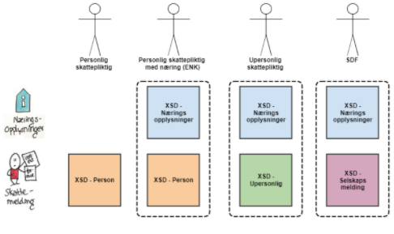
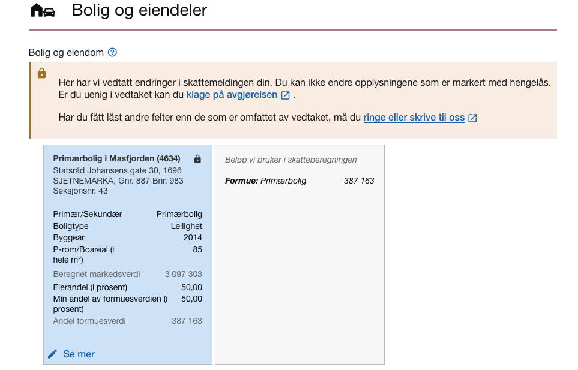

import TemaINaeringsspesifikasjonen from "../informasjonsmodeller/skattemeldingupersonlig/temaINaeringsspesifikasjonen.md";

<Summary>Tjenester for innrapportering av skattemeldingen for næringsdrivende fra sluttbrukersystemer</Summary>

<Tabs underline={true}>
<TabItem headerText="Om tjenesten" itemKey="itemKey-1" default>

Denne siden inneholder funksjonell og teknisk dokumentasjon for hvordan innrapportering av
skattemelding med eventuell næringsspesifikasjon for personlige og upersonlige skattepliktige skal leveres fra sluttbrukersystem.
Den primære målgruppen er systemleverandører av årsoppgjørsprogram eller regnskapssystem for
innrapportering av skattemeldingen og næringsopplysninger. Slike systemer kalles heretter
sluttbrukersystemer (SBS).

Løsningen legger opp til at en innsending skal inneholde en skattemelding. For personlige som driver ENK, upersonlige (selskaper) og for selskaper
med deltakerfastsetting skal innsendingen også __alltid__ inneholde næringsspesifikasjon. Det er kun lønnstakere og pensjonister som kun sender inn
skattemelding. Dette illustreres her:


<br></br> _Illustrasjon av skattemeldingsvarianter for personlige og upersonlige skattepliktige._

For generell informasjon om tjenestene se egne sider om:

* [Bruk av tjenestene](../om/bruk.md)
* [Sikkerhetsmekanismer](../om/sikkerhet.md)
* [Systembruker](../om/systembruker.md)
* [Feilhåndtering](../om/feil.md)
* [Versjonering](../om/versjoner.md)
* [Teknisk spesifikasjon](../om/tekniskspesifikasjon.md)

For informasjon og oppdateringer for systemleverandører med integrasjon mot skattemeldingen for person og næring, se våre [fellessider for systemleverandører](https://www.skatteetaten.no/samarbeidspartnere/sluttbrukersystemer/skattemelding-sbs/).

Dokumentasjonen for innsending av skattemeldingen ligger foreløpig på [en egen Github-side](https://github.com/Skatteetaten/skattemeldingen).
API-ene for innsending vil tilgjengeliggjøres som OpenAPI-spesifikasjoner på SwaggerHub. Dette er ikke enda klart.

Det tilbys to sett med API-er:

- Skatteetatens API: har tjenester for henting- og validering av skattemeldinger, eiendomskalkulator, hent vedlegg og
  foreløpig avregning.
- Altinn3 API: har tjenester for opprettelse og innsending av en skattemelding.

## Ordliste
| Begrep | Beskrivelse                                                                                                |
|--------|------------------------------------------------------------------------------------------------------------|
| SBS    | Sluttbrukersystem                                                                                          |
| SDF    | Selskap med deltakerfastsetting                                                                            |
| SERG   | Betegnelse på Eiendomsregisteret                                                                           |
| SME    | Skattemelding, modernisert versjon. (benyttes oftest om publikumssiden for innlevering av skattemeldingen) |
| SMIA   | Skattemelding interne arbeidsflate (nytt saksbehandlingssystem 2020)                                       |

## Tilgang til API-et
Når en skattepliktig skal benytte et sluttbrukersystem for å sende inn skattemeldingen og næringsopplysninger gjennom
API må sluttbrukeren og/eller sluttbrukersystemet være autentisert og autorisert gjennom en påloggingsprosess.

Ved kall til skattemelding-API ønsker Skatteetaten å kjenne til identiteten til innsender. Identiteten til pålogget
bruker, kombinert med informasjon fra Altinn autorisasjon vil avgjøre hvilken person/selskap en pålogget bruker kan
hente skattemeldingen til eller sende inn skattemelding for.

Autentisering skjer enten via ID-porten eller Maskinporten:

- Personlig innlogging vil skje via ID-porten med bruk av sluttbrukerens eget personnummer.
- Systemer/maskiner som ønsker å opptre på vegne av en organisasjon kan autentisere seg via Maskinporten.

For mer informasjon om autentisering og autorisasjon, se [Sikkerhet](../om/sikkerhet.md).

### Tilgang til Altinn3 App API
For tilgang til Altinn3-tjenestene må man ha en systembruker. Du kan lese mer om systembruker og hvordan systemet ditt kan ta det i bruk under [Systembruker](../om/systembruker.md).

Access-tokenet systembrukeren har mottatt fra Maskinporten må veksles til et Altinn-token for å autentisere seg mot Altinn3 API-et for innsending av skattemeldingen.
Mer informasjon om veksling av Maskinporten-token til Altinn-token og generell dokumentasjon om Altinn3 API finnes på
[Altinns side for autentisering med ID-Porten](https://docs.altinn.studio/nb/authorization/getting-started/authentication/id-porten/).
En mer teknisk dokumentasjon finnes i [Altinns API-dokumentasjon](https://docs.altinn.studio/nb/api/scenarios/authentication/).

### Scope
#### Skatteetaten API
Følgende scopes med respektive maks-levetider skal benyttes ved autentisering i Maskinporten mot Skatteetatens API-er:

| Scope                                            | Beskrivelse                                                                                  | Levetid access-token | Levetid refresh-token |
|--------------------------------------------------|----------------------------------------------------------------------------------------------|----------------------|-----------------------|
| skatteetaten:formueinntekt/skattemelding         | Tilgang til skattemeldingstjenester                                                          | 8 timer              | 90 dager              |
| skatteetaten:formueinntekt/skattemelding/eiendom | Tilgang til eiendomstjenester                                                                | 8 timer              | 90 dager              |
| app_skd_formueinntekt-skattemelding-v2           | Ressursen systembrukeren må ha for kontrollere rettighetspakker. Brukes også for Altinn3 API |

:::info
Scopet med den korteste levetiden vil være gjeldende for hele access-tokenet.
Vi anbefaler å begrense levetiden på access-tokenet ytterligere, og heller ta i bruk refresh-token.
:::

#### Altinn3 API
For Altinn3 benyttes en systembruker som beskrevet tidligere. Ressursen krever egne scopes mot Altinn3-appen.
Disse er listet opp i tabellen under:

| Scope                                  | Beskrivelse                                                                                         |
|----------------------------------------|-----------------------------------------------------------------------------------------------------|
| app_skd_formueinntekt-skattemelding-v2 | Ressursen systembrukeren må ha for å bli autorisert er å hente og sende inn innhold i Altinn3-appen |
| altinn:instances.read                  | Scope Altinn krever for å hente innhold i Altinn3-appen fra sluttbrukersystem                       |
| altinn:instances.write                 | Scope Altinn krever for å sende inn innhold i Altinn3-appen fra sluttbrukersystem                   |

For å se maksimal levetid til Altinn sine scopes, finner man oversikt over disse på [DigDir Scopes - Altinn dokumentasjon](https://docs.altinn.studio/nb/api/authentication/digdirscopes/).

### Rettighetspakker
Hvilke data en virksomhet får tilgang til i API-et bestemmes av [rettighetspakken](../om/rettighetspakker.md).

Skatteetaten har laget en selvbetjeningsløsning som gir virksomheter [innsyn i egne rettighetspakker](https://rettighetspakke-innsyn.skatteetaten.no/),
og lister derfor ikke lengre rettighetspakkene på Github. Se egen dokumentasjon om [hvordan logge inn](https://skatteetaten.github.io/api-dokumentasjon/anvendelsesomraader/deling-skatteetaten#innsyn-i-rettighetspakker).

### Skatteetaten må gi tilgang
For å kunne bruke API-ene må Skatteetaten gi din virksomhet tilgang.
[Bestill tilgang til API-et](https://www.skatteetaten.no/samarbeidspartnere/sluttbrukersystemer/skattemelding-sbs/#trenger-du-hjelp)

## Teknisk spesifikasjon
Følgende figur gir en en overordnet flyt med aktører og komponenter for innsending av skattemelding med næringsspesifikasjon:

[](../../static/download/skattemeldingupersonlig/Komponentoversikt%20skattemelding%20næring%20for%20SBS.png)

Som det fremkommer av figuren kan skattemeldingen med tilhørende næringsspesifikasjon sendes inn som _komplett_ eller _ikke-komplett_.
* Ved __komplett innsending__ sendes ferdig utfylt skattemelding og næringsspesifikasjon inn fra SBS og lagres hos Skatteetaten som <u>gjeldende fastsetting</u>.
* __Ikke-komplett innsending__ er kun støttet for personlig skattepliktige. SBS kan velge å la den skattepliktige fylle ut deler av personlig skattemelding,
  eller å kun støtte næringsspesifikasjon, og la den den skattepliktige fullføre innsending av skattemelding i Skatteetatens portalløsning (SME).
  Det er ikke mulig å kun sende inn næringsspesifikasjon, så om SBS kun skal støtte innsending av næringsspesifikasjon
  må det gjeldende utkastet til skattemelding hentes ut som beskrevet lenger nede og sendes inn sammen med næringsspesifikasjonen
  slik at den skattepliktige kan fylle inn dette selv i Skatteetatens portal.

Næringsspesifikasjonen kan ikke redigeres. Skal næringsspesifikasjon endres, må denne sendes inn på nytt fra SBS.

Det er fire hovedstrategier for hvordan man integrerer seg mot Skatteetatens tjenester for innsending av skattemelding og næringsspesifikasjon.
Dette er ikke en uttømmende liste, men representerer de mest vanlige scenariene:

#### Komplett innsending med full beregningsimplementasjon:
SBS implementerer alle beregninger som Skatteetaten gjør i valideringstjenesten, og sender inn skattemelding og næringsspesifikasjon som komplett.

#### Komplett innsending med integrert valideringstjeneste:
SBS integrerer valideringstjenesten i sitt sluttbrukersystem, og sender inn skattemelding og næringsspesifikasjon som komplett.

#### Ikke-komplett innsending med beregningsstøtte kun for næringsspesifikasjon:
SBS implementerer kun støtte for beregning av næringsspesifikasjon, og sender inn utkast til skattemelding fra Skatteetaten uten endringer.

#### Ikke-komplett innsending med integrert valideringstjeneste kun for næringsspesifikasjon:
SBS integrerer valideringstjenesten kun for næringsspesifikasjon, og sender inn utkast til skattemelding fra Skatteetaten uten endringer.

De påfølgende kapitlene beskriver funksjonell flyt fra et sluttbrukersystems perspektiv for en _komplett innsending med integrert valideringstjeneste_.
For en overordnet beskrivelse av noen sentrale konsepter i flyten, er [Skattemelding for selskap](https://www.skatteetaten.no/bedrift-og-organisasjon/skatt/skattemelding-naringsdrivende/selskap/)
nyttig bakgrunnsinformasjon.

### 1. Hent gjeldende skattemelding
Første steg i innsendingsprosessen er å hente ut den siste gjeldende skattemeldingen. Denne kan ha status utkast eller fastsatt:

* Utkast er en preutfylt skattemelding Skatteetaten har laget for den skattepliktige basert på innrapporterte data og data fra skattemeldingen tidligere år.
* Fastsatt betyr at skattemeldingen er manuelt innlevert eller automatisk innlevert ved utløp av innleveringsfrist. Denne kan også inneholde et eller flere myndighetsfastsatte felter. For mer informasjon om myndighetsfastsatte felter se avsnittet under valider skattemeldingen.

Tjenesten som benyttes for å hente ut den siste gjeldende skattemeldingen er `GET /api/skattemelding/v2/{inntektsår}/{identifikator}`.

XSD-filen for responsobjektet til tjenesten er `skattemeldingognaeringsspesifikasjonforespoerselresponse_{versjon}.xsd`,
og er dokumentert i <span style={{ color: "red" }}> [OpenAPI-spesifikasjonen] til tjenesten. </span>
De Base64-encodede dokumentene i konvolutten til responsobjektet er nærmere beskrevet i [fanen Informasjonsmodell](#informasjonsmodell-hent-gjeldende-skattemelding).

#### 1.1 Utvidet veiledning
Det er mulig å etterspørre eventuelle ubesvarte utvidede veiledninger som del av dette API-et.

En utvidet veiledning representerer opplysninger som Skatteetaten har om skatteyter som muligens burde vært oppgitt i skattmeldingen, men som ikke er det.
Disse opplysningene er gjerne ikke fullstendige, og kan derfor ikke forhåndsutfylles.
Opplysningene vil trolig heller ikke validere mot valideringstjenesten senere i prosessen uten å ha blitt besvart.

Bare "ubesvarte" utvidede veiledninger returneres i responsen. En veiledning kan besvares på to måter:
* Gjennom Skatteetatens innleveringsportal for personlige skatteytere, der de kan velge å avvise eller legge til opplysningene.
* Ved innsending av `komplett` skattemelding fra et sluttbrukersystem. Når en slik innsending er fullført og fører til fastsetting, vil alle ubesvarte veiledninger _på fastsettingstidspunktet_ bli besvart som at de er "hentet av SBS".
  * Siden nye utvidede veiledninger kan oppstå fortløpende, så finnes det en risiko for at det har kommet nye mellom tidspunktet hvor SBS henter veiledningene og fastsetting utføres. Det er derfor en risiko for at veiledninger som ikke har blitt hentet av SBSen og fremvist bruker blir besvart som det.

For å etterspørre utvidet veiledning, sendes query-parameteren `ìnkluderUtvidetVeiledning=true` med i kallet til `GET /api/skattemelding/v2/{inntektsaar}/{identifikator}`.
Parameteren støttes fra inntektsår 2022. Hvis request-parameteren sendes med for tidligere år vil den ignoreres.

Normalt inneholder dokumentet i responsen informasjon som tilsvarer én entitet i skattemeldingen.
I de tilfeller det er flere foreslår i praksis Skatteetaten at én av entitetene skal legges til, ikke alle.

#### 1.2 Låste felter
Skatteetaten har muligheten til å låse enkeltfelter eller hele skattemeldingen og/eller næringsspesifikasjonen.
Dette vil kun forekomme på en fastsatt skattemelding, og aldri utkast.

Responsen til hent gjeldende skattemelding vil inneholde en liste over eventuelle låste felter for en fastsatt skattemelding.
Dette er nærmere beskrevet i [fanen Informasjonsmodell](#låste-felt).

### 2. Søk etter eiendomsinformasjon, hent formuesgrunnlag og beregn markedsverdi
Skatteetaten har utviklet egne tjenester for å hente eiendomsinformasjon og formuesgrunnlag fra Eiendomsregisteret, og beregne korrekt markedsverdi.
Eiendomsdataene som hentes ut og beregnes sendes inn til valideringstjenesten og senere som en del av skattemeldingen for at Skatteetaten skal få beregnet korrekt formuesverdi for eiendommene.
Valideringstjenesten beregner og returnerer også formuesverdien for hele eiendommene, formuesverdien for den skattepliktiges formuesandel av
eiendommene, og verdi før verdsettingsrabatt for den skattepliktiges formuesandel av eiendommene. Dette er verdier som skal benyttes ved innsending av skattemeldingen.

Eiendomsopplysninger preutfylles for personlige skattepliktige, men må fastsettes for upersonlige.

#### 2.1 Søk etter eiendom
Søketjenesten brukes til å identifisere brukerens eiendommer som skal inngå i skattemeldingen.
Tjenesten fungerer som inngangsport til de øvrige eiendomstjenestene, og leverer en eiendomsidentifikator som brukes videre i prosessen.
Det er mulig å søke på alle norske veiadresser, matrikkelnummer og <span style={{ color: "red" }}>boligselskap</span>.

Bruk endepunktet `/api/skattemelding/v2/eiendom/soek/v2/{inntektsår}?query={query}&resultSize={resultSize}`.

Følgende forretningsregler gjelder for `query`-parameteren:
* `Hvis første tegn man angir er et tall vil søket kun lete blant matrikkeladresser.`
* `Hvis første tegn man angir er en bokstav vil søket kun lete blant veiadresser.`
* `Søket krever streng plassering av tegn.`

#### 2.2 Hent formuesgrunnlag
Formuesgrunnlag hentes ut for hver eiendom som skal inngå i skattemeldingen. Eiendomsidentifikatoren fra søketjenesten brukes til å identifisere eiendommene.
Tjenesten henter ut ulik informasjon basert på hvilken eiendomstype eiendomsidentifikator har, samt inntektsåret det søkes for.
Noen detaljer vil fjernes fra responsen hvis skatteyter ikke er eier av eiendommen.

Eiendomstypen bestemmer også om det skal beregnes markedsverdi, ev. utleieverdi, før validering og innsending av skattemeldingen.
For følgende eiendomstyper skal det beregnes markedsverdi gjennom tjenestene beskrevet i neste avsnitt:

| Eiendomstype               | Feltnavn i API-et                 |
|----------------------------|-----------------------------------|
| Selveid bolig              | `selveidBolig`                    |
| Boenhet i boligselskap     | `boenhetIBoligselskap`            |
| Flerboligbygning           | `flerboligbygning`                |
| Ikke utleid næringseiendom | `ikkeUtleidNaeringseiendomINorge` |

Bruk endepunktet `/api/skattemelding/v2/eiendom/formuesgrunnlag/{inntektsår}/{eiendomsidentifikator}/{identifikator}`.
`eiendomsIdentifikator` er `SERG eiendomsidentifikator` for eiendommen fra søketjenesten.

#### 2.3 Beregning av markedsverdi/utleieverdi
Det er tre tjenester som benyttes for å beregne markedsverdi for eiendommer basert på eiendomstype:
* Selveid bolig, boenhet i boligselskap: tjenesten for beregning av markedsverdi for bolig
* Flerboligbygning: tjenesten for å beregne markedsverdi for flerbolig
* Ikke utleid næringseiendom: tjenesten for beregning av utleieverdi for næringseiendom
* For andre eiendomstyper gjør valideringstjenesten nødvendige beregninger for å fastsette formuesverdien, og det er ikke nødvendig å kalle tjenestene for beregning av markedsverdi.

For de ovennevnte eiendomstypene det skal beregnes markedsverdi/utleieverdi for, sendes formuesgrunnlaget fra den foregående tjenesten som input til tjenesten.
Sender man inn hele responsen fra hent formuesgrunnlag vil responsen til beregningen innholde alt som ble sendt inn pluss de beregnede feltene.

Det er også er mulig å oppgi dokumentert markedsverdi.
<span style={{ color: "red" }}> Hvis det oppgis dokumentert markedsverdi for en ny bolig, må det vedlegges dokumentasjon. Opplasting av vedlegg skjer i en egen Altinn3-tjeneste.
For eksisterende boliger er ikke vedlegg påkrevd.</span>
Ugyldig dokumentert markedsverdi i forhold til klagegrense vil ikke hensyntas.
Om dokumentert markedsverdi har blitt hensyntatt vil responsen fra beregningstjenesten inkludere feltet `justertMarkedsverdi`.
Mer informasjon om klage finnes på [Klage til Skatteetaten](https://www.skatteetaten.no/kontakt/klage/).

#### 2.3.1 Beregning av markedsverdi for bolig
Beregningen er basert på sjablong fra SSB hvor boligegenskaper og inntektsår inngår i beregningen.

Endepunktet `/api/skattemelding/v2/eiendom/markedsverdi/bolig/{inntektsår}/{eiendomsidentifikator}` benyttes for å beregne markedsverdi for bolig.
Feltet `beregnetMarkedsverdiForBolig` i responsen er den beregnede markedsverdien for boligen.

Skal det sendes med dokumentert markedsverdi for boligen, sendes feltet `dokumentertMarkedsverdiForBolig` med i request-objektet.

#### 2.3.2 Beregning av markedsverdi for flerbolig
Beregningen er basert på sjablong fra SSB hvor boligegenskaper og inntektsår inngår i beregningen.
Spesielt for flerboligbygning er at det også beregnes markedsverdi for hver useksjonerte boenhet. Denne beregningen gjøres uavhengig av om dokumentert markedsverdi er oppgitt for bygningen.

Endepunktet `/api/skattemelding/v2/eiendom/markedsverdi/flerbolig/{inntektsår}/{eiendomsidentifikator}` benyttes for å beregne markedsverdi for flerbolig og useksjonerte boenheter.
I responsen returneres feltene `beregnetMarkedsverdiForFlerboligbygning` for hele boligen, og `boligverdi` for hver useksjonerte boenhet.

Skal det sendes med dokumentert markedsverdi for flerboligbygning, sendes feltet `dokumentertMarkedsverdiForFlerboligbygning` med i request-objektet sammen med `aarForMottattMarkedsverdiForFlerboligbygning`.

#### 2.3.2 Beregning av utleieverdi for næringseiendom
Beregningen er basert på næringssjablong fra SSB hvor næringstype, areal, bystatus, sentralitet og skatteleggingsperiode inngår i beregningen.

Endepunktet `/api/skattemelding/v2/eiendom/utleieverdi/{inntektsår}/{eiendomsidentifikator}` benyttes for å beregne utleieverdi for næringseiendom.
<span style={{ color: "red" }}> I responsen returneres feltene `beregnetUtleieverdiForIkkeUtleidNaeringseiendomINorge` for hele boligen, og `utleieverdiFraSerg`.</span>

Skal det sendes med dokumentert utleieverdi for næringseiendom, sendes feltet `dokumentertMarkedsverdiForIkkeUtleidNaeringseiendomINorge` med i request-objektet.

### 3. Valideringstjenesten
Før innsending av skattemelding med næringsspesifikasjon, <span style={{ color: "red" }}>bør</span> innsendingen valideres ved bruk av valideringstjenesten for å sikre at skattemeldingen er korrekt og mest sannsynligvis vil bli godkjent ved innsending.
Samme tjeneste benyttes av Skatteetatens mottak ved validering av innsendt skattemelding. Som beskervet i de fire hovedstrategiene for implementasjon, kan SBS velge å implementere alle beregninger selv, eller integrere valideringstjenesten i sitt system.

:::tip[Lagring av valideringsdata]
Skatteetaten vil ikke lagre eller følge opp informasjonen som sendes inn i valideringstjenesten på noen måte. Skatteetaten anser disse dataene som eid av den skattepliktige og ikke av Skatteetaten.
:::

Valideringen utfører følgende steg:
1. Kontroll av XML-meldingsformatet for skattemeldingen og næringsspesifikasjon mot de tilhørende XSD-ene
2. Utføring av alle relevante beregninger for å finne Skatteetatens versjon av de kalkulerte verdiene.
   Beregningene hensyntar også ektefelle.
3. Sammenligning av Skatteetatens kalkulerte verdier mot de innsendte kalkulerte verdiene
4. Validering av andre forretningsregler som ikke gjelder kalkyler
5. Tilbakemelding som inneholder:
<br/>  a. Skatteetatens skattemelding etter å ha kjørt interne beregninger
<br/>  b. Skatteetatens næringsspesifikasjon etter å ha kjørt interne beregninger
<br/>  c. Foreløpig beregnet skatt
<br/>  d. Summert skattegrunnlag for visning (nivå av inntekt, fradrag, formue, gjeld)
          Dette er de samme tallene som ligger i skatteoppgjøret for personlig skattepliktige som underlag for å kunne forstå grunnlagene i beregnet skatt
<br/>  e. Alle avvik som ble funnet på beregninger gruppert etter summer hvor det er avvik og summer Skatteetaten har beregnet hvor SBS ikke sendte inn noen verdi
<br/>  f. Kontrollutslag på kontroller av innsendte oppgaver (noen obligatoriske, andre til info)
<br/>  g. Valideringsresultat og eventuelle avvisningsårsaker
<br/>  h. Sentrale elementer fra skattesubjektet benyttet i skatteberegningen

:::info[Foreløpig skatteberegning]
Merk at skatteberegningen kun er en foreløpig beregning. Den endelige skatteberegningen utføres i skatteoppgjøret.
:::

Validering kan gjøres løpende etter hvert som sluttbruker fyller inn informasjon, eller som én samlet validering før innsending.
Dette avhenger av flyten i sluttbrukersystemet.

Endepunktet som benyttes for validering er `/api/skattemelding/v2/valider/{inntektsår}/{identifikator}`.

XSD-en for requestobjektet til tjenesten er `skattemeldingognaeringsspesifikasjonrequest_{versjon}.xsd`,
og XSD til responsobjektet er `skattemeldingognaeringsspesifikasjonresponse_{versjon}.xsd`.
Disse er dokumentert i <span style={{ color: "red" }}> [OpenAPI-spesifikasjonen] til tjenesten. </span>
XSD-ene er nærmere beskrevet i [Informasjonsmodell for validering og innsending av skattemelding med næringsspesifikasjon](#informasjonsmodell-for-validering-og-innsending-av-skattemelding-med-næringsspesifikasjon)

#### 3.1 Kontrollutslag på kontroller av innsendte oppgaver
I forbindelse med validering kjøres kontroller som er satt opp til å kjøres eksternt <span style={{ color: "red" }}>(med ekstern, menes da SMIA ref. api-v2 README?) </span>. Kontroller som kjøres eksternt er benevnt som veiledning.
Alle veiledningsforekomster har en betjeningsstrategi som returneres i responsdokumentet. Noen få av disse hindrer innsending, de fleste ikke.

Objektet `veiledningEtterKontroll` i responsen til valideringstjenesten inneholder en liste med veiledningsforekomster som er funnet under valideringen.
Objektet inneholder betjeningsstrategi og tekstlig gjengivelse av veiledningen.
Disse er nærmere beskrevet i fanen [__Informasjonsmodell__](#årsrevisjon-av-spesifikasjonene).

#### 3.2 Valideringsresultat og eventuelle avvisningsårsaker
Valideringstjenesten vil inneholde eget felt som viser valideringsresultatet, slik at man før innsending kan se om innsendt skattemelding med
næringsspesifikasjon vil bli avvist eller ikke.

Feltet `resultatAvValidering` i responsen vil returnere `validertOK` om innsendingen ikke inneholder feil som vil medføre avvisning,
eller `validertMedFeil` om innsending vil medføre at skattemeldingen med næringsspesifikasjon blir avvist.

I tillegg returneres `aarsakTilValidertMedFeil` hvis valideringsresultatet er ´validertMedFeil´, gir en tekstkode for feilårsaken.
`avvikVedValidering` returnerer en liste med alle avvik som ble funnet under valideringen.

#### 3.4 Avrundingsregler
For å unngå avvik i beregnede beløp må SBS og Skatteetatens valideringstjeneste benytte de samme prinsippene for avrunding av beløp.

* 2 desimaler er tillatt for opplysningene i XML for næringsspesifikasjon.
* Bruk av desimaler for opplysninger i XML for skattemelding tillates ikke.
* Alle beløp i XML for næringsspesifikasjon som skal overføres til XML for skattemelding skal avrundes til nærmeste kronebeløp iht. de alminnelige avrundingsreglene:
  * Ørebeløp som ender på 1 - 49 øre rundes ned til nærmeste kronebeløp.
  * Ørebeløp som ender på 50 - 99 øre rundes opp til nærmeste kronebeløp.

Bruk av desimaler for opplysninger i XML for skattemelding tillates ikke fordi det vil kunne skape utfordringer når summene skal
sendes videre til skatteberegning.

#### 3.5 Validering av låste felter
Ved validering av skattemelding som inneholder endringer på et felt som er låst vil følgende valideringsresultat returneres: `KanIkkeOverskriveMyndighetsfastsattVerdi` eller `KanIkkeSletteMyndighetsfastsattVerdi`
Dette skyldes at en forekomst som har blitt låst har blitt endret eller slettet.


<br/>_Eksempel på låst felt i SME_.

### 4. Innsending av skattemelding med næringsspesifikasjon i Altinn3 App API
Resten av prosessen for innsending av skattemelding med næringsspesifikasjon skjer ved bruk av Altinn3.
Skatteetaten har opprettet en egen app i Altinn3 som håndterer innsendingen av skattemeldingen med næringsspesifikasjon,
opplasting av vedlegg, signering av skattepliktig og eventuell revisor, og å hente ut kvittering på innsendt skattemelding i ettertid.

Det er mulig å følge prosessen for innsending via en oppgave i innboksen i Altinn, og få opp en forenklet visningsklient
som lar sluttbrukerne se innholdet i XML-dokumentene som er lastet opp på Altinn-instansen i et lesbart format.
Signering av den skattepliktige og eventuell revisor skjer også via klienten.
Etter at skattemeldingen er sendt inn vil det være mulig å hente ut innholdet som ble sendt inn via klienten.

Endepunkter med beskrivelse av parametre og respons ligger i [Open API-spesifikasjonen til Altinn3-appen](https://skd.apps.altinn.no/skd/formueinntekt-skattemelding-v2/swagger/index.html?urls.primaryName=End+user+app+API+for+skd%2Fformueinntekt-skattemelding-v2).
Denne genereres og administreres av Altinn basert på appen utviklet av Skatteetaten.

Autentisering mot Altinns API er beskrevet i [Tilgang til Altinn3 App API](#tilgang-til-altinn3-app-api) med referanse til detaljert dokumentasjon på Altinns sider.
Det er det innvekslede Altinn-tokenet som benyttes for å opprette instansen i Altinn3 og øvrige kall til Altinn3-API.

Diagrammet under viser den overordnede forretningsprosessen for innsending av skattemelding med næringsspesifikasjon via Altinn3-appen.

[
<br/>_Overordnet forretningsprosess for Altinn3-appen._.

#### 4.1 Opprettelse av instans i Altinn3
Første steg i innsendingen er å opprette en instans i Altinn3. En instans brukes av Altinn for å bevare tilstanden til innsendingen av skattemeldingen med næringsspesifikasjon, inklusirve alle dokumenter og vedlegg.
Detaljert dokumentasjon for hva en instans er og hvordan den brukes finnes i [Altinns API-dokumentasjon](https://docs.altinn.studio/nb/api/apps/instances/).
* `org` i Altinns dokumentasjon er `skd`
* `appname` er `formueinntekt-skattemelding-v2`.

Spesifikt for Skatteetatens app er at `ìnntektsaar` skattemeldingen gjelder for må spesifiseres ved opprettelse av intansen.

Når instansen er opprettet får den status `data`, og det er klart for å laste opp skattemeldingen med næringsspesifikasjon og eventuelle vedlegg.

##### 4.1.1. Revisors signering
Om det er forekomster som skal bekreftes av revisor, må også `skalBekreftesavRevisor` settes til `true` ved opprettelse av instansen.
Disse parameterne sendes inn i et `dataValues`-objekt som en del av requesten til Altinn3-API-et som vist i eksempelet under:

```
{
  "appId": "skd/formueinntekt-skattemelding-v2",
  "instanceOwner": { ... },
  "dataValues": 
    {
      "inntektsaar": 2023,
      "skalBekreftesavRevisor": true
    }
}
```

Hvilke forekomster i skattemeldingen og næringsspesifikasjonen som krever signatur av revisor er beskrevet i [Revisors plikter i forbindelse med signering av signaturpliktige opplysninger i næringsspesifikasjon og skattemelding.
](https://www.skatteetaten.no/rettskilder/type/skattedirektoratets-meldinger/revisors-plikter-i-forbindelse-med-signering-av-signaturpliktige-opplysninger-i-naringsspesifikasjon-og-skattemelding/).
Regnskapspliktige som ikke er revisjonspliktige kan også velge å engasjere en revisor. Feltet `skalBekreftesavRevisor` må da også settes til `true` ved opprettelse av instansen,
og revisor skal senere signere de signaturpliktige forekomstene som er angitt i skattemeldingen og næringsspesifikasjonen.

I kapittel [4.5 Sende videre til revisors signering](#45-sende-videre-til-revisors-signering) beskrives hvilken flyten ved signering av revisor.

#### 4.2 Laste opp vedlegg til skattemeldingen
Ved behov for å laste opp vedlegg gjøres dette etter at instansen er opprettet og før innsending av skattemeldingen.

Vedlegg til skattemeldingen lastes opp til instansen ved å benytte endepunktet [`POST /skd/formueinntekt-skattemelding-v2/instances/{instanceOwnerPartyId}/{instanceGuid}/data/type/skattemelding-vedlegg`](https://skd.apps.altinn.no/skd/formueinntekt-skattemelding-v2/swagger/index.html?urls.primaryName=End+user+app+API+for+skd%2Fformueinntekt-skattemelding-v2).
Tillatte vedleggstyper er PDF, JPEG, PNG og Excel (xlsx). Det er ikke mulig å laste opp andre filtyper, og må spesifiseres i `Content-Type`-headeren i requesten.
Filen som lastes opp må ha et filnavn som spesifiseres i `Content-Disposition`-headeren i requesten på formatet `attachment; filename={filnavn}`.

Når vedlegget er lastet opp på instansen må `id` hentes ut fra responsen og legges inn som en vedleggsreferanse i XML-objektet for skattemeldingen.
Det anbefales å sende skattemeldingsdokumentet til valideringstjenesten på nytt etter at dette har blitt oppdatert med vedleggsreferanser, for å sikre at alle vedleggene er korrekt referert i skattemeldingen.
En oversikt over vedleggstyper og hvordan disse legges til skattemeldingen i henhold til XSD er beskrevet i fanen __Informasjonsmodell__.

#### 4.3 Innsending av skattemelding med næringsspesifikasjon
Når de foregående stegene i prosessen er utført og skattemeldingen og næringsspesifikasjonen skal sendes videre til bekreftelse,
må skattemeldingensdokumentet for personlig, upersonlig eller selskapsmelding med næringsspesifikasjonen først lastes opp på instansen.

Dette gjøres ved å benytte endepunktet [`POST /skd/formueinntekt-skattemelding-v2/instances/{instanceOwnerPartyId}/{instanceGuid}/data/type/skattemeldingOgNaeringsspesifikasjon`](https://skd.apps.altinn.no/skd/formueinntekt-skattemelding-v2/swagger/index.html?urls.primaryName=End+user+app+API+for+skd%2Fformueinntekt-skattemelding-v2).

Dokumentenene skal lastes opp i henhold til XSD-filen `skattemeldingognaeringsspesifikasjonrequest_{versjon}.xsd`.
Dette er samme format som benyttes i valideringstjenesten.

Filnavnet som spesifiseres i `Content-Disposition` skal være `attachment; filename=skattemelding.xml` __uten double quotes__.

Responsen vil inneholde metadata om objektet som ble opprettet.
<span style={{ color: "red" }}>En unik identifikator (id) vil bli returnert som senere kan brukes til å oppdatere, sjekke status etc..</span>

#### 4.4 Sende skattemeldingen til signering
Når skattemeldingen med næringsspesifikasjon er lastet opp på instansen, og eventuelle vedlegg er lastet opp, kan skattemeldingen sendes til signering.
Dette gjøres ved å benytte endepunktet [`PUT /skd/formueinntekt-skattemelding-v2/instances/{instanceOwnerPartyId}/{instanceGuid}/process/next`](https://skd.apps.altinn.no/skd/formueinntekt-skattemelding-v2/swagger/index.html?urls.primaryName=End+user+app+API+for+skd%2Fformueinntekt-skattemelding-v2).
Dette setter instansen i status `confirmation`.

Når prosessen har blitt sendt til signering, vil den skattepliktige få tilgang til å se gjennom og signere skattemeldingen med næringsspesifikasjon
gjennom Skatteetatens visningsklient. Visningsklienten er tilgjengelig på URL `https://skatt.skatteetaten.no/web/skattemelding-visning/altinn?appId=skd/formueinntekt-skattemelding-v2&instansId={instanceGuid}`
slik at SBS kan lenke direkte til klienten, eller via innboksen i Altinn.

Hele signeringsprosessen kan håndteres direkte fra SBS uten å gå via Altinn eller visningsklienten.

##### 4.5 Sende videre til revisors signering
Hvis det er spesifisert i instansen at forekomster i skattemeldingen eller næringsspesifikasjonen skal signeres av revisor,
vil instansen etter at den skattepliktige har signert gå videre til revisors signering. Hvis den skattepliktige har signert
i visningsklienten vil denne håndtere endring av status til revisors signering.
Hvis SBS håndterer signeringen direkte, må SBS selv endre status til revisors signering etter at den skattepliktige har signert
ved å benytte endepunktet [`PUT /skd/formueinntekt-skattemelding-v2/instances/{instanceOwnerPartyId}/{instanceGuid}/process/next`](https://skd.apps.altinn.no/skd/formueinntekt-skattemelding-v2/swagger/index.html?urls.primaryName=End+user+app+API+for+skd%2Fformueinntekt-skattemelding-v2).
Instansen vil fortsatt være i status `confirmation`, men instansen inneholder også en separat _task_ som vil endres til _Task\_2Revisor_ når revisor skal signere.

Revisor signerer på samme måte som den skattepliktige som beskrevet i [kapittel 5.4](#54-sende-skattemeldingen-til-signering),
enten via visningsklienten eller direkte fra SBS.

##### 4.5.1 Revisors vedlegg
Det kan være tilfeller hvor revisor har behov for å laste opp vedlegg i forbindelse med revisjonen.
Dette kan eksempelvis være hvis revisor avslår en forekomst i skattemeldingen eller næringsspesifikasjonen.

Ved opplasting av vedlegg fra revisor benyttes endepunktet [`POST /skd/formueinntekt-skattemelding-v2/instances/{instanceOwnerPartyId}/{instanceGuid}/data/type/revisor-vedlegg`](https://skd.apps.altinn.no/skd/formueinntekt-skattemelding-v2/swagger/index.html?urls.primaryName=End+user+app+API+for+skd%2Fformueinntekt-skattemelding-v2).
`id`-feltet i responsen til opplastingen av vedlegget må legges inn i XML-dokumentet for revisors bekreftelse som er beskrevet under.
Oversikt over vedleggstyper er beskrevet i fanen __Informasjonsmodell__.

##### 4.5.2 Revisors bekreftelse
Revisors bekreftelse er en egen XSD-fil som skal lastes opp på instansen etter at revisor har signert.
Ved signering i visningsklienten er det ikke behov for å laste opp revisors bekreftelse, da visningsklienten håndterer dette.

XSD-filen for revisors bekreftelse er `revisorsbekreftelse_{versjon}_ekstern.xsd`.
For hvert av elementene som revisor signerer på, skal det opprettes et bekreftelseselement i henhold til XSD-en.
Denne må inneholde om revisor bekrefter eller ikke, samt referanser til informasjonselementet og forekomsten i skattemeldingen eller næringsspesifikasjonen som revisor signerer på.
XSD-en beskrives nærmere i fanen __Informasjonsmodell__.

Når revisor har godkjent/avslått de aktuelle forekomstene og XML-dokumentet er utfylt av SBS  med eventuelle vedleggsreferanser,
skal dette lastes opp på instansen ved å benytte endepunktet
[`POST /skd/formueinntekt-skattemelding-v2/instances/{instanceOwnerPartyId}/{instanceGuid}/data/type/revisor-bekreftelse`](https://skd.apps.altinn.no/skd/formueinntekt-skattemelding-v2/swagger/index.html?urls.primaryName=End+user+app+API+for+skd%2Fformueinntekt-skattemelding-v2).

#### 5.6 Innsending av skattemelding med næringsspesifikasjon til Skatteetaten
Når både den skattepliktige og eventuell revisor har signert, kan skattemeldingen med næringsspesifikasjon sendes videre til behandling hos Skatteetaten.
Dette trigges av nok et kall til [`PUT /skd/formueinntekt-skattemelding-v2/instances/{instanceOwnerPartyId}/{instanceGuid}/process/next`](https://skd.apps.altinn.no/skd/formueinntekt-skattemelding-v2/swagger/index.html?urls.primaryName=End+user+app+API+for+skd%2Fformueinntekt-skattemelding-v2).
Instansen vil da settes til status `feedback`.

#### 5.7 Opprettelse av gjeldende fastsetting og kvittering på innsendt skattemelding
:::danger
Denne må oppdateres med ny flyt for arkivering når denne er klar
:::

Etter at Skatteetaten har mottatt skattemeldingen med næringsspesifikasjon vil det sendes en kvittering i XML-format tilbake til Altinn3-appen.
Denne kan hentes ut på følgende måte:
1. Hent ut instansdata fra endepunktet [`GET /skd/formueinntekt-skattemelding-v2/instances/{instanceOwnerPartyId}/{instanceGuid}`](https://skd.apps.altinn.no/skd/formueinntekt-skattemelding-v2/swagger/index.html?urls.primaryName=End+user+app+API+for+skd%2Fformueinntekt-skattemelding-v2).
2. Hent ut `id`-feltet fra vedlegget `tilbakemelding` i responsen, og send denne i `dataGuid`-parameteren i endepunktet
[`GET /skd/formueinntekt-skattemelding-v2/instances/{instanceOwnerPartyId}/{instanceGuid}/data/{dataGuid}/type/tilbakemelding`](https://skd.apps.altinn.no/skd/formueinntekt-skattemelding-v2/swagger/index.html?urls.primaryName=End+user+app+API+for+skd%2Fformueinntekt-skattemelding-v2).

Når Skatteetaten har ferdigbehandlet innsendingen, vil instansen i Altinn3-appen bli satt til status `arkivert`.
Dette er ensbetydende med at det er opprettet _gjeldende fastsetting_ for skattemeldingen.
* Hvis SBS har sendt inn en komplett skattemelding og den er validert OK, vil Altinn3-instansen bli satt til `arkivert` direkte ved innsending fra SBS.
* Hvis SBS har sendt inn en ikke-komplett skattemelding, vil Altinn3-instansen bli ha status `feedback` inntil den skattepliktige har sendt inn i SME.
* Hvis skattemeldingen er validert til _Ikke OK_, blir status satt til `arkivert` direkte med melding om resultatet uavhengig av om den er komplett eller ikke-komplett.

Skatteetaten oppdaterer innboksen i Altinn med oppdatert status på innsendingen.

### Valgfrie tilleggstjenester
Nedenfor dokumenteres tjenester som er utviklet basret på behov fra sluttbrukersystemer, men som ikke er en del av den obligatoriske flyten for innsending av skattemeldingen.

#### Hent gjeldende skattemelding for gitt type
I noen tilfeller er det ønskelig å hente ut den siste gjeldende skattemeldingen for en gitt type, f.eks. for å hente ut siste gjeldende utkast av skattemeldingen etter fastsettelse.

Endepunktet som benyttes til dette er `GET /api/skattemelding/v2/{type}/{inntektsår}/{identifikator}`, hvor `type` kan være `utkast` eller `fastsatt`.

#### Valider skattemeldingen uten dokumentreferanseTilGjeldendeDokument
:::warning[Denne tjenesten erstatter ikke valideringstjenesten for innsending]
:::

Hvis det er et behov for å gjøre beregninger fra SBS før Skatteetaten har publisert utkast for et inntektsår, kan denne tjenesten benyttes.
Den er helt lik som valideringstjenesten, men krever ikke `dokumentreferanseTilGjeldendeDokument`.

Denne tjenesten skal ikke brukes for validering før innsending, da vi har en del kontroller som sjekker mot gjeldende utkast som denne tjenesten ikke utfører.

Endepunktet for denne tjenesten er `POST /api/skattemelding/v2/validertest/{inntektsår}/{identifikator}`

### Forleøpig avregning
Det er laget en egen tjeneste for å kunne gjøre en foreløpig avregning basert på den beregnede skatten man sender inn til komponenten.
Endelig avregning i forbindelse med skatteoppgjøret kan gi et annet avregningsresultat enn ved foreløpig avregning.

Tjenesten tar ikke høyde for eventuelte tidligere skatteoppgjør for aktuelt inntektsår.
Hvis skattyter har et skatteoppgjør og fått utbetalt tilgode, og skal gjøre en endring, så vil denne tjenesten avregne som om det var første skatteoppgjør.

Endepunktet som benyttes er `POST /api/skattemelding/v2/avregning/avregn/{inntektsaar}/{identifikator}`,
og er dokumentert i <span style={{ color: "red" }}> [OpenAPI-spesifikasjonen] til tjenesten. </span>

</TabItem>

<TabItem headerText="Informasjonsmodell" itemKey="itemKey-2">

Skattemeldingen og næringsopplysninger skal leveres som XML-filer. Innhold og format på XML-filene er spesifisert gjennom XML Schema Definition, XSD.

Følgende informasjonsmodeller skal brukes for fastsetting:
* skattemelding for formues- og inntektsskatt for personlige skattepliktige
* skattemelding for formues- og inntektsskatt for upersonlige skattepliktige
* selskapsmeldingen for selskap med deltakerfastsetting (SDF)
* næringsspesifikasjon

De til enhver tid gjeldende XSD-filene for informasjonsmodellene er tilgjengelig på [skattemeldingen på GitHub](https://github.com/Skatteetaten/skattemeldingen/tree/master/src/resources/xsd).

XSD-ene beskriver informasjonsmodellen som benyttes ved utveksling av data mellom sluttbrukersystemet og Skatteetaten.
Strukturen i informasjonsmodellen er ikke en beskrivelse av hvordan opplysningene skal presenteres for sluttbrukeren.
De samme opplysningene kan derfor være strukturert annerledes i en brukerflate enn i XML-en.

Dette gjelder også lede- og hjelpetekster. Tekstene som Skatteetaten har definert for skattemeldingen er knyttet til presentasjonen av opplysningene,
og er ikke en del av XSD-en. Tekstene er mappet mot XPath-uttrykk som angir hvor i XML-strukturen den enkelte teksten hører til.
Lede- og hjelpetekstene er tilgjengelige i maskinlesbart format på [GitHub](https://github.com/Skatteetaten/skattemeldingen/tree/master/docs/tekster).

Dokumentinnholdet i XML-forespørselene og responsene serialiseres i Base64-encodet format i henhold til [RFC 4648](https://datatracker.ietf.org/doc/html/rfc4648).
Responsen fra Skatteetaten vil alltid inneholde Base64 som er formatert på denne måten.
Dette gjelder både ved uthenting av gjeldende skattemelding, validering og innsending av skattemeldingen med næringsspesifikasjon.
Encodingen er gjort på `UTF-8`-format. Dette fremkommer også i `encoding`-feltet i XSD-ene.

## Årsrevisjon av spesifikasjonene

XSD-spesifikasjonene vil gjennomgå en årlig revisjon slik at det normalt kommer én ny versjon av disse per inntektsår.
Skatteetaten har valgt å ikke ha inntektsåret i filnavnet, men derimot ha et løpende versjonsnummer <span style={{ color: "red" }}>som er basert på
"semantic versioning".</span>

### Semantic Versioning

```
Given a version number MAJOR.MINOR.PATCH, increment the:

- MAJOR version when you make incompatible changes.
- MINOR version when you add functionality in a backwards compatible manner, and
- PATCH version when you make backwards compatible bug fixes.
```
Innenfor et inntektsår kan det forutsettes av det kun kommer MINOR- og PATCH-versjoner.

## Kompakt XSD
Alle XSD-filer med begrepsreferanser kommer i en "kompakt versjon" med _\_kompakt_ i filnavnet. De kompakte utgavene følger samme versjonering som de vanlige XSD-filene, men inneholder ikke referanser til begrepskatalogen.
Siden de ikke inneholder referansen til begrepskatalogen, vil det være enklere å følge med på funksjonelle endringer fra en versjon til neste ved hjelp av Git-funksjonalitet eller eksterne verktøy for å sammenligne to XSD-er.

Referanser til begrepskatalogen er angitt med egenskapen `skatt:begrepsreferanse` i de originale XSD-filene og er disse som er fjernet i de kompakte XSD-filene.

Eksempel:
<pre>
<code>
&lt;xsd:simpleType name="Heltall" <span style={{ color: "red" }}>skatt:begrepsreferanse="https://data.skatteetaten.no/web/datakatalog/begrep/20b52af0-9fe1-11e5-a9f8-e4115b280940"</span>&gt;
    &lt;xsd:restriction base="xsd:long" /&gt;
&lt;/xsd:simpleType&gt;
</code>
</pre>

## Generelle konsepter i XSD-filene
Noen typer og egenskaper brukes på tvers av informasjonsmodellene. XSD-ene angir hvilke egenskaper som er tilgjengelige på det enkelte objektet eller feltet.

### ID-er
Objekter i skattemeldingen har en `id` som identifiserer den enkelte forekomsten. Når et objekt kommer fra et utkast,
bør samme `id` videreføres når objektet endres. Feltene på objektet kan endres uten at objektet får en ny `id`.
Når sluttbrukersystemet oppretter et nytt objekt, må det også opprette en `id`. ID-en må være unik innenfor skattemeldingen.
Den kan for eksempel være en GUID eller en annen unik identifikator.

Det er noen unntak for håndtering av id i [næringsspesifikasjonen](#næringsspesifikasjon).

### Kodelister
For enkelte felt er verdiene som kan angis definert i eksterne kodelister.
Når en type i XSD-en bruker en slik kodeliste, er det angitt med egenskapen `skatt:eksternKodeliste`.

Eksempel:
<pre>
<code>
&lt;xsd:simpleType name="SaerskiltSkatteplikt" <span style={{ color: "red" }}>skatt:eksternKodeliste="/formuesOgInntektsskatt/2026_saerskiltSkatteplikt.xml"</span>&gt;
    &lt;xsd:restriction base="xsd:string" /&gt;
&lt;/xsd:simpleType&gt;
</code>
</pre>

Referansen i `skatt:eksternKodeliste` angir hvilken kodeliste som skal brukes for feltet.
Kodelistene er tilgjengelige på [GitHub](https://github.com/Skatteetaten/skattemeldingen/tree/master/src/resources/kodeliste).

### Egenskaper på objekter og felter
Objekter og felter i skattemeldingen kan ha egenskaper i tillegg til selve opplysningen som rapporteres. Hvilke egenskaper som kan brukes på den enkelte forekomsten, er definert i informasjonsmodellen.

#### Egenskaper på objekter
Enkelte forhold angis som egenskaper på objektet de gjelder, og rapporteres ikke som egne objekter i skattemeldingen.
Dette gjelder blant annet:
* utenlandsforhold, som angis med `landkode`
* kommunetilhørighet, som angis med `kommunenummer`

Det finnes altså ikke egne objekter for eksempelvis et utenlandsforhold eller en kommunetilhørighet. Egenskapen angis på objektet som forholdet gjelder.

For personlig skattepliktige fremgår hvilke egenskaper som kan brukes på de ulike forekomstene av kodelisten `{inntektsår}_egenskaperPerForekomstISkattemelding.xml` hvor `{inntektsår}` er inntektsåret for skattemeldingen.

#### Egenskaper på felter
Enkelte felt kan ha egenskaper i tillegg til feltets verdi. Hvilke egenskaper som kan angis, bestemmes av typen til feltet i XSD-en.
For eksempel kan et beløpsfelt ha skattemessige egenskaper knyttet til beløpet. Slike egenskaper skal bare brukes på felt der den aktuelle typen i XSD-en åpner for det.

Bruk XSD-en for samtlige, og i tillegg kodelisten `{inntektsår}_egenskaperPerForekomstISkattemelding.xml` for personlig skattepliktige, for å avgjøre hvilke egenskaper som kan brukes på den aktuelle forekomsten.

### Fastsettingsberegninger
En del steder i skattemeldingen er det laget beregningsstøtte for å komme frem til skattemessige verdier. Slike beregninger kalles
fastsettingsberegninger.

I XSD-ene for skattemeldingen er det mulig å se hvilke felt som har fastsettingsberegninger og som beregnes med utgangspunkt i andre felt. Dette
vises slik i XSD (merket rødt):

<pre>
<code>
&lt;xsd:complexType name="FormueOgGjeld"&gt;
  &lt;xsd:sequence&gt;
    &lt;xsd:element maxOccurs="unbounded" minOccurs="0" name="formuesobjekt" type="Formuesobjekt"/&gt;
    &lt;xsd:element name="id" type="Tekst"/&gt;
    &lt;xsd:element minOccurs="0" name="gjeld" type="Gjeld"/&gt;
    &lt;xsd:element minOccurs="0" name="samletVerdiFoerEventuellVerdsettingsrabatt" <span style={{ color: "red" }}>skatt:erAvledet="true"</span> type="BeloepSomHeltallMedOverstyring"/&gt;
    &lt;xsd:element minOccurs="0" name="samletGjeld" <span style={{ color: "red" }}>skatt:erAvledet="true"</span> type="BeloepSomHeltallMedOverstyring"/&gt;
    &lt;xsd:element minOccurs="0" name="samletVerdiBakAksjeneISelskapet" <span style={{ color: "red" }}>skatt:erAvledet="true"</span> type="BeloepSomHeltallMedOverstyring"/&gt;
    &lt;xsd:element minOccurs="0" name="fasteEiendommer" type="FasteEiendommer"/&gt;
  &lt;/xsd:sequence&gt;
&lt;/xsd:complexType&gt;
</code>
</pre>

Alle felt som er avledet vil bli reberegnet i mottak av skattemeldingen, og hvis verdien som er sendt inn ikke er lik verdien den beregnes til vil
innsendingen bli avvist.

Det er mulig å ikke sende inn avledede felter - disse vil da bli beregnet ved mottak og slik sett bli endel av fastsettingen
(det blir markert som et avvik i valideringstjenesten, men vil ikke bli avvist).

#### Overstyring av fastsettingsberegninger
Avledede felt har en tilhørende type som tillater overstyring (eks:`BeløpSomHeltallMedSkattemessigeEgenskaperMedOverstyring`).
Denne typen vil ha en egenskap `erOverstyrt` som gjør at det kan fastsettes at verdien i dette sumfeltet er overstyrt.
Det betyr at en sum kan fastsettes og denne vil gjelde selv om skatteetatens interne summeringer returnerer et annet beløp.
Slike avvik blir ikke avvist i valideringstjenesten.

## Spesifikasjon av konvolutt for skattemelding, selskapsmelding og næringsspesifikasjon
På [GitHub](https://github.com/Skatteetaten/skattemeldingen/tree/master/src/resources/xsd) ligger de versjonerte XSD-filene som benyttes for skattemelding personlig og upersonlig, selskapsmelding og næringsspesifikasjon, i fullstendig og kompakt format.
I de fullstendige versjonene av XSD-filene er det referanser til [begrepskatalogen](https://data.skatteetaten.no/web/datakatalog/begreper), hvor de ulike feltene er dokumentert.
Skatteetaten har også en [veileder](https://skattemelding-veileder.formueinntekt.skatt.skatteetaten.no/)
til skattemeldingen og næringsspesifikasjonen, hvor de ulike informasjonsmodellene er dokumentert per inntektsår.

Nedenfor beskrives de ulike XSD-filene. Versjonsnummeret er tatt bort fra filnavnet fordi disse revideres årlig.
De ulike objektene og feltene i XSD-ene vil heller ikke dokumenteres her, men det henvises til veilederen og begrepskatalogen for mer informasjon.

### XSD for personlig skattemelding
XSD for skattemelding for personlige skattepliktige er `skattemelding_{versjon}_ekstern.xsd`, og `skattemelding_{versjon}_kompakt_ekstern.xsd` for kompakt versjon uten begrepsreferanser.

### XSD for upersonlig skattemelding
XSD for skattemelding for upersonlige skattepliktige er `skattemeldingUpersonlig_{versjon}_ekstern.xsd`, og `skattemeldingUpersonlig_{versjon}_kompakt_ekstern.xsd` for kompakt versjon uten begrepsreferanser.

### XSD for selskapsmelding for SDF
XSD for selskapsmelding for selskap med deltakerfastsetting (SDF) er `selskapsmeldingSelskapMedDeltakerFastsetting_{versjon}_ekstern.xsd`,
og `selskapsmeldingSelskapMedDeltakerFastsetting_{versjon}_kompakt_ekstern.xsd` for kompakt versjon uten begrepsreferanser.

### Næringsspesifikasjon
XSD for næringsspesifikasjon er `naeringsspesifikasjon_{versjon}_ekstern.xsd`, og `naeringsspesifikasjon_{versjon}_kompakt_ekstern.xsd` for kompakt versjon uten begrepsreferanser.

Merk at informasjonen som skal sendes inn i næringsspesifikasjonen avhenger av hvilken `virksomhetstype` og `regnskapspliktsype` denne har.
Disse feltene finnes under `virksomhet`-objektet på rotnivået i næringsspesifikasjonen.
Ved å filtrere på virksomhets- og regnskapspliktstype i [veilederen](https://skattemelding-veileder.formueinntekt.skatt.skatteetaten.no/2025/naering),
skal det være mulig å se hvilke felter som skal fylles ut i næringsspesifikasjonen for den aktuelle virksomheten og skattepliktige.

#### ID-er i næringsspesifikasjonen
Det er et par spesielle regler for `id`-feltene i næringsspesifikasjonen:

* For entitetene under `Resultat` og `Balanse` skal id ___alltid___ settes til __1__.
* For entitetene `Resultatregnskapsforekomst` og `Balanseregnskapsforekomst`  skal id settes lik teknisk navn på valgt type i samme objekt.
  Typen er kontonummeret som beløpet er ført på. Se kodeliste `{inntektsår}_resultatregnskapOgBalanse.xml` for hvilke typer som er tilgjengelige.

<span style={{ color: "red" }}>Legg til info fra kapittel 8 i funksjonell spesifikasjon for mer informasjon om næringsspesifikasjonen.</span>

#### Overføring av tall
<span style={{ color: "red" }}>
Det er tre "informasjonsgrupper" som overføres fra næringsspesifikasjon til skattemeldingene :
* FordelingAvNæringsinntekt
  * Næringstype, beløp, andel innehaver, både totalbeløpet og andel innehaver som overføres til skattemeldingen.
* Personinntekt fra enkeltpersonforetak (kun til skattemelding personlig)
  * Bruker samme id som på næringsinntekt for å klare å summere inn på samme forekomst i skattemeldingen (identifikatorForFordelingAvNæringsinntektOgPersoninntekt)
* SamletGjeldOgFormuesobjekter (kun til skattemelding personlig)*
  * Her summeres opp fra balanse det som skal overføres videre til skattemeldingen. Formuespostene er splittet på om formuen gir
  verdsettingsrabatt eller ikke og videre andelsmessig redusert med den andelen som skal overføres til innehaver

*På skattemelding upersonlig må eiendeler som inngår i samlet verdi bak aksjene i selskapet fastsettes direkte i skattemeldingen. Det overføres ikke
verdier fra balanseregnskapet inn i skattemeldingen. Avsnittet under beskriver løsning for skattemelding personlig.
</span>

#### Overføring fra næringsspesifikasjonen til skattemeldingen
<span style={{ color: "red" }}>
Følgende egenskap ligger på alle balansekontoer i næringsspesifikasjon: `ekskluderesFraSkattemeldingen`.
Dersom en formuespost ikke skal overføres til skattemeldingen (som regel fordi informasjonen allerede er preutfylt i skattemeldingen), så angis det
her. Da skal kontoen ikke summeres opp til samletGjeldOgFormuesposter og følgelig heller ikke bli summert til skattemeldingen.

Det ligger en endringsårsak på preutfylte kort i skattemeldingen som angir at "_Verdien i denne posten inngår i formue overført fra næringsspesifikasjon_".
Denne kan brukes dersom man setter preutfylte verdier til 0 som følge at av tallet er tatt inn fra næringsspesifikasjonen.

Det er opp til innsender/skattepliktig å velge hvordan man styrer formue fra næring - om man vil beholde preutfylling og markere at kontoen ikke skal
overføres eller omvendt.
</span>

### Vedlegg
<span style={{ color: "red" }}>Beskriv [`/{inntektsår}/{inntektsår}_vedleggskategori.xml`](https://github.com/Skatteetaten/skattemeldingen/tree/master/src/resources/kodeliste)</span>

### Informasjonsmodell hent gjeldende skattemelding
XSD for responsobjektet til hent gjeldende skattemelding er `skattemeldingognaeringsspesifikasjonforespoerselrespons_{versjon}_kompakt.xsd`.
Merk at denne XSD-en kun kommer i kompakt versjon.

På rotnivå er det to objekter, `dokumenter` og `laasteFelt`.

`skattemeldingdokument` i `dokumenter`-objektet har en `type` og `content` som inneholder Base64-encodet XML for skattemeldingen.
Tabellen under viser hvilke typer som kan returneres i responsen, og hvilken XSD som beskriver innholdet i `content`-feltet:

| Dokumenttype i respons-XSD                                               | XSD-filnavn uten versjonsnummer (skattemeldingsdokument)                                                 | Beskrivelse                                  |
|--------------------------------------------------------------------------|----------------------------------------------------------------------------------------------------------|----------------------------------------------|
| `skattemeldingPersonligUtkast` <br /> `skattemeldingPersonligFastsatt`   | [`skattemelding_{versjon}_ekstern.xsd`](#xsd-for-personlig-skattemelding)                                | Skattemelding for personlige skattepliktige  |
| `skattemeldingUpersonligUtkast` <br /> `skattemeldingUpersonligFastsatt` | [`skattemeldingUpersonlig_{versjon}_ekstern.xsd`](#xsd-for-upersonlig-skattemelding)                     | Skattemelding for upersonlige skattepliktige |
| `selskapsmeldingSdfUtkast` <br /> `selskapsmeldingSdfFastsatt`           | [`selskapsmeldingSelskapMedDeltakerFastsetting_{versjon}_ekstern.xsd`](#xsd-for-selskapsmelding-for-sdf) | Selskapsmelding for SDF                      |

`naeringsspesifikasjondokument` i `dokumenter`-objektet inneholder `content` Base64-encodet XML for næringsspesifikasjonen.
XSD-en som beskriver innholdet i `content`-feltet er `naeringsspesifikasjon_{versjon}_ekstern.xsd`.

#### Utvidet veiledning
Det kan være mange `utvidetVeiledningdokument` i responsen, én per opplysning Skattetaten ønsker at skatteyter skal ta stilling til.
`content`-delen av `utvidetVeiledningdokument` inneholder et skattemeldingsdokument med foreslått tillegg for skatteyter.
Dette er ikke en fullstendig XML iht. skattemelding-XSD. 
I de tilfeller det er flere opplysninger per veiledningsdokument, er anbefalingen at én av entitetene skal legges til, ikke alle.

#### Låste felt
Som beskrevet i [den funksjonelle spesifikasjonen](#12-låste-felter) kan det være låste felter i skattemeldingen eller næringsspesifikasjonen.
Disse returneres i objektet `laasteFelt`, og er delt inn i hhv. `laastFeltSkattemelding` og `laastFeltNaeringsspesifikasjon`.

### Informasjonsmodell for validering og innsending av skattemelding med næringsspesifikasjon
Valideringstjenesten og Altinn3-tjenesten for innsending av skattemelding med næringsspesifikasjon benytter samme XSD-filer.
Dette gjør at det er mulig å validere skattemeldingen med næringsspesifikasjon før innsending, og at det ikke er behov for å endre på XML-filen mellom validering og innsending.

Opplasting av skattedata til Altinn gjøres i en såkalt konvolutt som inneholder aktuelle dokumenter, dokumentreferanse,
inntektsår og innsendingsinformasjon.

#### Request-objekt
XSD for request-objektet er `skattemeldingognaeringsspesifikasjonrequest_{versjon}.xsd`.

Objektet inneholder følgende informasjon som må fylles ut av sluttbrukersystemet: <br/>
* `dokumenter`: De ulike dokumentene for skattemelding, selskapsmelding og næringsspesifikasjon er beskrevet over.
* `inntektsaar`: Aktuelt inntektsår skattemelding gjelder for
* `innsendingsinformasjon`:
  * `innsendingstype`: `komplett` eller `ikkeKomplett`
  * `opprettetAv`: navn på sluttbrukersystem
  * `tin`: fødselsnummer/d-nummer (Tax Identification Number) for den skattepliktige som sender inn skattemeldingen.
  * `innsendingsformaal`: Innsendingens formål. Gyldige typer er definert i XSD-en, men er eksempelvis her det spesifiseres om det sendes inn en klage.

#### Respons-objekt
XSD for respons-objektet er `skattemeldingognaeringsspesifikasjonrespons_{versjon}.xsd`.

`dokumenter`-objektet kan inneholde flere av dokumenttypene i tabellen under:

<span style={{ color: "red" }}>Kan vi legge til mer info om hvilke dokumenter som returneres når?</span>

| Dokumenttype i respons-XSD                                                                                                                                       | XSD-filnavn uten versjonsnummer                                                                                                                         | Beskrivelse                                                                |
|------------------------------------------------------------------------------------------------------------------------------------------------------------------|---------------------------------------------------------------------------------------------------------------------------------------------------------|----------------------------------------------------------------------------|
| `summertskattegrunnlagforVisningPersonlig` <br/> `summertSkattegrunnlagForVisningPersonligSvalbard`                                                              | `skatteberegningsgrunnlag_{versjon}.xsd`                                                                                                                | Skatteberegningsgrunnlag for personlige skattepliktige                     |
| `summertskattegrunnlagforVisningUpersonlig` <br/> `summertSkattegrunnlagForVisningUpersonligSvalbard` <br/> `summertSkattegrunnlagForVisningUpersonligPetroleum` | `summertSkatteGrunnlagForVisning_upersonligskattyter_{versjon}.xsd`                                                                                     | Skatteberegningsgrunnlag for upersonlige skattepliktige                    |
| `skattemeldingPersonligEtterBeregning`                                                                                                                           | `skattemelding_{versjon}_ekstern.xsd` <br/> `skattemelding_{versjon}_kompakt_ekstern.xsd`                                                               | Skattemelding for personlige skattepliktigemed og uten begrepsreferanser   |
| `skattemeldingUpersonligEtterBeregning`                                                                                                                          | `skattemeldingUpersonlig_{versjon}_ekstern.xsd` <br/> `skattemeldingUpersonlig_{versjon}_kompakt_ekstern.xsd`                                           | Skattemelding for upersonlige skattepliktige med og uten begrepsreferanser |
| `beregnetSkattPersonlig` <br/> `beregnetSkattPersonligSvalbard`                                                                                                  | `beregnet_skatt_{versjon}.xsd`                                                                                                                          | Beregnet skatt for personlige skattepliktige                               |
| `beregnetSkattUpersonlig` <br/> `beregnetSkattUpersonligSvalbard`                                                                                                | `beregnetskatt_upersonlig_{versjon}_ekstern.xsd`                                                                                                        | Beregnet skatt for upersonlige skattepliktige                              |
| `selskapsmeldingSdfEtterBeregning`                                                                                                                               | `selskapsmeldingSelskapMedDeltakerFastsetting_{versjon}_ekstern.xsd` <br/> `selskapsmeldingSelskapMedDeltakerFastsetting_{versjon}_kompakt_ekstern.xsd` | Selskapsmelding for SDF med og uten begrepsreferanser                      |
| `naeringsspesifikasjonEtterBeregning`                                                                                                                            | `naeringsspesifikasjon_{versjon}_ekstern.xsd` <br/> `naeringsspesifikasjon_{versjon}_kompakt_ekstern.xsd`                                               | Næringsspesifikasjon med og uten begrepsreferanser                         |

`resultatAvValidering` sier om skattemeldingen med næringsspesifikasjon er `validertOK` eller `validertMedFeil`.
Hvis resultatet er `validertMedFeil`, vil det være én eller flere forekomster av `aarsakTilValidertMedFeil`.

En vesentlig forskjell i responsobjektet mellom valideringstjenesten og innsendingstjenesten er at 
i valideringstjenesten vil objektet `avvikVedValidering` returneres ved eventuelle avvik,
mens det etter innsending vil returneres eventuelle avvik i `avvikEtterBeregning`.
Objektene er like, og består av følgende felter:
* `avvikstype`: Avvikstype er definert fra kodelisten `{inntektsår}_avvikskodeVedValidertMedFeil.xml`.
* `forekomstidentifikator` – identifikator av felt i skattemeldingen
* `mottattVerdi` – verdien som ble sendt inn
* `beregnetVerdi` – verdien som ble beregnet
* `avvikIVerdi` – avviket mellom den innsendte verdien og den beregnede verdien
* `sti` – stien til elementet som har avvik 

`veiledningEtterKontroll` inneholder veiledningsforekomster avdekket etter kontroll. Veiledningsforekomstene
kommer fra Skatteetatens saksbehandlingssystemer (SMIA), og er definert i JSON-filen
[`kontrollDefinisjoner_eksterne_{inntektsår}.json` på GitHub](https://github.com/Skatteetaten/skattemeldingen/tree/master/docs/kontroller)
per inntektsår. Forekomstene inneholder følgende felter:
* `veiledningsType`: identifikator for veiledningen, mapper til feltet `kontrollnavn` i JSON-filen.
* `hjelpetekst`: veiledningstekst som kan vises i SBS. Ligger inne som `hjelpetekstSME` per språk i JSON-filen.
* `forekomstidentifikator`: identifikator til felt i skattemeldingen
* `sti`: stien til elementet med veiledning
* `betjeningsstrategi`: strategi for hvordan veiledningen skal vises i SBS. Ettersom veiledningene kommer fra SMIA,
  listes ikke alle mulige strategier her. De ulike strategiene er derimot representert i JSON-filen.
  
  Det er likevel er verdt å fremheve betjeningsstrategiene `faktiskFeil` og `merknadDokumentasjon` da forekomster av disse i responsen vil hindre innsending senere. <br/>
  `merknadDokumentasjon` krever at det legges til dokumentasjon på korttypen, mens `faktiskFeil` er en faktisk feil som må rettes før innsending. <br/>
  Øvrige betjeningsstrategier er kun merknader på formatet `merknad*`, eksempelvis `merknadStandard`, og vil ikke hindre innsending.

`informasjonOmPersonligSkattesubjekt` og `informasjonOmUpersonligSkattesubjekt` inneholder sentrale skatteelementer tilknyttet hhv. personlig og upersonlig skattesubjekt.

### Signering av revisor
<span style={{ color: "red" }}>revisorsbekreftelse_\{versjon}\_ekstern.xsd</span>
Vedlegg: Nytt i 2024 er at vedlegg ikke trenger å være knyttet til en informasjonselementidentifikator og evt. forekomstidentifikator. Det er fortsatt lovlig å knytte vedlegg til en entitet slik som før:
Peke på samme informasjonselementidentifikator (entitet) og evt. forekomstidentifikator som bekreftelsen man ønsker å dokumentere med vedlegg.

**Merk:** <br/>
`informasjonselementidentifikator`: xpath til elementet som skal bekreftes <br/>
`forekomstidentifikator`: forekomstidentifikator til xpath elementet <br/>
`erBekreftetGodkjent`: true/false, om elementet er bekreftet av revisor eller ikke <br/>
`/vedlegg/id`: id til vedlegget i altinn3 instansen

#### Elementer som kan få signering av revisor
Følgende elementer i skattemeldingen og næringsspesifikasjonen kan få signering av revisor:
* Skattemelding personlig
  * Forskning og utvikling: feltet `prosjektSkalBekreftesAvRevisor` skal settes til `true` iht. XSD
* Skattemelding upersonlig
  * Konsernbidrag: feltet `konsernbidragSkalBekreftesAvRevisor` skal settes til `true` iht. XSD
  * Forskning og utvikling: feltet `prosjektSkalBekreftesAvRevisor` skal settes til `true` iht. XSD
* Selskapsmelding for SDF
  * Forskning og utvikling: feltet `prosjektSkalBekreftesAvRevisor` skal settes til `true` iht. XSD
* Næringsspesifikasjon
  * Hele dokumentet skal signeres, så her ligger signeringselementet på rotnoden (`skalBekreftesAvRevisor`)

## Interoperabilitet mellom ulike sluttbrukersystemer via Altinn
Alle ledd i løsningen skal være så standardiserte at det er mulig for en skattepliktig eller annen aktør å bytte ut ett SBS med et annet
uten at det fører til problemer med å behandle skattemeldingen i det nye systemet. Dette gjelder også mellom ulike SBS-er fra ulike leverandører.
Dette oppnås ved at Altinn blir et felles opplastingsområde som kan benyttes til å utveksle data på tvers av ulike SBS-er.
Dataene som er lagret i Altinn eller sendt inn til Skatteetaten er sluttbrukerens eiendom og skal være tilgjengelig fra alle typer SBS.

Dette betyr at de ulike operasjonene i flyten i løsningen kan kunne utføres av SBS-er av ulik type.
Det er ikke et krav at en SBS-type støtter alle operasjoner i flyten eller må støtte data for alle inntektsår, men de operasjonene og
inntektsårene som støttes må følge standarden. Det er dermed mulig å tilby et SBS som kun leverer deler av flyten i løsningen, men
et slikt system kan ha begrenset verdi for de skattepliktige sluttbrukene.

Det er ikke et krav at SBS-ene har samme interne datamodell for skattemeldingen.

### Eksempel på samspill og interoperabilitet mellom ulike SBS-system
* Regnskapsfører som benytter SBS av type "A" sammenstiller et utkast av skattemeldingen og næringsspesifikasjon og laster disse filene opp
til Altinn som versjon 1.
* Den næringsdrivende som benytter SBS av type "B" får skattemeldingen og næringsspesifikasjon lastet ned fra Altinn til sitt SBS og
kan der kontrollere eller komplettere skattemeldingen og næringsspesifikasjon . Deretter lastes skattemeldingen og næringsspesifikasjon opp
til Altinn som versjon 2.
* Revisor som benytter SBS av type "C" får skattemeldingen og næringsspesifikasjon lastet ned fra Altinn til sitt SBS og kan der
kontrollere og signere skattemeldingen og næringsspesifikasjon . Deretter oppdateres status på skattemeldingen og næringsspesifikasjon til
"signert" ved at SBS oppdaterer statusen til Altinn.
* Siden status nå er signert kan skattemeldingen og næringsspesifikasjon bli sendt inn til skatteetaten. Dette utføres via et API-kall fra et av de
samarbeidende SBS-systemene.
* Året etter har regnskapsfører byttet til SBS av type "D". Fra denne SBS-en kan regnskapsfører hente skattemeldingen for sine kunder for
tidligere år fra Altinn/Skatteetaten. 

De 3 aktørene i dette scenariet kan ha hvert sitt SBS fra ulike leverandører.

</TabItem>

<TabItem headerText ="Test" itemKey="itemKey-3">

## Demoklienter for scenarier for innsending av skattemelding med næringsspesifikasjon
Skatteetaten har utviklet flere demoklienter i Python med Jupyter notebook som viser hvordan koble seg på ID-porten og kalle
Skatteetatens API, og sende inn skattemeldingen med vedlegg via Altinn3. Fremgangsmåten og testklienter finnes på
[Skatteetatens GitHub](https://github.com/Skatteetaten/skattemeldingen/blob/master/docs/test). 
Det er også laget en [brukerveiledning for testdata](https://github.com/Skatteetaten/skattemeldingen/blob/master/docs/test/testdata/Brukerveiledning%20testdata.pptx)
i PowerPoint.

GitHub-siden lenker også til blant annet eksempel-XML-filer, Tenor testdatasøk og fremgangsmåte for å opprette 
Maskinporten-integrasjon til bruk for testing og senere produksjon.

## Testdata for eiendommer
For å teste eiendomstjenestene er det laget en oversikt over hvilke eiendommer som kan søkes opp i en [egen CSV-fil på Skatteetatens GitHub](https://github.com/Skatteetaten/skattemeldingen/blob/master/docs/api-v2/Syntetiske_eiendommer_v5.csv).

</TabItem>

<TabItem headerText="Kontakt oss" itemKey="itemKey-4">

Trenger du faglig eller teknisk brukerstøtte knyttet til integrasjon mot A-meldingen kan du kontakte oss via [brukerstøttetjenesten](https://eksternjira.sits.no/plugins/servlet/desk/site/global).

Lenke til å sette opp tilgang til brukerstøttetjenesten og bestille tilgang til ny tjeneste/scope finner dere på denne siden (under «Trenger du hjelp?»):  [Skattemelding – for sluttbrukersystemer - Skatteetaten](https://www.skatteetaten.no/samarbeidspartnere/sluttbrukersystemer/skattemelding-sbs/)

</TabItem>

</Tabs>

