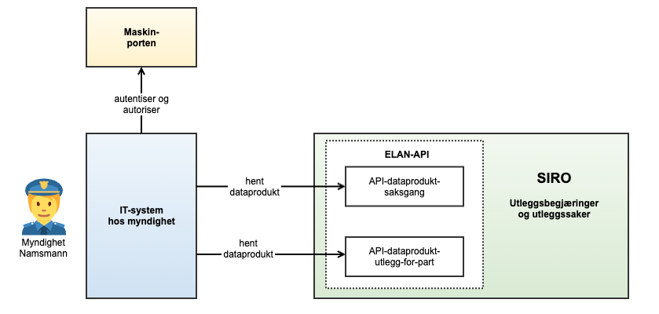
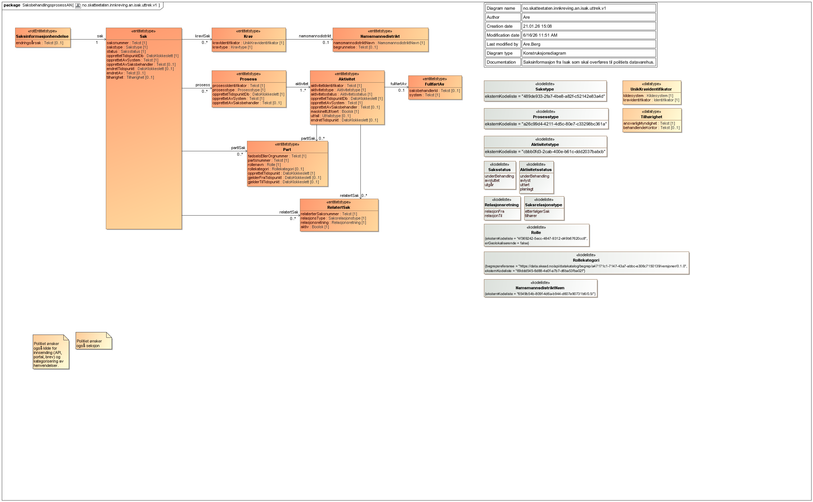
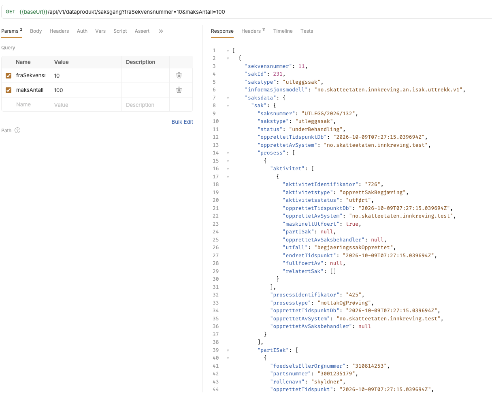

 Tjenesten leverer et API for å fortløpende hente data/hendelser om utleggsbegjæringssaker og utleggssaker som er behandlet av Namsfogden i systemet SIRO.

<Tabs underline={true}>
<TabItem headerText="Om tjenesten" itemKey="itemKey-1" default>

APIet benyttes til å hente data om utleggsbegjæringssaker og utleggssaker som er behandlet av Namsfogden i IT-systemet SIRO. Målgruppen er Namsfogden og Politiet. Dersom du ønsker å ta i bruk API-et eller har spørsmål knyttet til dette, ta kontakt med fremtidensinnkreving@skatteetaten.no.

Figuren nedenfor viser arkitekturen og grensesnitt. Det vil i fremtiden kunne legges til nye dataprodukttjenester som ikke er angitt i figuren.

### Beskrivelse av figuren:
* **SIRO**: Systemet som Namsfogden benytter for å behandle utleggsbegjæringer og utleggssaker. SIRO er kilden til data.
* **ELAN-API**: Samling av API-tjenester som henter data fra SIRO og publiserer dataprodukter til konsumentene.
* **API-dataprodukt-saksgang**: API-tjeneste som henter saksdata fra SIRO og publiserer dette til konsumentene.
* **API-dataprodukt-utlegg-for-part**: API-tjeneste som henter utleggstiltaksdata fra SIRO og publiserer dette til konsumentene.
* **IT-system hos myndighet**: System som henter dataprodukter fra ELAN-API. Dette kan være systemer hos Namsfogden og Politiet, eller andre som har fått tilgang til tjenesten.
* **Maskinporten**: Autentiserings- og tilgangskontrolltjeneste fra DigDir for datautveksling mellom etater og virksomheter. Sikrer at kun autoriserte konsumenter får tilgang til dataproduktene.

## Teknisk spesifikasjon - API
### Open API spesifikasjon
Spesifikasjonen av  API-et med endepunkter, parameterne, og informasjon ligger i [Open API spesifikasjonen](https://app.swaggerhub.com/apis/skatteetaten/dataprodukt-saksgang-siro-api) på SwaggerHub.

## Bruk av tjenesten
Konsumenten henter dataprodukter ved å kalle GET /api/v1/dataprodukt/saksgang med parametrene fraSekvensnummer og maksAntall, der fraSekvensnummer angir startpunktet for nyere data og maksAntall begrenser antall treff per kall. 
Svaret er en liste med dataprodukter i JSON-format, og konsumenten må oppdatere fraSekvensnummer til siste returnerte sekvensnummer for å hente ny data i neste poll. 
Hvis input er ugyldig (for eksempel negativ fraSekvensnummer eller maksAntall < 1), returneres HTTP 400.

### Parametre
* "maksantall" kan settes til et tall mellom 1 og 1000, og default er 100. Hvis maksAntall settes til mer enn 1000, begrenses det til 1000.
* "fraSekvensnummer" settes i første kall til 0. Deretter setter parameteren = siste sekvensnummer som ble returnert i forrige kall. Hvis fraSekvensnummer settes til et tall som er høyere enn siste sekvensnummer, returneres en tom liste.

## Tilgang

### Skatteetaten må gi tilgang

For å få tilgang til tjenesten må brukeren ha akseptert bruksvilkår for APIet. Dette gjøres i sammneheng med at man søker om tilgang til APIet i [Skatteetatens saks- og serviceverktøy](https://www.skatteetaten.no/deling/kontakt/)

### Autentisering i Maskinporten
Brukers IT-system må benytte autentisering via Maskinporten. Se [Sikkerhetsmekanismer](../om/sikkerhet.md) for mer informasjon om autentisering og Maskinporten.

### Scope
Følgende scope skal benyttes ved autentisering i Maskinporten:
* For dataprodukt-saksgang_an: `skatteetaten:innkrevingsaksgangan`
* For dataprodukt-utlegg-for-part: ikke bestemt ennå

## Generelt om Skatteetatens API-tjenester
For generell informasjon om Skatteetatens API-tjenester, se egne sider om:

* [Bruk av tjenestene](../om/bruk.md)
* [Sikkerhetsmekanismer](../om/sikkerhet.md)
* [Feilhåndtering](../om/feil.md)
* [Versjonering](../om/versjoner.md)
* [Teknisk API-spesifikasjon](../om/tekniskspesifikasjon.md)

</TabItem>

<TabItem headerText="Informasjonsmodell" itemKey="itemKey-2">
## dataprodukt_saksgang-an
API-et returnerer et sett med saksopplysninger som er relevante for innsyn i utleggsbegjæringer og utleggssaker. 
OpenAPI spesifikasjonen på SwaggerHub viser detaljert informasjon om feltene som returneres i responsen.

En grafisk fremstilling av informasjonsmodellen er vist nedenfor.

</TabItem>

<TabItem headerText="Eksempler" itemKey="itemKey-3"> 
### Her er et eksempel på en request utført i test-verktøyet Bruno:

### Her er et eksempel på en respons fra tjenesten, med et dataprodukt som inneholder informasjon om en utleggsbegjæring:   
[Last ned JSON-eksempel](../../static/download/utlegg_dataprodukt_namsfogden/eksempel_dataprodukt_response.json)

</TabItem>

<TabItem headerText="Feilkoder" itemKey="itemKey-4">
Se egen side for generell info om [feilhåndtering i tjenestene](../om/feil.md).
</TabItem>

<TabItem headerText="Test" itemKey="itemKey-5">
Ta kontakt med FI/Utleggsprosjektet for å få tilgang til testmiljø for API-et.
</TabItem>

<TabItem headerText="Datakatalog" itemKey="itemKey-6">
Datatjenestebeskrivelse er ikke i Felles datakatalog enda.
</TabItem>

</Tabs>
