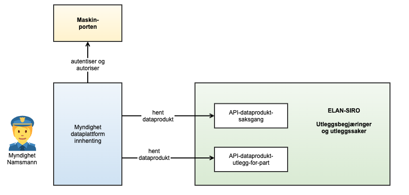
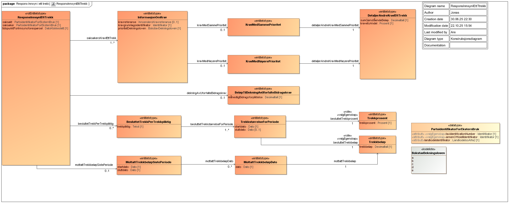

Tjenesten leverer ..

<Tabs underline={true}>
<TabItem headerText="Om tjenesten" itemKey="itemKey-1" default>

APIet benyttes til å hente data om utleggsbegjæringssaker og utleggssaker som er behandler av Namsfogden i systemet SIRO. Målgruppen er Namsfogden og Politiet. Dersom du ønsker å ta i bruk APIet eller har spørsmål knyttet til dette, ta kontakt med fremtidensinnkreving@skatteetaten.no.

Figuren nedenfor viser arkitekturen og grensesnitt., Det vil også i fremtiden kunne legges til nye tjenester som ikke er angitt i figuren.

For generell informasjon om Skatteetatens API-tjenester, se egne sider om:

* [Bruk av tjenestene](../om/bruk.md)
* [Sikkerhetsmekanismer](../om/sikkerhet.md)
* [Feilhåndtering](../om/feil.md)
* [Versjonering](../om/versjoner.md)
* [Teknisk API-spesifikasjon](../om/tekniskspesifikasjon.md)

## Teknisk spesifikasjon

URL-er til API-et, beskrivelsen av parameterne, endepunkter og respons ligger i [Open API spesifikasjonen](https://app.swaggerhub.com/apis/skatteetaten/dataprodukt-saksgang-siro-api) på SwaggerHub.

## Tilgang

### Skatteetaten må gi tilgang

For å få tilgang til tjenesten må brukeren ha akseptert bruksvilkår for APIet. Dette gjøres i sammneheng med at man søker om tilgang til APIet i [Skatteetatens saks- og serviceverktøy](https://www.skatteetaten.no/deling/kontakt/)

### Autentisering i Maskinporten

Brukers IT-system må benytte autentisering via Maskinporten.

### Scope

Følgende scope skal benyttes ved autentisering i Maskinporten: `skatteetaten:innkrevingsaksgangan`

## Datakatalog

Datatjenestebeskrivelse er ikke i Felles datakatalog enda.

</TabItem>
<TabItem headerText="Eksempler" itemKey="itemKey-2"> 

Legg inn eksempler

</TabItem>
<TabItem headerText="Feilkoder" itemKey="itemKey-3">

Se egen side for generell info om [feilhåndtering i tjenestene](../om/feil.md).

</TabItem>
<TabItem headerText="Informasjonsmodell" itemKey="itemKey-4">

Tvangsforbyrdelseslovens forskrift [§ 4 Fordringshaveres innsyn i opplysninger om løpende utleggstrekk](https://lovdata.no/nav/forskrift/2025-07-09-1510) gir kreditor rett til å få innsyn i ett trekk. Forutsetningene for bruk av tjenesten er blant annet
* Prosessfullmektig kan kun få svar på krav i saker som hen er prosessfullmektig for.
* Kravene må være i et etablert og ikke avsluttet trekk.

| Informasjonselement                                                                                                                                                       | Hvilken informasjon returneres                                                                                                                                                                                                                                                                                                                                                |
|:--------------------------------------------------------------------------------------------------------------------------------------------------------------------------|:------------------------------------------------------------------------------------------------------------------------------------------------------------------------------------------------------------------------------------------------------------------------------------------------------------------------------------------------------------------------------| 
| a. summen av krav i trekket med bedre artsprioritet enn saksøkerens krav                                                                                                  | Summen av beløp og stipulerte renter på kravene i trekket som har bedre artsprioritet enn det aktuelle kravet (artsprioritet a er bedre enn b, b bedre enn c, osv.) eller bedre tidsprioritet                                                                                                                                                                                 |
| b. summen av krav i trekket med lik artsprioritet som saksøkerens krav, samt kravenes samlede grunnlag for forholdsmessig fordeling etter dekningsloven § 2-8 tredje ledd | Summen av beløp og stipulerte renter på kravene i trekket som har samme artsprioritet som det aktuelle kravet. Kravets dividendegrunnlag i trekket (gjenstående beløp for forholdsmessig fordeling pluss påløpte renter for forholdsmessig fordeling) for kravet / de andre kravene sitt dividendegrunnlag                                                                    |
| c. hvor mye av trekket som skal dekke uforfalte bidragskrav                                                                                                               | Besluttet løpende bidragskrav i trekk                                                                                                                                                                                                                                                                                                                                         |
| d. datoen for sist gjennomførte trekk og hvilket beløp som ble trukket                                                                                                    | Mottatte og plasserte beløp i dag og 1 måned bakover i tid                                                                                                                                                                                                                                                                                                                    |
| e. gjeldende beslutning om trekkets størrelse og hvem som er trekkpliktig                                                                                                 | Trekkpåleggene i dag og frem i tid – likt som i kreditors saksinnsyn                                                                                                                                                                                                                                                                                                          |

</TabItem>
<TabItem headerText="Test" itemKey="itemKey-5">

Bruk valgfrie organisasjoner fra Tenor som innsender av utleggsbegjæring.
Innsendinger av vedlegg og utleggsbegjæringer i testmiljøet vil ikke bli videre behandlet av Skattetaten.

## Test der systemleverandør er innsender (alternativ 1)
Informasjon kommer
## Test der systembruker benyttes (alternativ 2)
Informasjon kommer

</TabItem>
</Tabs>
